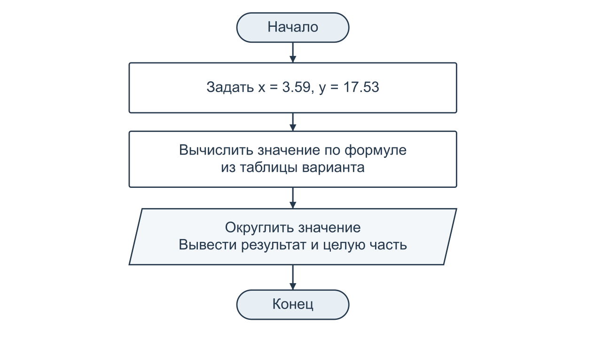

# Python Labs

Четыре лабораторные работы по Python с заданиями, решениями и тестами для вариантов №1–30.
Репозиторий помогает разобрать алгоритм на примере, сверить результат с контрольными данными
и запустить проверки перед сдачей работы.

## С чего начать

[Вводная методичка по Python (PDF)](docs/introduction_to_python.pdf) подходит для всех четырёх лабораторных. Полные задания и указатели вариантов собраны на [странице учебных материалов](docs/README.md).

1. Выберите лабораторную и откройте её указатель вариантов.
2. Откройте README своего варианта. В нём есть условие, параметры, команды запуска, контрольные примеры и ссылки на отчёты и схемы.
3. Выберите уровень решения и повторите контрольный запуск.

| Лабораторная | Что разбирается |
| --- | --- |
| [ЛР №1](lab_01_linear_function/README.md) | Линейный алгоритм, формулы, округление и целая часть |
| [ЛР №2](lab_02_branching/README.md) | Кусочные функции, выбор ветви и граничные случаи |
| [ЛР №3](lab_03_loops/README.md) | Табуляция и вычисление суммы, произведения или экстремума |
| [ЛР №4](lab_04_arrays/README.md) | Одномерный массив как матрица, отбор и обработка элементов |

## Установка

Нужен Python 3.10 или новее. Если у вас ещё нет локальной копии, скачайте её через Git:

```shell
git clone https://github.com/Netrunner3077/python-labs.git
cd python-labs
```

Команды ниже выполняются из корня репозитория. Если `.venv` уже создана, пропустите её создание.

**Windows, PowerShell**

```powershell
python -m venv .venv
. .\.venv\Scripts\Activate.ps1
python -m pip install -r requirements.txt
```

Если PowerShell блокирует активацию, из корня проекта можно обращаться к интерпретатору напрямую.
Например, `.\.venv\Scripts\python.exe -m pip install -r requirements.txt`.

**Linux и macOS**

```bash
python3 -m venv .venv
source .venv/bin/activate
python -m pip install -r requirements.txt
```

Решения используют стандартную библиотеку Python. Для тестирования дополнительно установите pytest:

```shell
python -m pip install -r requirements-dev.txt
```

## Пример запуска

Из корня проекта с активированной `.venv` запустите начальное решение ЛР №1 варианта №1:

```shell
python "lab_01_linear_function/variants/v01/src/linear_lab_01_v01_(noob).py"
```

```text
Результат = 0.7441
Целая часть = 0
```



В `noob` исходные данные заданы в коде, а результат выводится в консоль.
У `basic` и `advanced` способ ввода зависит от работы и варианта.
Например, для ЛР №1 варианта №1 базовому решению нужен `input.txt` с двумя числами
в рабочем каталоге. Продвинутому можно передать `--input` и `--output`.
[Команды и контрольные данные для этого варианта](lab_01_linear_function/variants/v01/README.md).

## Тестирование

```shell
python -m pytest
python -m pytest "lab_03_loops/variants"
python -m pytest "lab_03_loops/variants/v06/tests"
python -m pytest -rx "lab_01_linear_function/variants/v14/tests"
```

Первая команда запускает весь набор, вторая — одну лабораторную, третья — один вариант.
Ключ `-rx` показывает причины ожидаемых отказов в старых решениях варианта №14.
Если строгая проверка неожиданно пройдёт, pytest сообщит об `XPASS` и вернёт ошибку.

Контрольные данные и сценарии находятся в `tests/test_solutions.py` каждого варианта.
[Общие фикстуры](qa_support/conftest.py) копируют скрипты во временные каталоги
и проверяют их через обычный запуск, чтобы тестовые файлы не оставались в репозитории.

## Как внести вклад

1. Откройте [репозиторий на GitHub](https://github.com/Netrunner3077/python-labs) и создайте ветку для изменения. Если у вас нет доступа на запись, сделайте форк.
2. Внесите изменения в каталог нужного варианта. При изменении поведения обновите контрольный пример, тест и соответствующие материалы.
3. Запустите тесты варианта и приложите итог прогона к pull request. Укажите номер лабораторной, вариант и изменённый уровень решения.

## Автор и лицензия

**Автор:** Токарев В.С., группа МЛ12, магистратура «Цифровое Востоковедение», ДГТУ, 2026.

**Преподаватель:** доц. Швидченко С.А.

Для обратной связи используйте [репозиторий проекта на GitHub](https://github.com/Netrunner3077/python-labs).
Отдельная лицензия в репозитории не указана.

## Что хранится в корне

- [`pyproject.toml`](pyproject.toml) хранит метаданные проекта и настройки pytest, Ruff и mypy. Pytest использует его как конфигурацию репозитория и подключает плагин `qa_support.conftest`.
- [`qa_support/`](qa_support/) содержит единственный `conftest.py`. Там собраны общие фикстуры, а проверки конкретных вариантов лежат рядом с решениями.
- [`requirements.txt`](requirements.txt) описывает зависимости запуска, [`requirements-dev.txt`](requirements-dev.txt) — зависимости для проверок.
- [`.editorconfig`](.editorconfig) и [`.gitignore`](.gitignore) задают правила для всего репозитория.
- [`Makefile`](Makefile) — необязательная обёртка для GNU Make. В её целях запуска пока указаны пути из прежней структуры. Для текущих вариантов используйте команды из этого README.

## Полная файловая структура

<details>
<summary>Развернуть дерево всех файлов и каталогов проекта</summary>

```text
python-labs/  # корень проекта
├── .git/  # локальная история и настройки Git
├── .venv/  # локальное окружение Python
├── .pytest_cache/  # локальный кэш pytest
├── __pycache__/  # локальный кэш байткода Python
├── docs/  # общие учебные материалы для всех лабораторных
│   ├── introduction_to_python.pdf  # вводная методичка преподавателя по Python
│   └── README.md  # указатель общих материалов, заданий и отчётов
├── lab_01_linear_function/  # ЛР №1. Линейные вычисления
│   ├── variants/  # каталоги вариантов №1–30
│   │   ├── v01/  # материалы варианта №1
│   │   │   ├── diagrams/  # редактируемые блок-схемы и изображения
│   │   │   │   ├── lab_01_v01_advanced.drawio  # редактируемая схема решения advanced
│   │   │   │   ├── lab_01_v01_advanced.png  # изображение схемы решения advanced
│   │   │   │   ├── lab_01_v01_basic.drawio  # редактируемая схема решения basic
│   │   │   │   ├── lab_01_v01_basic.png  # изображение схемы решения basic
│   │   │   │   ├── lab_01_v01_noob.drawio  # редактируемая схема решения noob
│   │   │   │   └── lab_01_v01_noob.png  # изображение схемы решения noob
│   │   │   ├── docs/  # учебные документы по варианту
│   │   │   │   ├── reports/  # отчёты о решениях трёх уровней
│   │   │   │   │   ├── lab_01_v01_advanced_report.docx  # отчёт о решении advanced
│   │   │   │   │   ├── lab_01_v01_basic_report.docx  # отчёт о решении basic
│   │   │   │   │   └── lab_01_v01_noob_report.docx  # отчёт о решении noob
│   │   │   │   └── tasks/  # преподавательское задание или выписка по варианту
│   │   │   │       └── lab_01_v01_task.docx  # задание и исходные данные варианта
│   │   │   ├── src/  # самостоятельно запускаемые решения Python
│   │   │   │   ├── linear_lab_01_v01_(advanced).py  # решение уровня advanced
│   │   │   │   ├── linear_lab_01_v01_(basic).py  # решение уровня basic
│   │   │   │   └── linear_lab_01_v01_(noob).py  # решение уровня noob
│   │   │   ├── tests/  # автоматические проверки варианта
│   │   │   │   └── test_solutions.py  # контрольные сценарии для noob, basic и advanced
│   │   │   └── README.md  # условие, запуск и контрольные примеры
│   │   ├── v02/  # материалы варианта №2
│   │   │   ├── diagrams/  # редактируемые блок-схемы и изображения
│   │   │   │   ├── lab_01_v02_advanced.drawio  # редактируемая схема решения advanced
│   │   │   │   ├── lab_01_v02_advanced.png  # изображение схемы решения advanced
│   │   │   │   ├── lab_01_v02_basic.drawio  # редактируемая схема решения basic
│   │   │   │   ├── lab_01_v02_basic.png  # изображение схемы решения basic
│   │   │   │   ├── lab_01_v02_noob.drawio  # редактируемая схема решения noob
│   │   │   │   └── lab_01_v02_noob.png  # изображение схемы решения noob
│   │   │   ├── docs/  # учебные документы по варианту
│   │   │   │   ├── reports/  # отчёты о решениях трёх уровней
│   │   │   │   │   ├── lab_01_v02_advanced_report.docx  # отчёт о решении advanced
│   │   │   │   │   ├── lab_01_v02_basic_report.docx  # отчёт о решении basic
│   │   │   │   │   └── lab_01_v02_noob_report.docx  # отчёт о решении noob
│   │   │   │   └── tasks/  # преподавательское задание или выписка по варианту
│   │   │   │       └── lab_01_v02_task.docx  # задание и исходные данные варианта
│   │   │   ├── src/  # самостоятельно запускаемые решения Python
│   │   │   │   ├── linear_lab_01_v02_(advanced).py  # решение уровня advanced
│   │   │   │   ├── linear_lab_01_v02_(basic).py  # решение уровня basic
│   │   │   │   └── linear_lab_01_v02_(noob).py  # решение уровня noob
│   │   │   ├── tests/  # автоматические проверки варианта
│   │   │   │   └── test_solutions.py  # контрольные сценарии для noob, basic и advanced
│   │   │   └── README.md  # условие, запуск и контрольные примеры
│   │   ├── v03/  # материалы варианта №3
│   │   │   ├── diagrams/  # редактируемые блок-схемы и изображения
│   │   │   │   ├── lab_01_v03_advanced.drawio  # редактируемая схема решения advanced
│   │   │   │   ├── lab_01_v03_advanced.png  # изображение схемы решения advanced
│   │   │   │   ├── lab_01_v03_basic.drawio  # редактируемая схема решения basic
│   │   │   │   ├── lab_01_v03_basic.png  # изображение схемы решения basic
│   │   │   │   ├── lab_01_v03_noob.drawio  # редактируемая схема решения noob
│   │   │   │   └── lab_01_v03_noob.png  # изображение схемы решения noob
│   │   │   ├── docs/  # учебные документы по варианту
│   │   │   │   ├── reports/  # отчёты о решениях трёх уровней
│   │   │   │   │   ├── lab_01_v03_advanced_report.docx  # отчёт о решении advanced
│   │   │   │   │   ├── lab_01_v03_basic_report.docx  # отчёт о решении basic
│   │   │   │   │   └── lab_01_v03_noob_report.docx  # отчёт о решении noob
│   │   │   │   └── tasks/  # преподавательское задание или выписка по варианту
│   │   │   │       └── lab_01_v03_task.docx  # задание и исходные данные варианта
│   │   │   ├── src/  # самостоятельно запускаемые решения Python
│   │   │   │   ├── linear_lab_01_v03_(advanced).py  # решение уровня advanced
│   │   │   │   ├── linear_lab_01_v03_(basic).py  # решение уровня basic
│   │   │   │   └── linear_lab_01_v03_(noob).py  # решение уровня noob
│   │   │   ├── tests/  # автоматические проверки варианта
│   │   │   │   └── test_solutions.py  # контрольные сценарии для noob, basic и advanced
│   │   │   └── README.md  # условие, запуск и контрольные примеры
│   │   ├── v04/  # материалы варианта №4
│   │   │   ├── diagrams/  # редактируемые блок-схемы и изображения
│   │   │   │   ├── lab_01_v04_advanced.drawio  # редактируемая схема решения advanced
│   │   │   │   ├── lab_01_v04_advanced.png  # изображение схемы решения advanced
│   │   │   │   ├── lab_01_v04_basic.drawio  # редактируемая схема решения basic
│   │   │   │   ├── lab_01_v04_basic.png  # изображение схемы решения basic
│   │   │   │   ├── lab_01_v04_noob.drawio  # редактируемая схема решения noob
│   │   │   │   └── lab_01_v04_noob.png  # изображение схемы решения noob
│   │   │   ├── docs/  # учебные документы по варианту
│   │   │   │   ├── reports/  # отчёты о решениях трёх уровней
│   │   │   │   │   ├── lab_01_v04_advanced_report.docx  # отчёт о решении advanced
│   │   │   │   │   ├── lab_01_v04_basic_report.docx  # отчёт о решении basic
│   │   │   │   │   └── lab_01_v04_noob_report.docx  # отчёт о решении noob
│   │   │   │   └── tasks/  # преподавательское задание или выписка по варианту
│   │   │   │       └── lab_01_v04_task.docx  # задание и исходные данные варианта
│   │   │   ├── src/  # самостоятельно запускаемые решения Python
│   │   │   │   ├── linear_lab_01_v04_(advanced).py  # решение уровня advanced
│   │   │   │   ├── linear_lab_01_v04_(basic).py  # решение уровня basic
│   │   │   │   └── linear_lab_01_v04_(noob).py  # решение уровня noob
│   │   │   ├── tests/  # автоматические проверки варианта
│   │   │   │   └── test_solutions.py  # контрольные сценарии для noob, basic и advanced
│   │   │   └── README.md  # условие, запуск и контрольные примеры
│   │   ├── v05/  # материалы варианта №5
│   │   │   ├── diagrams/  # редактируемые блок-схемы и изображения
│   │   │   │   ├── lab_01_v05_advanced.drawio  # редактируемая схема решения advanced
│   │   │   │   ├── lab_01_v05_advanced.png  # изображение схемы решения advanced
│   │   │   │   ├── lab_01_v05_basic.drawio  # редактируемая схема решения basic
│   │   │   │   ├── lab_01_v05_basic.png  # изображение схемы решения basic
│   │   │   │   ├── lab_01_v05_noob.drawio  # редактируемая схема решения noob
│   │   │   │   └── lab_01_v05_noob.png  # изображение схемы решения noob
│   │   │   ├── docs/  # учебные документы по варианту
│   │   │   │   ├── reports/  # отчёты о решениях трёх уровней
│   │   │   │   │   ├── lab_01_v05_advanced_report.docx  # отчёт о решении advanced
│   │   │   │   │   ├── lab_01_v05_basic_report.docx  # отчёт о решении basic
│   │   │   │   │   └── lab_01_v05_noob_report.docx  # отчёт о решении noob
│   │   │   │   └── tasks/  # преподавательское задание или выписка по варианту
│   │   │   │       └── lab_01_v05_task.docx  # задание и исходные данные варианта
│   │   │   ├── src/  # самостоятельно запускаемые решения Python
│   │   │   │   ├── linear_lab_01_v05_(advanced).py  # решение уровня advanced
│   │   │   │   ├── linear_lab_01_v05_(basic).py  # решение уровня basic
│   │   │   │   └── linear_lab_01_v05_(noob).py  # решение уровня noob
│   │   │   ├── tests/  # автоматические проверки варианта
│   │   │   │   └── test_solutions.py  # контрольные сценарии для noob, basic и advanced
│   │   │   └── README.md  # условие, запуск и контрольные примеры
│   │   ├── v06/  # материалы варианта №6
│   │   │   ├── diagrams/  # редактируемые блок-схемы и изображения
│   │   │   │   ├── lab_01_v06.drawio  # редактируемая схема решения noob
│   │   │   │   ├── lab_01_v06.png  # изображение схемы решения noob
│   │   │   │   ├── lab_01_v06_advanced.drawio  # редактируемая схема решения advanced
│   │   │   │   ├── lab_01_v06_advanced.png  # изображение схемы решения advanced
│   │   │   │   ├── lab_01_v06_basic.drawio  # редактируемая схема решения basic
│   │   │   │   └── lab_01_v06_basic.png  # изображение схемы решения basic
│   │   │   ├── docs/  # учебные документы по варианту
│   │   │   │   ├── reports/  # отчёты о решениях трёх уровней
│   │   │   │   │   ├── lab_01_v06_advanced_report.docx  # отчёт о решении advanced
│   │   │   │   │   ├── lab_01_v06_basic_report.docx  # отчёт о решении basic
│   │   │   │   │   └── lab_01_v06_report.docx  # отчёт о решении noob
│   │   │   │   └── tasks/  # преподавательское задание или выписка по варианту
│   │   │   │       └── lab_01_v06_task.docx  # задание и исходные данные варианта
│   │   │   ├── src/  # самостоятельно запускаемые решения Python
│   │   │   │   ├── calculate_function_lab_01_v06_(noob).py  # решение уровня noob
│   │   │   │   ├── linear_lab_01_v06_(advanced).py  # решение уровня advanced
│   │   │   │   └── linear_lab_01_v06_(basic).py  # решение уровня basic
│   │   │   ├── tests/  # автоматические проверки варианта
│   │   │   │   └── test_solutions.py  # контрольные сценарии для noob, basic и advanced
│   │   │   └── README.md  # условие, запуск и контрольные примеры
│   │   ├── v07/  # материалы варианта №7
│   │   │   ├── diagrams/  # редактируемые блок-схемы и изображения
│   │   │   │   ├── lab_01_v07_advanced.drawio  # редактируемая схема решения advanced
│   │   │   │   ├── lab_01_v07_advanced.png  # изображение схемы решения advanced
│   │   │   │   ├── lab_01_v07_basic.drawio  # редактируемая схема решения basic
│   │   │   │   ├── lab_01_v07_basic.png  # изображение схемы решения basic
│   │   │   │   ├── lab_01_v07_noob.drawio  # редактируемая схема решения noob
│   │   │   │   └── lab_01_v07_noob.png  # изображение схемы решения noob
│   │   │   ├── docs/  # учебные документы по варианту
│   │   │   │   ├── reports/  # отчёты о решениях трёх уровней
│   │   │   │   │   ├── lab_01_v07_advanced_report.docx  # отчёт о решении advanced
│   │   │   │   │   ├── lab_01_v07_basic_report.docx  # отчёт о решении basic
│   │   │   │   │   └── lab_01_v07_noob_report.docx  # отчёт о решении noob
│   │   │   │   └── tasks/  # преподавательское задание или выписка по варианту
│   │   │   │       └── lab_01_v07_task.docx  # задание и исходные данные варианта
│   │   │   ├── src/  # самостоятельно запускаемые решения Python
│   │   │   │   ├── linear_lab_01_v07_(advanced).py  # решение уровня advanced
│   │   │   │   ├── linear_lab_01_v07_(basic).py  # решение уровня basic
│   │   │   │   └── linear_lab_01_v07_(noob).py  # решение уровня noob
│   │   │   ├── tests/  # автоматические проверки варианта
│   │   │   │   └── test_solutions.py  # контрольные сценарии для noob, basic и advanced
│   │   │   └── README.md  # условие, запуск и контрольные примеры
│   │   ├── v08/  # материалы варианта №8
│   │   │   ├── diagrams/  # редактируемые блок-схемы и изображения
│   │   │   │   ├── lab_01_v08_advanced.drawio  # редактируемая схема решения advanced
│   │   │   │   ├── lab_01_v08_advanced.png  # изображение схемы решения advanced
│   │   │   │   ├── lab_01_v08_basic.drawio  # редактируемая схема решения basic
│   │   │   │   ├── lab_01_v08_basic.png  # изображение схемы решения basic
│   │   │   │   ├── lab_01_v08_noob.drawio  # редактируемая схема решения noob
│   │   │   │   └── lab_01_v08_noob.png  # изображение схемы решения noob
│   │   │   ├── docs/  # учебные документы по варианту
│   │   │   │   ├── reports/  # отчёты о решениях трёх уровней
│   │   │   │   │   ├── lab_01_v08_advanced_report.docx  # отчёт о решении advanced
│   │   │   │   │   ├── lab_01_v08_basic_report.docx  # отчёт о решении basic
│   │   │   │   │   └── lab_01_v08_noob_report.docx  # отчёт о решении noob
│   │   │   │   └── tasks/  # преподавательское задание или выписка по варианту
│   │   │   │       └── lab_01_v08_task.docx  # задание и исходные данные варианта
│   │   │   ├── src/  # самостоятельно запускаемые решения Python
│   │   │   │   ├── linear_lab_01_v08_(advanced).py  # решение уровня advanced
│   │   │   │   ├── linear_lab_01_v08_(basic).py  # решение уровня basic
│   │   │   │   └── linear_lab_01_v08_(noob).py  # решение уровня noob
│   │   │   ├── tests/  # автоматические проверки варианта
│   │   │   │   └── test_solutions.py  # контрольные сценарии для noob, basic и advanced
│   │   │   └── README.md  # условие, запуск и контрольные примеры
│   │   ├── v09/  # материалы варианта №9
│   │   │   ├── diagrams/  # редактируемые блок-схемы и изображения
│   │   │   │   ├── lab_01_v09_advanced.drawio  # редактируемая схема решения advanced
│   │   │   │   ├── lab_01_v09_advanced.png  # изображение схемы решения advanced
│   │   │   │   ├── lab_01_v09_basic.drawio  # редактируемая схема решения basic
│   │   │   │   ├── lab_01_v09_basic.png  # изображение схемы решения basic
│   │   │   │   ├── lab_01_v09_noob.drawio  # редактируемая схема решения noob
│   │   │   │   └── lab_01_v09_noob.png  # изображение схемы решения noob
│   │   │   ├── docs/  # учебные документы по варианту
│   │   │   │   ├── reports/  # отчёты о решениях трёх уровней
│   │   │   │   │   ├── lab_01_v09_advanced_report.docx  # отчёт о решении advanced
│   │   │   │   │   ├── lab_01_v09_basic_report.docx  # отчёт о решении basic
│   │   │   │   │   └── lab_01_v09_noob_report.docx  # отчёт о решении noob
│   │   │   │   └── tasks/  # преподавательское задание или выписка по варианту
│   │   │   │       └── lab_01_v09_task.docx  # задание и исходные данные варианта
│   │   │   ├── src/  # самостоятельно запускаемые решения Python
│   │   │   │   ├── linear_lab_01_v09_(advanced).py  # решение уровня advanced
│   │   │   │   ├── linear_lab_01_v09_(basic).py  # решение уровня basic
│   │   │   │   └── linear_lab_01_v09_(noob).py  # решение уровня noob
│   │   │   ├── tests/  # автоматические проверки варианта
│   │   │   │   └── test_solutions.py  # контрольные сценарии для noob, basic и advanced
│   │   │   └── README.md  # условие, запуск и контрольные примеры
│   │   ├── v10/  # материалы варианта №10
│   │   │   ├── diagrams/  # редактируемые блок-схемы и изображения
│   │   │   │   ├── lab_01_v10_advanced.drawio  # редактируемая схема решения advanced
│   │   │   │   ├── lab_01_v10_advanced.png  # изображение схемы решения advanced
│   │   │   │   ├── lab_01_v10_basic.drawio  # редактируемая схема решения basic
│   │   │   │   ├── lab_01_v10_basic.png  # изображение схемы решения basic
│   │   │   │   ├── lab_01_v10_noob.drawio  # редактируемая схема решения noob
│   │   │   │   └── lab_01_v10_noob.png  # изображение схемы решения noob
│   │   │   ├── docs/  # учебные документы по варианту
│   │   │   │   ├── reports/  # отчёты о решениях трёх уровней
│   │   │   │   │   ├── lab_01_v10_advanced_report.docx  # отчёт о решении advanced
│   │   │   │   │   ├── lab_01_v10_basic_report.docx  # отчёт о решении basic
│   │   │   │   │   └── lab_01_v10_noob_report.docx  # отчёт о решении noob
│   │   │   │   └── tasks/  # преподавательское задание или выписка по варианту
│   │   │   │       └── lab_01_v10_task.docx  # задание и исходные данные варианта
│   │   │   ├── src/  # самостоятельно запускаемые решения Python
│   │   │   │   ├── linear_lab_01_v10_(advanced).py  # решение уровня advanced
│   │   │   │   ├── linear_lab_01_v10_(basic).py  # решение уровня basic
│   │   │   │   └── linear_lab_01_v10_(noob).py  # решение уровня noob
│   │   │   ├── tests/  # автоматические проверки варианта
│   │   │   │   └── test_solutions.py  # контрольные сценарии для noob, basic и advanced
│   │   │   └── README.md  # условие, запуск и контрольные примеры
│   │   ├── v11/  # материалы варианта №11
│   │   │   ├── diagrams/  # редактируемые блок-схемы и изображения
│   │   │   │   ├── lab_01_v11_advanced.drawio  # редактируемая схема решения advanced
│   │   │   │   ├── lab_01_v11_advanced.png  # изображение схемы решения advanced
│   │   │   │   ├── lab_01_v11_basic.drawio  # редактируемая схема решения basic
│   │   │   │   ├── lab_01_v11_basic.png  # изображение схемы решения basic
│   │   │   │   ├── lab_01_v11_noob.drawio  # редактируемая схема решения noob
│   │   │   │   └── lab_01_v11_noob.png  # изображение схемы решения noob
│   │   │   ├── docs/  # учебные документы по варианту
│   │   │   │   ├── reports/  # отчёты о решениях трёх уровней
│   │   │   │   │   ├── lab_01_v11_advanced_report.docx  # отчёт о решении advanced
│   │   │   │   │   ├── lab_01_v11_basic_report.docx  # отчёт о решении basic
│   │   │   │   │   └── lab_01_v11_noob_report.docx  # отчёт о решении noob
│   │   │   │   └── tasks/  # преподавательское задание или выписка по варианту
│   │   │   │       └── lab_01_v11_task.docx  # задание и исходные данные варианта
│   │   │   ├── src/  # самостоятельно запускаемые решения Python
│   │   │   │   ├── linear_lab_01_v11_(advanced).py  # решение уровня advanced
│   │   │   │   ├── linear_lab_01_v11_(basic).py  # решение уровня basic
│   │   │   │   └── linear_lab_01_v11_(noob).py  # решение уровня noob
│   │   │   ├── tests/  # автоматические проверки варианта
│   │   │   │   └── test_solutions.py  # контрольные сценарии для noob, basic и advanced
│   │   │   └── README.md  # условие, запуск и контрольные примеры
│   │   ├── v12/  # материалы варианта №12
│   │   │   ├── diagrams/  # редактируемые блок-схемы и изображения
│   │   │   │   ├── lab_01_v12_advanced.drawio  # редактируемая схема решения advanced
│   │   │   │   ├── lab_01_v12_advanced.png  # изображение схемы решения advanced
│   │   │   │   ├── lab_01_v12_basic.drawio  # редактируемая схема решения basic
│   │   │   │   ├── lab_01_v12_basic.png  # изображение схемы решения basic
│   │   │   │   ├── lab_01_v12_noob.drawio  # редактируемая схема решения noob
│   │   │   │   └── lab_01_v12_noob.png  # изображение схемы решения noob
│   │   │   ├── docs/  # учебные документы по варианту
│   │   │   │   ├── reports/  # отчёты о решениях трёх уровней
│   │   │   │   │   ├── lab_01_v12_advanced_report.docx  # отчёт о решении advanced
│   │   │   │   │   ├── lab_01_v12_basic_report.docx  # отчёт о решении basic
│   │   │   │   │   └── lab_01_v12_noob_report.docx  # отчёт о решении noob
│   │   │   │   └── tasks/  # преподавательское задание или выписка по варианту
│   │   │   │       └── lab_01_v12_task.docx  # задание и исходные данные варианта
│   │   │   ├── src/  # самостоятельно запускаемые решения Python
│   │   │   │   ├── linear_lab_01_v12_(advanced).py  # решение уровня advanced
│   │   │   │   ├── linear_lab_01_v12_(basic).py  # решение уровня basic
│   │   │   │   └── linear_lab_01_v12_(noob).py  # решение уровня noob
│   │   │   ├── tests/  # автоматические проверки варианта
│   │   │   │   └── test_solutions.py  # контрольные сценарии для noob, basic и advanced
│   │   │   └── README.md  # условие, запуск и контрольные примеры
│   │   ├── v13/  # материалы варианта №13
│   │   │   ├── diagrams/  # редактируемые блок-схемы и изображения
│   │   │   │   ├── lab_01_v13_advanced.drawio  # редактируемая схема решения advanced
│   │   │   │   ├── lab_01_v13_advanced.png  # изображение схемы решения advanced
│   │   │   │   ├── lab_01_v13_basic.drawio  # редактируемая схема решения basic
│   │   │   │   ├── lab_01_v13_basic.png  # изображение схемы решения basic
│   │   │   │   ├── lab_01_v13_noob.drawio  # редактируемая схема решения noob
│   │   │   │   └── lab_01_v13_noob.png  # изображение схемы решения noob
│   │   │   ├── docs/  # учебные документы по варианту
│   │   │   │   ├── reports/  # отчёты о решениях трёх уровней
│   │   │   │   │   ├── lab_01_v13_advanced_report.docx  # отчёт о решении advanced
│   │   │   │   │   ├── lab_01_v13_basic_report.docx  # отчёт о решении basic
│   │   │   │   │   └── lab_01_v13_noob_report.docx  # отчёт о решении noob
│   │   │   │   └── tasks/  # преподавательское задание или выписка по варианту
│   │   │   │       └── lab_01_v13_task.docx  # задание и исходные данные варианта
│   │   │   ├── src/  # самостоятельно запускаемые решения Python
│   │   │   │   ├── linear_lab_01_v13_(advanced).py  # решение уровня advanced
│   │   │   │   ├── linear_lab_01_v13_(basic).py  # решение уровня basic
│   │   │   │   └── linear_lab_01_v13_(noob).py  # решение уровня noob
│   │   │   ├── tests/  # автоматические проверки варианта
│   │   │   │   └── test_solutions.py  # контрольные сценарии для noob, basic и advanced
│   │   │   └── README.md  # условие, запуск и контрольные примеры
│   │   ├── v14/  # материалы варианта №14
│   │   │   ├── diagrams/  # редактируемые блок-схемы и изображения
│   │   │   │   ├── calculate_function_diagram_lab_01.drawio  # редактируемая схема решения basic
│   │   │   │   ├── calculate_function_diagram_lab_01.drawio.svg  # изображение схемы решения basic
│   │   │   │   ├── calculate_function_diagram_lab_01_advanced.drawio  # редактируемая схема решения advanced
│   │   │   │   ├── calculate_function_diagram_lab_01_advanced.svg  # изображение схемы решения advanced
│   │   │   │   ├── lab_01_v14_noob.drawio  # редактируемая схема решения noob
│   │   │   │   └── lab_01_v14_noob.png  # изображение схемы решения noob
│   │   │   ├── docs/  # учебные документы по варианту
│   │   │   │   ├── reports/  # отчёты о решениях трёх уровней
│   │   │   │   │   ├── lab_01_report.docx  # отчёт о решении basic
│   │   │   │   │   ├── lab_01_report_advanced.docx  # отчёт о решении advanced
│   │   │   │   │   └── lab_01_v14_noob_report.docx  # отчёт о решении noob
│   │   │   │   └── tasks/  # преподавательское задание или выписка по варианту
│   │   │   │       └── python_01_lab.docx  # полное задание преподавателя с таблицей вариантов
│   │   │   ├── examples/  # дополнительные учебные примеры
│   │   │   │   └── randomizer.py  # пример генерации случайного числа для ЛР №1
│   │   │   ├── results/  # каталог для локального вывода скриптов
│   │   │   │   └── .gitkeep  # сохраняет пустой каталог результатов в Git
│   │   │   ├── src/  # самостоятельно запускаемые решения Python
│   │   │   │   ├── calculate_function_lab_01_v14_(advanced).py  # решение уровня advanced
│   │   │   │   ├── calculate_function_lab_01_v14_(basic).py  # решение уровня basic
│   │   │   │   └── linear_lab_01_v14_(noob).py  # решение уровня noob
│   │   │   ├── tests/  # автоматические проверки варианта
│   │   │   │   └── test_solutions.py  # контрольные сценарии для noob, basic и advanced
│   │   │   └── README.md  # условие, запуск и контрольные примеры
│   │   ├── v15/  # материалы варианта №15
│   │   │   ├── diagrams/  # редактируемые блок-схемы и изображения
│   │   │   │   ├── lab_01_v15_advanced.drawio  # редактируемая схема решения advanced
│   │   │   │   ├── lab_01_v15_advanced.png  # изображение схемы решения advanced
│   │   │   │   ├── lab_01_v15_basic.drawio  # редактируемая схема решения basic
│   │   │   │   ├── lab_01_v15_basic.png  # изображение схемы решения basic
│   │   │   │   ├── lab_01_v15_noob.drawio  # редактируемая схема решения noob
│   │   │   │   └── lab_01_v15_noob.png  # изображение схемы решения noob
│   │   │   ├── docs/  # учебные документы по варианту
│   │   │   │   ├── reports/  # отчёты о решениях трёх уровней
│   │   │   │   │   ├── lab_01_v15_advanced_report.docx  # отчёт о решении advanced
│   │   │   │   │   ├── lab_01_v15_basic_report.docx  # отчёт о решении basic
│   │   │   │   │   └── lab_01_v15_noob_report.docx  # отчёт о решении noob
│   │   │   │   └── tasks/  # преподавательское задание или выписка по варианту
│   │   │   │       └── lab_01_v15_task.docx  # задание и исходные данные варианта
│   │   │   ├── src/  # самостоятельно запускаемые решения Python
│   │   │   │   ├── linear_lab_01_v15_(advanced).py  # решение уровня advanced
│   │   │   │   ├── linear_lab_01_v15_(basic).py  # решение уровня basic
│   │   │   │   └── linear_lab_01_v15_(noob).py  # решение уровня noob
│   │   │   ├── tests/  # автоматические проверки варианта
│   │   │   │   └── test_solutions.py  # контрольные сценарии для noob, basic и advanced
│   │   │   └── README.md  # условие, запуск и контрольные примеры
│   │   ├── v16/  # материалы варианта №16
│   │   │   ├── diagrams/  # редактируемые блок-схемы и изображения
│   │   │   │   ├── lab_01_v16_advanced.drawio  # редактируемая схема решения advanced
│   │   │   │   ├── lab_01_v16_advanced.png  # изображение схемы решения advanced
│   │   │   │   ├── lab_01_v16_basic.drawio  # редактируемая схема решения basic
│   │   │   │   ├── lab_01_v16_basic.png  # изображение схемы решения basic
│   │   │   │   ├── lab_01_v16_noob.drawio  # редактируемая схема решения noob
│   │   │   │   └── lab_01_v16_noob.png  # изображение схемы решения noob
│   │   │   ├── docs/  # учебные документы по варианту
│   │   │   │   ├── reports/  # отчёты о решениях трёх уровней
│   │   │   │   │   ├── lab_01_v16_advanced_report.docx  # отчёт о решении advanced
│   │   │   │   │   ├── lab_01_v16_basic_report.docx  # отчёт о решении basic
│   │   │   │   │   └── lab_01_v16_noob_report.docx  # отчёт о решении noob
│   │   │   │   └── tasks/  # преподавательское задание или выписка по варианту
│   │   │   │       └── lab_01_v16_task.docx  # задание и исходные данные варианта
│   │   │   ├── src/  # самостоятельно запускаемые решения Python
│   │   │   │   ├── linear_lab_01_v16_(advanced).py  # решение уровня advanced
│   │   │   │   ├── linear_lab_01_v16_(basic).py  # решение уровня basic
│   │   │   │   └── linear_lab_01_v16_(noob).py  # решение уровня noob
│   │   │   ├── tests/  # автоматические проверки варианта
│   │   │   │   └── test_solutions.py  # контрольные сценарии для noob, basic и advanced
│   │   │   └── README.md  # условие, запуск и контрольные примеры
│   │   ├── v17/  # материалы варианта №17
│   │   │   ├── diagrams/  # редактируемые блок-схемы и изображения
│   │   │   │   ├── lab_01_v17_advanced.drawio  # редактируемая схема решения advanced
│   │   │   │   ├── lab_01_v17_advanced.png  # изображение схемы решения advanced
│   │   │   │   ├── lab_01_v17_basic.drawio  # редактируемая схема решения basic
│   │   │   │   ├── lab_01_v17_basic.png  # изображение схемы решения basic
│   │   │   │   ├── lab_01_v17_noob.drawio  # редактируемая схема решения noob
│   │   │   │   └── lab_01_v17_noob.png  # изображение схемы решения noob
│   │   │   ├── docs/  # учебные документы по варианту
│   │   │   │   ├── reports/  # отчёты о решениях трёх уровней
│   │   │   │   │   ├── lab_01_v17_advanced_report.docx  # отчёт о решении advanced
│   │   │   │   │   ├── lab_01_v17_basic_report.docx  # отчёт о решении basic
│   │   │   │   │   └── lab_01_v17_noob_report.docx  # отчёт о решении noob
│   │   │   │   └── tasks/  # преподавательское задание или выписка по варианту
│   │   │   │       └── lab_01_v17_task.docx  # задание и исходные данные варианта
│   │   │   ├── src/  # самостоятельно запускаемые решения Python
│   │   │   │   ├── linear_lab_01_v17_(advanced).py  # решение уровня advanced
│   │   │   │   ├── linear_lab_01_v17_(basic).py  # решение уровня basic
│   │   │   │   └── linear_lab_01_v17_(noob).py  # решение уровня noob
│   │   │   ├── tests/  # автоматические проверки варианта
│   │   │   │   └── test_solutions.py  # контрольные сценарии для noob, basic и advanced
│   │   │   └── README.md  # условие, запуск и контрольные примеры
│   │   ├── v18/  # материалы варианта №18
│   │   │   ├── diagrams/  # редактируемые блок-схемы и изображения
│   │   │   │   ├── lab_01_v18_advanced.drawio  # редактируемая схема решения advanced
│   │   │   │   ├── lab_01_v18_advanced.png  # изображение схемы решения advanced
│   │   │   │   ├── lab_01_v18_basic.drawio  # редактируемая схема решения basic
│   │   │   │   ├── lab_01_v18_basic.png  # изображение схемы решения basic
│   │   │   │   ├── lab_01_v18_noob.drawio  # редактируемая схема решения noob
│   │   │   │   └── lab_01_v18_noob.png  # изображение схемы решения noob
│   │   │   ├── docs/  # учебные документы по варианту
│   │   │   │   ├── reports/  # отчёты о решениях трёх уровней
│   │   │   │   │   ├── lab_01_v18_advanced_report.docx  # отчёт о решении advanced
│   │   │   │   │   ├── lab_01_v18_basic_report.docx  # отчёт о решении basic
│   │   │   │   │   └── lab_01_v18_noob_report.docx  # отчёт о решении noob
│   │   │   │   └── tasks/  # преподавательское задание или выписка по варианту
│   │   │   │       └── lab_01_v18_task.docx  # задание и исходные данные варианта
│   │   │   ├── src/  # самостоятельно запускаемые решения Python
│   │   │   │   ├── linear_lab_01_v18_(advanced).py  # решение уровня advanced
│   │   │   │   ├── linear_lab_01_v18_(basic).py  # решение уровня basic
│   │   │   │   └── linear_lab_01_v18_(noob).py  # решение уровня noob
│   │   │   ├── tests/  # автоматические проверки варианта
│   │   │   │   └── test_solutions.py  # контрольные сценарии для noob, basic и advanced
│   │   │   └── README.md  # условие, запуск и контрольные примеры
│   │   ├── v19/  # материалы варианта №19
│   │   │   ├── diagrams/  # редактируемые блок-схемы и изображения
│   │   │   │   ├── lab_01_v19_advanced.drawio  # редактируемая схема решения advanced
│   │   │   │   ├── lab_01_v19_advanced.png  # изображение схемы решения advanced
│   │   │   │   ├── lab_01_v19_basic.drawio  # редактируемая схема решения basic
│   │   │   │   ├── lab_01_v19_basic.png  # изображение схемы решения basic
│   │   │   │   ├── lab_01_v19_noob.drawio  # редактируемая схема решения noob
│   │   │   │   └── lab_01_v19_noob.png  # изображение схемы решения noob
│   │   │   ├── docs/  # учебные документы по варианту
│   │   │   │   ├── reports/  # отчёты о решениях трёх уровней
│   │   │   │   │   ├── lab_01_v19_advanced_report.docx  # отчёт о решении advanced
│   │   │   │   │   ├── lab_01_v19_basic_report.docx  # отчёт о решении basic
│   │   │   │   │   └── lab_01_v19_noob_report.docx  # отчёт о решении noob
│   │   │   │   └── tasks/  # преподавательское задание или выписка по варианту
│   │   │   │       └── lab_01_v19_task.docx  # задание и исходные данные варианта
│   │   │   ├── src/  # самостоятельно запускаемые решения Python
│   │   │   │   ├── linear_lab_01_v19_(advanced).py  # решение уровня advanced
│   │   │   │   ├── linear_lab_01_v19_(basic).py  # решение уровня basic
│   │   │   │   └── linear_lab_01_v19_(noob).py  # решение уровня noob
│   │   │   ├── tests/  # автоматические проверки варианта
│   │   │   │   └── test_solutions.py  # контрольные сценарии для noob, basic и advanced
│   │   │   └── README.md  # условие, запуск и контрольные примеры
│   │   ├── v20/  # материалы варианта №20
│   │   │   ├── diagrams/  # редактируемые блок-схемы и изображения
│   │   │   │   ├── lab_01_v20_advanced.drawio  # редактируемая схема решения advanced
│   │   │   │   ├── lab_01_v20_advanced.png  # изображение схемы решения advanced
│   │   │   │   ├── lab_01_v20_basic.drawio  # редактируемая схема решения basic
│   │   │   │   ├── lab_01_v20_basic.png  # изображение схемы решения basic
│   │   │   │   ├── lab_01_v20_noob.drawio  # редактируемая схема решения noob
│   │   │   │   └── lab_01_v20_noob.png  # изображение схемы решения noob
│   │   │   ├── docs/  # учебные документы по варианту
│   │   │   │   ├── reports/  # отчёты о решениях трёх уровней
│   │   │   │   │   ├── lab_01_v20_advanced_report.docx  # отчёт о решении advanced
│   │   │   │   │   ├── lab_01_v20_basic_report.docx  # отчёт о решении basic
│   │   │   │   │   └── lab_01_v20_noob_report.docx  # отчёт о решении noob
│   │   │   │   └── tasks/  # преподавательское задание или выписка по варианту
│   │   │   │       └── lab_01_v20_task.docx  # задание и исходные данные варианта
│   │   │   ├── src/  # самостоятельно запускаемые решения Python
│   │   │   │   ├── linear_lab_01_v20_(advanced).py  # решение уровня advanced
│   │   │   │   ├── linear_lab_01_v20_(basic).py  # решение уровня basic
│   │   │   │   └── linear_lab_01_v20_(noob).py  # решение уровня noob
│   │   │   ├── tests/  # автоматические проверки варианта
│   │   │   │   └── test_solutions.py  # контрольные сценарии для noob, basic и advanced
│   │   │   └── README.md  # условие, запуск и контрольные примеры
│   │   ├── v21/  # материалы варианта №21
│   │   │   ├── diagrams/  # редактируемые блок-схемы и изображения
│   │   │   │   ├── lab_01_v21_advanced.drawio  # редактируемая схема решения advanced
│   │   │   │   ├── lab_01_v21_advanced.png  # изображение схемы решения advanced
│   │   │   │   ├── lab_01_v21_basic.drawio  # редактируемая схема решения basic
│   │   │   │   ├── lab_01_v21_basic.png  # изображение схемы решения basic
│   │   │   │   ├── lab_01_v21_noob.drawio  # редактируемая схема решения noob
│   │   │   │   └── lab_01_v21_noob.png  # изображение схемы решения noob
│   │   │   ├── docs/  # учебные документы по варианту
│   │   │   │   ├── reports/  # отчёты о решениях трёх уровней
│   │   │   │   │   ├── lab_01_v21_advanced_report.docx  # отчёт о решении advanced
│   │   │   │   │   ├── lab_01_v21_basic_report.docx  # отчёт о решении basic
│   │   │   │   │   └── lab_01_v21_noob_report.docx  # отчёт о решении noob
│   │   │   │   └── tasks/  # преподавательское задание или выписка по варианту
│   │   │   │       └── lab_01_v21_task.docx  # задание и исходные данные варианта
│   │   │   ├── src/  # самостоятельно запускаемые решения Python
│   │   │   │   ├── linear_lab_01_v21_(advanced).py  # решение уровня advanced
│   │   │   │   ├── linear_lab_01_v21_(basic).py  # решение уровня basic
│   │   │   │   └── linear_lab_01_v21_(noob).py  # решение уровня noob
│   │   │   ├── tests/  # автоматические проверки варианта
│   │   │   │   └── test_solutions.py  # контрольные сценарии для noob, basic и advanced
│   │   │   └── README.md  # условие, запуск и контрольные примеры
│   │   ├── v22/  # материалы варианта №22
│   │   │   ├── diagrams/  # редактируемые блок-схемы и изображения
│   │   │   │   ├── lab_01_v22_advanced.drawio  # редактируемая схема решения advanced
│   │   │   │   ├── lab_01_v22_advanced.png  # изображение схемы решения advanced
│   │   │   │   ├── lab_01_v22_basic.drawio  # редактируемая схема решения basic
│   │   │   │   ├── lab_01_v22_basic.png  # изображение схемы решения basic
│   │   │   │   ├── lab_01_v22_noob.drawio  # редактируемая схема решения noob
│   │   │   │   └── lab_01_v22_noob.png  # изображение схемы решения noob
│   │   │   ├── docs/  # учебные документы по варианту
│   │   │   │   ├── reports/  # отчёты о решениях трёх уровней
│   │   │   │   │   ├── lab_01_v22_advanced_report.docx  # отчёт о решении advanced
│   │   │   │   │   ├── lab_01_v22_basic_report.docx  # отчёт о решении basic
│   │   │   │   │   └── lab_01_v22_noob_report.docx  # отчёт о решении noob
│   │   │   │   └── tasks/  # преподавательское задание или выписка по варианту
│   │   │   │       └── lab_01_v22_task.docx  # задание и исходные данные варианта
│   │   │   ├── src/  # самостоятельно запускаемые решения Python
│   │   │   │   ├── linear_lab_01_v22_(advanced).py  # решение уровня advanced
│   │   │   │   ├── linear_lab_01_v22_(basic).py  # решение уровня basic
│   │   │   │   └── linear_lab_01_v22_(noob).py  # решение уровня noob
│   │   │   ├── tests/  # автоматические проверки варианта
│   │   │   │   └── test_solutions.py  # контрольные сценарии для noob, basic и advanced
│   │   │   └── README.md  # условие, запуск и контрольные примеры
│   │   ├── v23/  # материалы варианта №23
│   │   │   ├── diagrams/  # редактируемые блок-схемы и изображения
│   │   │   │   ├── lab_01_v23_advanced.drawio  # редактируемая схема решения advanced
│   │   │   │   ├── lab_01_v23_advanced.png  # изображение схемы решения advanced
│   │   │   │   ├── lab_01_v23_basic.drawio  # редактируемая схема решения basic
│   │   │   │   ├── lab_01_v23_basic.png  # изображение схемы решения basic
│   │   │   │   ├── lab_01_v23_noob.drawio  # редактируемая схема решения noob
│   │   │   │   └── lab_01_v23_noob.png  # изображение схемы решения noob
│   │   │   ├── docs/  # учебные документы по варианту
│   │   │   │   ├── reports/  # отчёты о решениях трёх уровней
│   │   │   │   │   ├── lab_01_v23_advanced_report.docx  # отчёт о решении advanced
│   │   │   │   │   ├── lab_01_v23_basic_report.docx  # отчёт о решении basic
│   │   │   │   │   └── lab_01_v23_noob_report.docx  # отчёт о решении noob
│   │   │   │   └── tasks/  # преподавательское задание или выписка по варианту
│   │   │   │       └── lab_01_v23_task.docx  # задание и исходные данные варианта
│   │   │   ├── src/  # самостоятельно запускаемые решения Python
│   │   │   │   ├── linear_lab_01_v23_(advanced).py  # решение уровня advanced
│   │   │   │   ├── linear_lab_01_v23_(basic).py  # решение уровня basic
│   │   │   │   └── linear_lab_01_v23_(noob).py  # решение уровня noob
│   │   │   ├── tests/  # автоматические проверки варианта
│   │   │   │   └── test_solutions.py  # контрольные сценарии для noob, basic и advanced
│   │   │   └── README.md  # условие, запуск и контрольные примеры
│   │   ├── v24/  # материалы варианта №24
│   │   │   ├── diagrams/  # редактируемые блок-схемы и изображения
│   │   │   │   ├── lab_01_v24_advanced.drawio  # редактируемая схема решения advanced
│   │   │   │   ├── lab_01_v24_advanced.png  # изображение схемы решения advanced
│   │   │   │   ├── lab_01_v24_basic.drawio  # редактируемая схема решения basic
│   │   │   │   ├── lab_01_v24_basic.png  # изображение схемы решения basic
│   │   │   │   ├── lab_01_v24_noob.drawio  # редактируемая схема решения noob
│   │   │   │   └── lab_01_v24_noob.png  # изображение схемы решения noob
│   │   │   ├── docs/  # учебные документы по варианту
│   │   │   │   ├── reports/  # отчёты о решениях трёх уровней
│   │   │   │   │   ├── lab_01_v24_advanced_report.docx  # отчёт о решении advanced
│   │   │   │   │   ├── lab_01_v24_basic_report.docx  # отчёт о решении basic
│   │   │   │   │   └── lab_01_v24_noob_report.docx  # отчёт о решении noob
│   │   │   │   └── tasks/  # преподавательское задание или выписка по варианту
│   │   │   │       └── lab_01_v24_task.docx  # задание и исходные данные варианта
│   │   │   ├── src/  # самостоятельно запускаемые решения Python
│   │   │   │   ├── linear_lab_01_v24_(advanced).py  # решение уровня advanced
│   │   │   │   ├── linear_lab_01_v24_(basic).py  # решение уровня basic
│   │   │   │   └── linear_lab_01_v24_(noob).py  # решение уровня noob
│   │   │   ├── tests/  # автоматические проверки варианта
│   │   │   │   └── test_solutions.py  # контрольные сценарии для noob, basic и advanced
│   │   │   └── README.md  # условие, запуск и контрольные примеры
│   │   ├── v25/  # материалы варианта №25
│   │   │   ├── diagrams/  # редактируемые блок-схемы и изображения
│   │   │   │   ├── lab_01_v25_advanced.drawio  # редактируемая схема решения advanced
│   │   │   │   ├── lab_01_v25_advanced.png  # изображение схемы решения advanced
│   │   │   │   ├── lab_01_v25_basic.drawio  # редактируемая схема решения basic
│   │   │   │   ├── lab_01_v25_basic.png  # изображение схемы решения basic
│   │   │   │   ├── lab_01_v25_noob.drawio  # редактируемая схема решения noob
│   │   │   │   └── lab_01_v25_noob.png  # изображение схемы решения noob
│   │   │   ├── docs/  # учебные документы по варианту
│   │   │   │   ├── reports/  # отчёты о решениях трёх уровней
│   │   │   │   │   ├── lab_01_v25_advanced_report.docx  # отчёт о решении advanced
│   │   │   │   │   ├── lab_01_v25_basic_report.docx  # отчёт о решении basic
│   │   │   │   │   └── lab_01_v25_noob_report.docx  # отчёт о решении noob
│   │   │   │   └── tasks/  # преподавательское задание или выписка по варианту
│   │   │   │       └── lab_01_v25_task.docx  # задание и исходные данные варианта
│   │   │   ├── src/  # самостоятельно запускаемые решения Python
│   │   │   │   ├── linear_lab_01_v25_(advanced).py  # решение уровня advanced
│   │   │   │   ├── linear_lab_01_v25_(basic).py  # решение уровня basic
│   │   │   │   └── linear_lab_01_v25_(noob).py  # решение уровня noob
│   │   │   ├── tests/  # автоматические проверки варианта
│   │   │   │   └── test_solutions.py  # контрольные сценарии для noob, basic и advanced
│   │   │   └── README.md  # условие, запуск и контрольные примеры
│   │   ├── v26/  # материалы варианта №26
│   │   │   ├── diagrams/  # редактируемые блок-схемы и изображения
│   │   │   │   ├── lab_01_v26_advanced.drawio  # редактируемая схема решения advanced
│   │   │   │   ├── lab_01_v26_advanced.png  # изображение схемы решения advanced
│   │   │   │   ├── lab_01_v26_basic.drawio  # редактируемая схема решения basic
│   │   │   │   ├── lab_01_v26_basic.png  # изображение схемы решения basic
│   │   │   │   ├── lab_01_v26_noob.drawio  # редактируемая схема решения noob
│   │   │   │   └── lab_01_v26_noob.png  # изображение схемы решения noob
│   │   │   ├── docs/  # учебные документы по варианту
│   │   │   │   ├── reports/  # отчёты о решениях трёх уровней
│   │   │   │   │   ├── lab_01_v26_advanced_report.docx  # отчёт о решении advanced
│   │   │   │   │   ├── lab_01_v26_basic_report.docx  # отчёт о решении basic
│   │   │   │   │   └── lab_01_v26_noob_report.docx  # отчёт о решении noob
│   │   │   │   └── tasks/  # преподавательское задание или выписка по варианту
│   │   │   │       └── lab_01_v26_task.docx  # задание и исходные данные варианта
│   │   │   ├── src/  # самостоятельно запускаемые решения Python
│   │   │   │   ├── linear_lab_01_v26_(advanced).py  # решение уровня advanced
│   │   │   │   ├── linear_lab_01_v26_(basic).py  # решение уровня basic
│   │   │   │   └── linear_lab_01_v26_(noob).py  # решение уровня noob
│   │   │   ├── tests/  # автоматические проверки варианта
│   │   │   │   └── test_solutions.py  # контрольные сценарии для noob, basic и advanced
│   │   │   └── README.md  # условие, запуск и контрольные примеры
│   │   ├── v27/  # материалы варианта №27
│   │   │   ├── diagrams/  # редактируемые блок-схемы и изображения
│   │   │   │   ├── lab_01_v27_advanced.drawio  # редактируемая схема решения advanced
│   │   │   │   ├── lab_01_v27_advanced.png  # изображение схемы решения advanced
│   │   │   │   ├── lab_01_v27_basic.drawio  # редактируемая схема решения basic
│   │   │   │   ├── lab_01_v27_basic.png  # изображение схемы решения basic
│   │   │   │   ├── lab_01_v27_noob.drawio  # редактируемая схема решения noob
│   │   │   │   └── lab_01_v27_noob.png  # изображение схемы решения noob
│   │   │   ├── docs/  # учебные документы по варианту
│   │   │   │   ├── reports/  # отчёты о решениях трёх уровней
│   │   │   │   │   ├── lab_01_v27_advanced_report.docx  # отчёт о решении advanced
│   │   │   │   │   ├── lab_01_v27_basic_report.docx  # отчёт о решении basic
│   │   │   │   │   └── lab_01_v27_noob_report.docx  # отчёт о решении noob
│   │   │   │   └── tasks/  # преподавательское задание или выписка по варианту
│   │   │   │       └── lab_01_v27_task.docx  # задание и исходные данные варианта
│   │   │   ├── src/  # самостоятельно запускаемые решения Python
│   │   │   │   ├── linear_lab_01_v27_(advanced).py  # решение уровня advanced
│   │   │   │   ├── linear_lab_01_v27_(basic).py  # решение уровня basic
│   │   │   │   └── linear_lab_01_v27_(noob).py  # решение уровня noob
│   │   │   ├── tests/  # автоматические проверки варианта
│   │   │   │   └── test_solutions.py  # контрольные сценарии для noob, basic и advanced
│   │   │   └── README.md  # условие, запуск и контрольные примеры
│   │   ├── v28/  # материалы варианта №28
│   │   │   ├── diagrams/  # редактируемые блок-схемы и изображения
│   │   │   │   ├── lab_01_v28_advanced.drawio  # редактируемая схема решения advanced
│   │   │   │   ├── lab_01_v28_advanced.png  # изображение схемы решения advanced
│   │   │   │   ├── lab_01_v28_basic.drawio  # редактируемая схема решения basic
│   │   │   │   ├── lab_01_v28_basic.png  # изображение схемы решения basic
│   │   │   │   ├── lab_01_v28_noob.drawio  # редактируемая схема решения noob
│   │   │   │   └── lab_01_v28_noob.png  # изображение схемы решения noob
│   │   │   ├── docs/  # учебные документы по варианту
│   │   │   │   ├── reports/  # отчёты о решениях трёх уровней
│   │   │   │   │   ├── lab_01_v28_advanced_report.docx  # отчёт о решении advanced
│   │   │   │   │   ├── lab_01_v28_basic_report.docx  # отчёт о решении basic
│   │   │   │   │   └── lab_01_v28_noob_report.docx  # отчёт о решении noob
│   │   │   │   └── tasks/  # преподавательское задание или выписка по варианту
│   │   │   │       └── lab_01_v28_task.docx  # задание и исходные данные варианта
│   │   │   ├── src/  # самостоятельно запускаемые решения Python
│   │   │   │   ├── linear_lab_01_v28_(advanced).py  # решение уровня advanced
│   │   │   │   ├── linear_lab_01_v28_(basic).py  # решение уровня basic
│   │   │   │   └── linear_lab_01_v28_(noob).py  # решение уровня noob
│   │   │   ├── tests/  # автоматические проверки варианта
│   │   │   │   └── test_solutions.py  # контрольные сценарии для noob, basic и advanced
│   │   │   └── README.md  # условие, запуск и контрольные примеры
│   │   ├── v29/  # материалы варианта №29
│   │   │   ├── diagrams/  # редактируемые блок-схемы и изображения
│   │   │   │   ├── lab_01_v29_advanced.drawio  # редактируемая схема решения advanced
│   │   │   │   ├── lab_01_v29_advanced.png  # изображение схемы решения advanced
│   │   │   │   ├── lab_01_v29_basic.drawio  # редактируемая схема решения basic
│   │   │   │   ├── lab_01_v29_basic.png  # изображение схемы решения basic
│   │   │   │   ├── lab_01_v29_noob.drawio  # редактируемая схема решения noob
│   │   │   │   └── lab_01_v29_noob.png  # изображение схемы решения noob
│   │   │   ├── docs/  # учебные документы по варианту
│   │   │   │   ├── reports/  # отчёты о решениях трёх уровней
│   │   │   │   │   ├── lab_01_v29_advanced_report.docx  # отчёт о решении advanced
│   │   │   │   │   ├── lab_01_v29_basic_report.docx  # отчёт о решении basic
│   │   │   │   │   └── lab_01_v29_noob_report.docx  # отчёт о решении noob
│   │   │   │   └── tasks/  # преподавательское задание или выписка по варианту
│   │   │   │       └── lab_01_v29_task.docx  # задание и исходные данные варианта
│   │   │   ├── src/  # самостоятельно запускаемые решения Python
│   │   │   │   ├── linear_lab_01_v29_(advanced).py  # решение уровня advanced
│   │   │   │   ├── linear_lab_01_v29_(basic).py  # решение уровня basic
│   │   │   │   └── linear_lab_01_v29_(noob).py  # решение уровня noob
│   │   │   ├── tests/  # автоматические проверки варианта
│   │   │   │   └── test_solutions.py  # контрольные сценарии для noob, basic и advanced
│   │   │   └── README.md  # условие, запуск и контрольные примеры
│   │   └── v30/  # материалы варианта №30
│   │       ├── diagrams/  # редактируемые блок-схемы и изображения
│   │       │   ├── lab_01_v30_advanced.drawio  # редактируемая схема решения advanced
│   │       │   ├── lab_01_v30_advanced.png  # изображение схемы решения advanced
│   │       │   ├── lab_01_v30_basic.drawio  # редактируемая схема решения basic
│   │       │   ├── lab_01_v30_basic.png  # изображение схемы решения basic
│   │       │   ├── lab_01_v30_noob.drawio  # редактируемая схема решения noob
│   │       │   └── lab_01_v30_noob.png  # изображение схемы решения noob
│   │       ├── docs/  # учебные документы по варианту
│   │       │   ├── reports/  # отчёты о решениях трёх уровней
│   │       │   │   ├── lab_01_v30_advanced_report.docx  # отчёт о решении advanced
│   │       │   │   ├── lab_01_v30_basic_report.docx  # отчёт о решении basic
│   │       │   │   └── lab_01_v30_noob_report.docx  # отчёт о решении noob
│   │       │   └── tasks/  # преподавательское задание или выписка по варианту
│   │       │       └── lab_01_v30_task.docx  # задание и исходные данные варианта
│   │       ├── src/  # самостоятельно запускаемые решения Python
│   │       │   ├── linear_lab_01_v30_(advanced).py  # решение уровня advanced
│   │       │   ├── linear_lab_01_v30_(basic).py  # решение уровня basic
│   │       │   └── linear_lab_01_v30_(noob).py  # решение уровня noob
│   │       ├── tests/  # автоматические проверки варианта
│   │       │   └── test_solutions.py  # контрольные сценарии для noob, basic и advanced
│   │       └── README.md  # условие, запуск и контрольные примеры
│   └── README.md  # описание лабораторной и указатель вариантов
├── lab_02_branching/  # ЛР №2. Кусочные функции
│   ├── variants/  # каталоги вариантов №1–30
│   │   ├── v01/  # материалы варианта №1
│   │   │   ├── diagrams/  # редактируемые блок-схемы и изображения
│   │   │   │   ├── lab_02_v01_advanced.drawio  # редактируемая схема решения advanced
│   │   │   │   ├── lab_02_v01_advanced.png  # изображение схемы решения advanced
│   │   │   │   ├── lab_02_v01_basic.drawio  # редактируемая схема решения basic
│   │   │   │   ├── lab_02_v01_basic.png  # изображение схемы решения basic
│   │   │   │   ├── lab_02_v01_noob.drawio  # редактируемая схема решения noob
│   │   │   │   └── lab_02_v01_noob.png  # изображение схемы решения noob
│   │   │   ├── docs/  # учебные документы по варианту
│   │   │   │   ├── reports/  # отчёты о решениях трёх уровней
│   │   │   │   │   ├── lab_02_v01_advanced_report.docx  # отчёт о решении advanced
│   │   │   │   │   ├── lab_02_v01_basic_report.docx  # отчёт о решении basic
│   │   │   │   │   └── lab_02_v01_noob_report.docx  # отчёт о решении noob
│   │   │   │   └── tasks/  # преподавательское задание или выписка по варианту
│   │   │   │       └── lab_02_v01_task.docx  # задание и исходные данные варианта
│   │   │   ├── src/  # самостоятельно запускаемые решения Python
│   │   │   │   ├── branching_lab_02_v01_(advanced).py  # решение уровня advanced
│   │   │   │   ├── branching_lab_02_v01_(basic).py  # решение уровня basic
│   │   │   │   └── branching_lab_02_v01_(noob).py  # решение уровня noob
│   │   │   ├── tests/  # автоматические проверки варианта
│   │   │   │   └── test_solutions.py  # контрольные сценарии для noob, basic и advanced
│   │   │   └── README.md  # условие, запуск и контрольные примеры
│   │   ├── v02/  # материалы варианта №2
│   │   │   ├── diagrams/  # редактируемые блок-схемы и изображения
│   │   │   │   ├── lab_02_v02_advanced.drawio  # редактируемая схема решения advanced
│   │   │   │   ├── lab_02_v02_advanced.png  # изображение схемы решения advanced
│   │   │   │   ├── lab_02_v02_basic.drawio  # редактируемая схема решения basic
│   │   │   │   ├── lab_02_v02_basic.png  # изображение схемы решения basic
│   │   │   │   ├── lab_02_v02_noob.drawio  # редактируемая схема решения noob
│   │   │   │   └── lab_02_v02_noob.png  # изображение схемы решения noob
│   │   │   ├── docs/  # учебные документы по варианту
│   │   │   │   ├── reports/  # отчёты о решениях трёх уровней
│   │   │   │   │   ├── lab_02_v02_advanced_report.docx  # отчёт о решении advanced
│   │   │   │   │   ├── lab_02_v02_basic_report.docx  # отчёт о решении basic
│   │   │   │   │   └── lab_02_v02_noob_report.docx  # отчёт о решении noob
│   │   │   │   └── tasks/  # преподавательское задание или выписка по варианту
│   │   │   │       └── lab_02_v02_task.docx  # задание и исходные данные варианта
│   │   │   ├── src/  # самостоятельно запускаемые решения Python
│   │   │   │   ├── branching_lab_02_v02_(advanced).py  # решение уровня advanced
│   │   │   │   ├── branching_lab_02_v02_(basic).py  # решение уровня basic
│   │   │   │   └── branching_lab_02_v02_(noob).py  # решение уровня noob
│   │   │   ├── tests/  # автоматические проверки варианта
│   │   │   │   └── test_solutions.py  # контрольные сценарии для noob, basic и advanced
│   │   │   └── README.md  # условие, запуск и контрольные примеры
│   │   ├── v03/  # материалы варианта №3
│   │   │   ├── diagrams/  # редактируемые блок-схемы и изображения
│   │   │   │   ├── lab_02_v03_advanced.drawio  # редактируемая схема решения advanced
│   │   │   │   ├── lab_02_v03_advanced.png  # изображение схемы решения advanced
│   │   │   │   ├── lab_02_v03_basic.drawio  # редактируемая схема решения basic
│   │   │   │   ├── lab_02_v03_basic.png  # изображение схемы решения basic
│   │   │   │   ├── lab_02_v03_noob.drawio  # редактируемая схема решения noob
│   │   │   │   └── lab_02_v03_noob.png  # изображение схемы решения noob
│   │   │   ├── docs/  # учебные документы по варианту
│   │   │   │   ├── reports/  # отчёты о решениях трёх уровней
│   │   │   │   │   ├── lab_02_v03_advanced_report.docx  # отчёт о решении advanced
│   │   │   │   │   ├── lab_02_v03_basic_report.docx  # отчёт о решении basic
│   │   │   │   │   └── lab_02_v03_noob_report.docx  # отчёт о решении noob
│   │   │   │   └── tasks/  # преподавательское задание или выписка по варианту
│   │   │   │       └── lab_02_v03_task.docx  # задание и исходные данные варианта
│   │   │   ├── src/  # самостоятельно запускаемые решения Python
│   │   │   │   ├── branching_lab_02_v03_(advanced).py  # решение уровня advanced
│   │   │   │   ├── branching_lab_02_v03_(basic).py  # решение уровня basic
│   │   │   │   └── branching_lab_02_v03_(noob).py  # решение уровня noob
│   │   │   ├── tests/  # автоматические проверки варианта
│   │   │   │   └── test_solutions.py  # контрольные сценарии для noob, basic и advanced
│   │   │   └── README.md  # условие, запуск и контрольные примеры
│   │   ├── v04/  # материалы варианта №4
│   │   │   ├── diagrams/  # редактируемые блок-схемы и изображения
│   │   │   │   ├── lab_02_v04_advanced.drawio  # редактируемая схема решения advanced
│   │   │   │   ├── lab_02_v04_advanced.png  # изображение схемы решения advanced
│   │   │   │   ├── lab_02_v04_basic.drawio  # редактируемая схема решения basic
│   │   │   │   ├── lab_02_v04_basic.png  # изображение схемы решения basic
│   │   │   │   ├── lab_02_v04_noob.drawio  # редактируемая схема решения noob
│   │   │   │   └── lab_02_v04_noob.png  # изображение схемы решения noob
│   │   │   ├── docs/  # учебные документы по варианту
│   │   │   │   ├── reports/  # отчёты о решениях трёх уровней
│   │   │   │   │   ├── lab_02_v04_advanced_report.docx  # отчёт о решении advanced
│   │   │   │   │   ├── lab_02_v04_basic_report.docx  # отчёт о решении basic
│   │   │   │   │   └── lab_02_v04_noob_report.docx  # отчёт о решении noob
│   │   │   │   └── tasks/  # преподавательское задание или выписка по варианту
│   │   │   │       └── lab_02_v04_task.docx  # задание и исходные данные варианта
│   │   │   ├── src/  # самостоятельно запускаемые решения Python
│   │   │   │   ├── branching_lab_02_v04_(advanced).py  # решение уровня advanced
│   │   │   │   ├── branching_lab_02_v04_(basic).py  # решение уровня basic
│   │   │   │   └── branching_lab_02_v04_(noob).py  # решение уровня noob
│   │   │   ├── tests/  # автоматические проверки варианта
│   │   │   │   └── test_solutions.py  # контрольные сценарии для noob, basic и advanced
│   │   │   └── README.md  # условие, запуск и контрольные примеры
│   │   ├── v05/  # материалы варианта №5
│   │   │   ├── diagrams/  # редактируемые блок-схемы и изображения
│   │   │   │   ├── lab_02_v05_advanced.drawio  # редактируемая схема решения advanced
│   │   │   │   ├── lab_02_v05_advanced.png  # изображение схемы решения advanced
│   │   │   │   ├── lab_02_v05_basic.drawio  # редактируемая схема решения basic
│   │   │   │   ├── lab_02_v05_basic.png  # изображение схемы решения basic
│   │   │   │   ├── lab_02_v05_noob.drawio  # редактируемая схема решения noob
│   │   │   │   └── lab_02_v05_noob.png  # изображение схемы решения noob
│   │   │   ├── docs/  # учебные документы по варианту
│   │   │   │   ├── reports/  # отчёты о решениях трёх уровней
│   │   │   │   │   ├── lab_02_v05_advanced_report.docx  # отчёт о решении advanced
│   │   │   │   │   ├── lab_02_v05_basic_report.docx  # отчёт о решении basic
│   │   │   │   │   └── lab_02_v05_noob_report.docx  # отчёт о решении noob
│   │   │   │   └── tasks/  # преподавательское задание или выписка по варианту
│   │   │   │       └── lab_02_v05_task.docx  # задание и исходные данные варианта
│   │   │   ├── src/  # самостоятельно запускаемые решения Python
│   │   │   │   ├── branching_lab_02_v05_(advanced).py  # решение уровня advanced
│   │   │   │   ├── branching_lab_02_v05_(basic).py  # решение уровня basic
│   │   │   │   └── branching_lab_02_v05_(noob).py  # решение уровня noob
│   │   │   ├── tests/  # автоматические проверки варианта
│   │   │   │   └── test_solutions.py  # контрольные сценарии для noob, basic и advanced
│   │   │   └── README.md  # условие, запуск и контрольные примеры
│   │   ├── v06/  # материалы варианта №6
│   │   │   ├── diagrams/  # редактируемые блок-схемы и изображения
│   │   │   │   ├── lab_02_v06.drawio  # редактируемая схема решения noob
│   │   │   │   ├── lab_02_v06.png  # изображение схемы решения noob
│   │   │   │   ├── lab_02_v06_advanced.drawio  # редактируемая схема решения advanced
│   │   │   │   ├── lab_02_v06_advanced.png  # изображение схемы решения advanced
│   │   │   │   ├── lab_02_v06_basic.drawio  # редактируемая схема решения basic
│   │   │   │   └── lab_02_v06_basic.png  # изображение схемы решения basic
│   │   │   ├── docs/  # учебные документы по варианту
│   │   │   │   ├── reports/  # отчёты о решениях трёх уровней
│   │   │   │   │   ├── lab_02_v06_advanced_report.docx  # отчёт о решении advanced
│   │   │   │   │   ├── lab_02_v06_basic_report.docx  # отчёт о решении basic
│   │   │   │   │   └── lab_02_v06_report.docx  # отчёт о решении noob
│   │   │   │   └── tasks/  # преподавательское задание или выписка по варианту
│   │   │   │       └── lab_02_v06_task.docx  # задание и исходные данные варианта
│   │   │   ├── src/  # самостоятельно запускаемые решения Python
│   │   │   │   ├── branching_lab_02_v06_(advanced).py  # решение уровня advanced
│   │   │   │   ├── branching_lab_02_v06_(basic).py  # решение уровня basic
│   │   │   │   └── branching_lab_02_v06_(noob).py  # решение уровня noob
│   │   │   ├── tests/  # автоматические проверки варианта
│   │   │   │   └── test_solutions.py  # контрольные сценарии для noob, basic и advanced
│   │   │   └── README.md  # условие, запуск и контрольные примеры
│   │   ├── v07/  # материалы варианта №7
│   │   │   ├── diagrams/  # редактируемые блок-схемы и изображения
│   │   │   │   ├── lab_02_v07_advanced.drawio  # редактируемая схема решения advanced
│   │   │   │   ├── lab_02_v07_advanced.png  # изображение схемы решения advanced
│   │   │   │   ├── lab_02_v07_basic.drawio  # редактируемая схема решения basic
│   │   │   │   ├── lab_02_v07_basic.png  # изображение схемы решения basic
│   │   │   │   ├── lab_02_v07_noob.drawio  # редактируемая схема решения noob
│   │   │   │   └── lab_02_v07_noob.png  # изображение схемы решения noob
│   │   │   ├── docs/  # учебные документы по варианту
│   │   │   │   ├── reports/  # отчёты о решениях трёх уровней
│   │   │   │   │   ├── lab_02_v07_advanced_report.docx  # отчёт о решении advanced
│   │   │   │   │   ├── lab_02_v07_basic_report.docx  # отчёт о решении basic
│   │   │   │   │   └── lab_02_v07_noob_report.docx  # отчёт о решении noob
│   │   │   │   └── tasks/  # преподавательское задание или выписка по варианту
│   │   │   │       └── lab_02_v07_task.docx  # задание и исходные данные варианта
│   │   │   ├── src/  # самостоятельно запускаемые решения Python
│   │   │   │   ├── branching_lab_02_v07_(advanced).py  # решение уровня advanced
│   │   │   │   ├── branching_lab_02_v07_(basic).py  # решение уровня basic
│   │   │   │   └── branching_lab_02_v07_(noob).py  # решение уровня noob
│   │   │   ├── tests/  # автоматические проверки варианта
│   │   │   │   └── test_solutions.py  # контрольные сценарии для noob, basic и advanced
│   │   │   └── README.md  # условие, запуск и контрольные примеры
│   │   ├── v08/  # материалы варианта №8
│   │   │   ├── diagrams/  # редактируемые блок-схемы и изображения
│   │   │   │   ├── lab_02_v08_advanced.drawio  # редактируемая схема решения advanced
│   │   │   │   ├── lab_02_v08_advanced.png  # изображение схемы решения advanced
│   │   │   │   ├── lab_02_v08_basic.drawio  # редактируемая схема решения basic
│   │   │   │   ├── lab_02_v08_basic.png  # изображение схемы решения basic
│   │   │   │   ├── lab_02_v08_noob.drawio  # редактируемая схема решения noob
│   │   │   │   └── lab_02_v08_noob.png  # изображение схемы решения noob
│   │   │   ├── docs/  # учебные документы по варианту
│   │   │   │   ├── reports/  # отчёты о решениях трёх уровней
│   │   │   │   │   ├── lab_02_v08_advanced_report.docx  # отчёт о решении advanced
│   │   │   │   │   ├── lab_02_v08_basic_report.docx  # отчёт о решении basic
│   │   │   │   │   └── lab_02_v08_noob_report.docx  # отчёт о решении noob
│   │   │   │   └── tasks/  # преподавательское задание или выписка по варианту
│   │   │   │       └── lab_02_v08_task.docx  # задание и исходные данные варианта
│   │   │   ├── src/  # самостоятельно запускаемые решения Python
│   │   │   │   ├── branching_lab_02_v08_(advanced).py  # решение уровня advanced
│   │   │   │   ├── branching_lab_02_v08_(basic).py  # решение уровня basic
│   │   │   │   └── branching_lab_02_v08_(noob).py  # решение уровня noob
│   │   │   ├── tests/  # автоматические проверки варианта
│   │   │   │   └── test_solutions.py  # контрольные сценарии для noob, basic и advanced
│   │   │   └── README.md  # условие, запуск и контрольные примеры
│   │   ├── v09/  # материалы варианта №9
│   │   │   ├── diagrams/  # редактируемые блок-схемы и изображения
│   │   │   │   ├── lab_02_v09_advanced.drawio  # редактируемая схема решения advanced
│   │   │   │   ├── lab_02_v09_advanced.png  # изображение схемы решения advanced
│   │   │   │   ├── lab_02_v09_basic.drawio  # редактируемая схема решения basic
│   │   │   │   ├── lab_02_v09_basic.png  # изображение схемы решения basic
│   │   │   │   ├── lab_02_v09_noob.drawio  # редактируемая схема решения noob
│   │   │   │   └── lab_02_v09_noob.png  # изображение схемы решения noob
│   │   │   ├── docs/  # учебные документы по варианту
│   │   │   │   ├── reports/  # отчёты о решениях трёх уровней
│   │   │   │   │   ├── lab_02_v09_advanced_report.docx  # отчёт о решении advanced
│   │   │   │   │   ├── lab_02_v09_basic_report.docx  # отчёт о решении basic
│   │   │   │   │   └── lab_02_v09_noob_report.docx  # отчёт о решении noob
│   │   │   │   └── tasks/  # преподавательское задание или выписка по варианту
│   │   │   │       └── lab_02_v09_task.docx  # задание и исходные данные варианта
│   │   │   ├── src/  # самостоятельно запускаемые решения Python
│   │   │   │   ├── branching_lab_02_v09_(advanced).py  # решение уровня advanced
│   │   │   │   ├── branching_lab_02_v09_(basic).py  # решение уровня basic
│   │   │   │   └── branching_lab_02_v09_(noob).py  # решение уровня noob
│   │   │   ├── tests/  # автоматические проверки варианта
│   │   │   │   └── test_solutions.py  # контрольные сценарии для noob, basic и advanced
│   │   │   └── README.md  # условие, запуск и контрольные примеры
│   │   ├── v10/  # материалы варианта №10
│   │   │   ├── diagrams/  # редактируемые блок-схемы и изображения
│   │   │   │   ├── lab_02_v10_advanced.drawio  # редактируемая схема решения advanced
│   │   │   │   ├── lab_02_v10_advanced.png  # изображение схемы решения advanced
│   │   │   │   ├── lab_02_v10_basic.drawio  # редактируемая схема решения basic
│   │   │   │   ├── lab_02_v10_basic.png  # изображение схемы решения basic
│   │   │   │   ├── lab_02_v10_noob.drawio  # редактируемая схема решения noob
│   │   │   │   └── lab_02_v10_noob.png  # изображение схемы решения noob
│   │   │   ├── docs/  # учебные документы по варианту
│   │   │   │   ├── reports/  # отчёты о решениях трёх уровней
│   │   │   │   │   ├── lab_02_v10_advanced_report.docx  # отчёт о решении advanced
│   │   │   │   │   ├── lab_02_v10_basic_report.docx  # отчёт о решении basic
│   │   │   │   │   └── lab_02_v10_noob_report.docx  # отчёт о решении noob
│   │   │   │   └── tasks/  # преподавательское задание или выписка по варианту
│   │   │   │       └── lab_02_v10_task.docx  # задание и исходные данные варианта
│   │   │   ├── src/  # самостоятельно запускаемые решения Python
│   │   │   │   ├── branching_lab_02_v10_(advanced).py  # решение уровня advanced
│   │   │   │   ├── branching_lab_02_v10_(basic).py  # решение уровня basic
│   │   │   │   └── branching_lab_02_v10_(noob).py  # решение уровня noob
│   │   │   ├── tests/  # автоматические проверки варианта
│   │   │   │   └── test_solutions.py  # контрольные сценарии для noob, basic и advanced
│   │   │   └── README.md  # условие, запуск и контрольные примеры
│   │   ├── v11/  # материалы варианта №11
│   │   │   ├── diagrams/  # редактируемые блок-схемы и изображения
│   │   │   │   ├── lab_02_v11_advanced.drawio  # редактируемая схема решения advanced
│   │   │   │   ├── lab_02_v11_advanced.png  # изображение схемы решения advanced
│   │   │   │   ├── lab_02_v11_basic.drawio  # редактируемая схема решения basic
│   │   │   │   ├── lab_02_v11_basic.png  # изображение схемы решения basic
│   │   │   │   ├── lab_02_v11_noob.drawio  # редактируемая схема решения noob
│   │   │   │   └── lab_02_v11_noob.png  # изображение схемы решения noob
│   │   │   ├── docs/  # учебные документы по варианту
│   │   │   │   ├── reports/  # отчёты о решениях трёх уровней
│   │   │   │   │   ├── lab_02_v11_advanced_report.docx  # отчёт о решении advanced
│   │   │   │   │   ├── lab_02_v11_basic_report.docx  # отчёт о решении basic
│   │   │   │   │   └── lab_02_v11_noob_report.docx  # отчёт о решении noob
│   │   │   │   └── tasks/  # преподавательское задание или выписка по варианту
│   │   │   │       └── lab_02_v11_task.docx  # задание и исходные данные варианта
│   │   │   ├── src/  # самостоятельно запускаемые решения Python
│   │   │   │   ├── branching_lab_02_v11_(advanced).py  # решение уровня advanced
│   │   │   │   ├── branching_lab_02_v11_(basic).py  # решение уровня basic
│   │   │   │   └── branching_lab_02_v11_(noob).py  # решение уровня noob
│   │   │   ├── tests/  # автоматические проверки варианта
│   │   │   │   └── test_solutions.py  # контрольные сценарии для noob, basic и advanced
│   │   │   └── README.md  # условие, запуск и контрольные примеры
│   │   ├── v12/  # материалы варианта №12
│   │   │   ├── diagrams/  # редактируемые блок-схемы и изображения
│   │   │   │   ├── lab_02_v12_advanced.drawio  # редактируемая схема решения advanced
│   │   │   │   ├── lab_02_v12_advanced.png  # изображение схемы решения advanced
│   │   │   │   ├── lab_02_v12_basic.drawio  # редактируемая схема решения basic
│   │   │   │   ├── lab_02_v12_basic.png  # изображение схемы решения basic
│   │   │   │   ├── lab_02_v12_noob.drawio  # редактируемая схема решения noob
│   │   │   │   └── lab_02_v12_noob.png  # изображение схемы решения noob
│   │   │   ├── docs/  # учебные документы по варианту
│   │   │   │   ├── reports/  # отчёты о решениях трёх уровней
│   │   │   │   │   ├── lab_02_v12_advanced_report.docx  # отчёт о решении advanced
│   │   │   │   │   ├── lab_02_v12_basic_report.docx  # отчёт о решении basic
│   │   │   │   │   └── lab_02_v12_noob_report.docx  # отчёт о решении noob
│   │   │   │   └── tasks/  # преподавательское задание или выписка по варианту
│   │   │   │       └── lab_02_v12_task.docx  # задание и исходные данные варианта
│   │   │   ├── src/  # самостоятельно запускаемые решения Python
│   │   │   │   ├── branching_lab_02_v12_(advanced).py  # решение уровня advanced
│   │   │   │   ├── branching_lab_02_v12_(basic).py  # решение уровня basic
│   │   │   │   └── branching_lab_02_v12_(noob).py  # решение уровня noob
│   │   │   ├── tests/  # автоматические проверки варианта
│   │   │   │   └── test_solutions.py  # контрольные сценарии для noob, basic и advanced
│   │   │   └── README.md  # условие, запуск и контрольные примеры
│   │   ├── v13/  # материалы варианта №13
│   │   │   ├── diagrams/  # редактируемые блок-схемы и изображения
│   │   │   │   ├── lab_02_v13_advanced.drawio  # редактируемая схема решения advanced
│   │   │   │   ├── lab_02_v13_advanced.png  # изображение схемы решения advanced
│   │   │   │   ├── lab_02_v13_basic.drawio  # редактируемая схема решения basic
│   │   │   │   ├── lab_02_v13_basic.png  # изображение схемы решения basic
│   │   │   │   ├── lab_02_v13_noob.drawio  # редактируемая схема решения noob
│   │   │   │   └── lab_02_v13_noob.png  # изображение схемы решения noob
│   │   │   ├── docs/  # учебные документы по варианту
│   │   │   │   ├── reports/  # отчёты о решениях трёх уровней
│   │   │   │   │   ├── lab_02_v13_advanced_report.docx  # отчёт о решении advanced
│   │   │   │   │   ├── lab_02_v13_basic_report.docx  # отчёт о решении basic
│   │   │   │   │   └── lab_02_v13_noob_report.docx  # отчёт о решении noob
│   │   │   │   └── tasks/  # преподавательское задание или выписка по варианту
│   │   │   │       └── lab_02_v13_task.docx  # задание и исходные данные варианта
│   │   │   ├── src/  # самостоятельно запускаемые решения Python
│   │   │   │   ├── branching_lab_02_v13_(advanced).py  # решение уровня advanced
│   │   │   │   ├── branching_lab_02_v13_(basic).py  # решение уровня basic
│   │   │   │   └── branching_lab_02_v13_(noob).py  # решение уровня noob
│   │   │   ├── tests/  # автоматические проверки варианта
│   │   │   │   └── test_solutions.py  # контрольные сценарии для noob, basic и advanced
│   │   │   └── README.md  # условие, запуск и контрольные примеры
│   │   ├── v14/  # материалы варианта №14
│   │   │   ├── diagrams/  # редактируемые блок-схемы и изображения
│   │   │   │   ├── branching_block_scheme_lab_02_v14.drawio  # редактируемая схема решения basic
│   │   │   │   ├── branching_block_scheme_lab_02_v14.svg  # изображение схемы решения basic
│   │   │   │   ├── branching_block_scheme_lab_02_v14_advanced.drawio  # редактируемая схема решения advanced
│   │   │   │   ├── branching_block_scheme_lab_02_v14_advanced.svg  # изображение схемы решения advanced
│   │   │   │   ├── lab_02_v14_noob.drawio  # редактируемая схема решения noob
│   │   │   │   └── lab_02_v14_noob.png  # изображение схемы решения noob
│   │   │   ├── docs/  # учебные документы по варианту
│   │   │   │   ├── reports/  # отчёты о решениях трёх уровней
│   │   │   │   │   ├── lab_02_report.docx  # отчёт о решении basic
│   │   │   │   │   ├── lab_02_report_advanced.docx  # отчёт о решении advanced
│   │   │   │   │   └── lab_02_v14_noob_report.docx  # отчёт о решении noob
│   │   │   │   └── tasks/  # преподавательское задание или выписка по варианту
│   │   │   │       └── python_02_lab.docx  # полное задание преподавателя с таблицей вариантов
│   │   │   ├── results/  # каталог для локального вывода скриптов
│   │   │   │   └── .gitkeep  # сохраняет пустой каталог результатов в Git
│   │   │   ├── src/  # самостоятельно запускаемые решения Python
│   │   │   │   ├── branching_lab_02_v14_(advanced).py  # решение уровня advanced
│   │   │   │   ├── branching_lab_02_v14_(basic).py  # решение уровня basic
│   │   │   │   └── branching_lab_02_v14_(noob).py  # решение уровня noob
│   │   │   ├── tests/  # автоматические проверки варианта
│   │   │   │   └── test_solutions.py  # контрольные сценарии для noob, basic и advanced
│   │   │   └── README.md  # условие, запуск и контрольные примеры
│   │   ├── v15/  # материалы варианта №15
│   │   │   ├── diagrams/  # редактируемые блок-схемы и изображения
│   │   │   │   ├── lab_02_v15_advanced.drawio  # редактируемая схема решения advanced
│   │   │   │   ├── lab_02_v15_advanced.png  # изображение схемы решения advanced
│   │   │   │   ├── lab_02_v15_basic.drawio  # редактируемая схема решения basic
│   │   │   │   ├── lab_02_v15_basic.png  # изображение схемы решения basic
│   │   │   │   ├── lab_02_v15_noob.drawio  # редактируемая схема решения noob
│   │   │   │   └── lab_02_v15_noob.png  # изображение схемы решения noob
│   │   │   ├── docs/  # учебные документы по варианту
│   │   │   │   ├── reports/  # отчёты о решениях трёх уровней
│   │   │   │   │   ├── lab_02_v15_advanced_report.docx  # отчёт о решении advanced
│   │   │   │   │   ├── lab_02_v15_basic_report.docx  # отчёт о решении basic
│   │   │   │   │   └── lab_02_v15_noob_report.docx  # отчёт о решении noob
│   │   │   │   └── tasks/  # преподавательское задание или выписка по варианту
│   │   │   │       └── lab_02_v15_task.docx  # задание и исходные данные варианта
│   │   │   ├── src/  # самостоятельно запускаемые решения Python
│   │   │   │   ├── branching_lab_02_v15_(advanced).py  # решение уровня advanced
│   │   │   │   ├── branching_lab_02_v15_(basic).py  # решение уровня basic
│   │   │   │   └── branching_lab_02_v15_(noob).py  # решение уровня noob
│   │   │   ├── tests/  # автоматические проверки варианта
│   │   │   │   └── test_solutions.py  # контрольные сценарии для noob, basic и advanced
│   │   │   └── README.md  # условие, запуск и контрольные примеры
│   │   ├── v16/  # материалы варианта №16
│   │   │   ├── diagrams/  # редактируемые блок-схемы и изображения
│   │   │   │   ├── lab_02_v16_advanced.drawio  # редактируемая схема решения advanced
│   │   │   │   ├── lab_02_v16_advanced.png  # изображение схемы решения advanced
│   │   │   │   ├── lab_02_v16_basic.drawio  # редактируемая схема решения basic
│   │   │   │   ├── lab_02_v16_basic.png  # изображение схемы решения basic
│   │   │   │   ├── lab_02_v16_noob.drawio  # редактируемая схема решения noob
│   │   │   │   └── lab_02_v16_noob.png  # изображение схемы решения noob
│   │   │   ├── docs/  # учебные документы по варианту
│   │   │   │   ├── reports/  # отчёты о решениях трёх уровней
│   │   │   │   │   ├── lab_02_v16_advanced_report.docx  # отчёт о решении advanced
│   │   │   │   │   ├── lab_02_v16_basic_report.docx  # отчёт о решении basic
│   │   │   │   │   └── lab_02_v16_noob_report.docx  # отчёт о решении noob
│   │   │   │   └── tasks/  # преподавательское задание или выписка по варианту
│   │   │   │       └── lab_02_v16_task.docx  # задание и исходные данные варианта
│   │   │   ├── src/  # самостоятельно запускаемые решения Python
│   │   │   │   ├── branching_lab_02_v16_(advanced).py  # решение уровня advanced
│   │   │   │   ├── branching_lab_02_v16_(basic).py  # решение уровня basic
│   │   │   │   └── branching_lab_02_v16_(noob).py  # решение уровня noob
│   │   │   ├── tests/  # автоматические проверки варианта
│   │   │   │   └── test_solutions.py  # контрольные сценарии для noob, basic и advanced
│   │   │   └── README.md  # условие, запуск и контрольные примеры
│   │   ├── v17/  # материалы варианта №17
│   │   │   ├── diagrams/  # редактируемые блок-схемы и изображения
│   │   │   │   ├── lab_02_v17_advanced.drawio  # редактируемая схема решения advanced
│   │   │   │   ├── lab_02_v17_advanced.png  # изображение схемы решения advanced
│   │   │   │   ├── lab_02_v17_basic.drawio  # редактируемая схема решения basic
│   │   │   │   ├── lab_02_v17_basic.png  # изображение схемы решения basic
│   │   │   │   ├── lab_02_v17_noob.drawio  # редактируемая схема решения noob
│   │   │   │   └── lab_02_v17_noob.png  # изображение схемы решения noob
│   │   │   ├── docs/  # учебные документы по варианту
│   │   │   │   ├── reports/  # отчёты о решениях трёх уровней
│   │   │   │   │   ├── lab_02_v17_advanced_report.docx  # отчёт о решении advanced
│   │   │   │   │   ├── lab_02_v17_basic_report.docx  # отчёт о решении basic
│   │   │   │   │   └── lab_02_v17_noob_report.docx  # отчёт о решении noob
│   │   │   │   └── tasks/  # преподавательское задание или выписка по варианту
│   │   │   │       └── lab_02_v17_task.docx  # задание и исходные данные варианта
│   │   │   ├── src/  # самостоятельно запускаемые решения Python
│   │   │   │   ├── branching_lab_02_v17_(advanced).py  # решение уровня advanced
│   │   │   │   ├── branching_lab_02_v17_(basic).py  # решение уровня basic
│   │   │   │   └── branching_lab_02_v17_(noob).py  # решение уровня noob
│   │   │   ├── tests/  # автоматические проверки варианта
│   │   │   │   └── test_solutions.py  # контрольные сценарии для noob, basic и advanced
│   │   │   └── README.md  # условие, запуск и контрольные примеры
│   │   ├── v18/  # материалы варианта №18
│   │   │   ├── diagrams/  # редактируемые блок-схемы и изображения
│   │   │   │   ├── lab_02_v18_advanced.drawio  # редактируемая схема решения advanced
│   │   │   │   ├── lab_02_v18_advanced.png  # изображение схемы решения advanced
│   │   │   │   ├── lab_02_v18_basic.drawio  # редактируемая схема решения basic
│   │   │   │   ├── lab_02_v18_basic.png  # изображение схемы решения basic
│   │   │   │   ├── lab_02_v18_noob.drawio  # редактируемая схема решения noob
│   │   │   │   └── lab_02_v18_noob.png  # изображение схемы решения noob
│   │   │   ├── docs/  # учебные документы по варианту
│   │   │   │   ├── reports/  # отчёты о решениях трёх уровней
│   │   │   │   │   ├── lab_02_v18_advanced_report.docx  # отчёт о решении advanced
│   │   │   │   │   ├── lab_02_v18_basic_report.docx  # отчёт о решении basic
│   │   │   │   │   └── lab_02_v18_noob_report.docx  # отчёт о решении noob
│   │   │   │   └── tasks/  # преподавательское задание или выписка по варианту
│   │   │   │       └── lab_02_v18_task.docx  # задание и исходные данные варианта
│   │   │   ├── src/  # самостоятельно запускаемые решения Python
│   │   │   │   ├── branching_lab_02_v18_(advanced).py  # решение уровня advanced
│   │   │   │   ├── branching_lab_02_v18_(basic).py  # решение уровня basic
│   │   │   │   └── branching_lab_02_v18_(noob).py  # решение уровня noob
│   │   │   ├── tests/  # автоматические проверки варианта
│   │   │   │   └── test_solutions.py  # контрольные сценарии для noob, basic и advanced
│   │   │   └── README.md  # условие, запуск и контрольные примеры
│   │   ├── v19/  # материалы варианта №19
│   │   │   ├── diagrams/  # редактируемые блок-схемы и изображения
│   │   │   │   ├── lab_02_v19_advanced.drawio  # редактируемая схема решения advanced
│   │   │   │   ├── lab_02_v19_advanced.png  # изображение схемы решения advanced
│   │   │   │   ├── lab_02_v19_basic.drawio  # редактируемая схема решения basic
│   │   │   │   ├── lab_02_v19_basic.png  # изображение схемы решения basic
│   │   │   │   ├── lab_02_v19_noob.drawio  # редактируемая схема решения noob
│   │   │   │   └── lab_02_v19_noob.png  # изображение схемы решения noob
│   │   │   ├── docs/  # учебные документы по варианту
│   │   │   │   ├── reports/  # отчёты о решениях трёх уровней
│   │   │   │   │   ├── lab_02_v19_advanced_report.docx  # отчёт о решении advanced
│   │   │   │   │   ├── lab_02_v19_basic_report.docx  # отчёт о решении basic
│   │   │   │   │   └── lab_02_v19_noob_report.docx  # отчёт о решении noob
│   │   │   │   └── tasks/  # преподавательское задание или выписка по варианту
│   │   │   │       └── lab_02_v19_task.docx  # задание и исходные данные варианта
│   │   │   ├── src/  # самостоятельно запускаемые решения Python
│   │   │   │   ├── branching_lab_02_v19_(advanced).py  # решение уровня advanced
│   │   │   │   ├── branching_lab_02_v19_(basic).py  # решение уровня basic
│   │   │   │   └── branching_lab_02_v19_(noob).py  # решение уровня noob
│   │   │   ├── tests/  # автоматические проверки варианта
│   │   │   │   └── test_solutions.py  # контрольные сценарии для noob, basic и advanced
│   │   │   └── README.md  # условие, запуск и контрольные примеры
│   │   ├── v20/  # материалы варианта №20
│   │   │   ├── diagrams/  # редактируемые блок-схемы и изображения
│   │   │   │   ├── lab_02_v20_advanced.drawio  # редактируемая схема решения advanced
│   │   │   │   ├── lab_02_v20_advanced.png  # изображение схемы решения advanced
│   │   │   │   ├── lab_02_v20_basic.drawio  # редактируемая схема решения basic
│   │   │   │   ├── lab_02_v20_basic.png  # изображение схемы решения basic
│   │   │   │   ├── lab_02_v20_noob.drawio  # редактируемая схема решения noob
│   │   │   │   └── lab_02_v20_noob.png  # изображение схемы решения noob
│   │   │   ├── docs/  # учебные документы по варианту
│   │   │   │   ├── reports/  # отчёты о решениях трёх уровней
│   │   │   │   │   ├── lab_02_v20_advanced_report.docx  # отчёт о решении advanced
│   │   │   │   │   ├── lab_02_v20_basic_report.docx  # отчёт о решении basic
│   │   │   │   │   └── lab_02_v20_noob_report.docx  # отчёт о решении noob
│   │   │   │   └── tasks/  # преподавательское задание или выписка по варианту
│   │   │   │       └── lab_02_v20_task.docx  # задание и исходные данные варианта
│   │   │   ├── src/  # самостоятельно запускаемые решения Python
│   │   │   │   ├── branching_lab_02_v20_(advanced).py  # решение уровня advanced
│   │   │   │   ├── branching_lab_02_v20_(basic).py  # решение уровня basic
│   │   │   │   └── branching_lab_02_v20_(noob).py  # решение уровня noob
│   │   │   ├── tests/  # автоматические проверки варианта
│   │   │   │   └── test_solutions.py  # контрольные сценарии для noob, basic и advanced
│   │   │   └── README.md  # условие, запуск и контрольные примеры
│   │   ├── v21/  # материалы варианта №21
│   │   │   ├── diagrams/  # редактируемые блок-схемы и изображения
│   │   │   │   ├── lab_02_v21_advanced.drawio  # редактируемая схема решения advanced
│   │   │   │   ├── lab_02_v21_advanced.png  # изображение схемы решения advanced
│   │   │   │   ├── lab_02_v21_basic.drawio  # редактируемая схема решения basic
│   │   │   │   ├── lab_02_v21_basic.png  # изображение схемы решения basic
│   │   │   │   ├── lab_02_v21_noob.drawio  # редактируемая схема решения noob
│   │   │   │   └── lab_02_v21_noob.png  # изображение схемы решения noob
│   │   │   ├── docs/  # учебные документы по варианту
│   │   │   │   ├── reports/  # отчёты о решениях трёх уровней
│   │   │   │   │   ├── lab_02_v21_advanced_report.docx  # отчёт о решении advanced
│   │   │   │   │   ├── lab_02_v21_basic_report.docx  # отчёт о решении basic
│   │   │   │   │   └── lab_02_v21_noob_report.docx  # отчёт о решении noob
│   │   │   │   └── tasks/  # преподавательское задание или выписка по варианту
│   │   │   │       └── lab_02_v21_task.docx  # задание и исходные данные варианта
│   │   │   ├── src/  # самостоятельно запускаемые решения Python
│   │   │   │   ├── branching_lab_02_v21_(advanced).py  # решение уровня advanced
│   │   │   │   ├── branching_lab_02_v21_(basic).py  # решение уровня basic
│   │   │   │   └── branching_lab_02_v21_(noob).py  # решение уровня noob
│   │   │   ├── tests/  # автоматические проверки варианта
│   │   │   │   └── test_solutions.py  # контрольные сценарии для noob, basic и advanced
│   │   │   └── README.md  # условие, запуск и контрольные примеры
│   │   ├── v22/  # материалы варианта №22
│   │   │   ├── diagrams/  # редактируемые блок-схемы и изображения
│   │   │   │   ├── lab_02_v22_advanced.drawio  # редактируемая схема решения advanced
│   │   │   │   ├── lab_02_v22_advanced.png  # изображение схемы решения advanced
│   │   │   │   ├── lab_02_v22_basic.drawio  # редактируемая схема решения basic
│   │   │   │   ├── lab_02_v22_basic.png  # изображение схемы решения basic
│   │   │   │   ├── lab_02_v22_noob.drawio  # редактируемая схема решения noob
│   │   │   │   └── lab_02_v22_noob.png  # изображение схемы решения noob
│   │   │   ├── docs/  # учебные документы по варианту
│   │   │   │   ├── reports/  # отчёты о решениях трёх уровней
│   │   │   │   │   ├── lab_02_v22_advanced_report.docx  # отчёт о решении advanced
│   │   │   │   │   ├── lab_02_v22_basic_report.docx  # отчёт о решении basic
│   │   │   │   │   └── lab_02_v22_noob_report.docx  # отчёт о решении noob
│   │   │   │   └── tasks/  # преподавательское задание или выписка по варианту
│   │   │   │       └── lab_02_v22_task.docx  # задание и исходные данные варианта
│   │   │   ├── src/  # самостоятельно запускаемые решения Python
│   │   │   │   ├── branching_lab_02_v22_(advanced).py  # решение уровня advanced
│   │   │   │   ├── branching_lab_02_v22_(basic).py  # решение уровня basic
│   │   │   │   └── branching_lab_02_v22_(noob).py  # решение уровня noob
│   │   │   ├── tests/  # автоматические проверки варианта
│   │   │   │   └── test_solutions.py  # контрольные сценарии для noob, basic и advanced
│   │   │   └── README.md  # условие, запуск и контрольные примеры
│   │   ├── v23/  # материалы варианта №23
│   │   │   ├── diagrams/  # редактируемые блок-схемы и изображения
│   │   │   │   ├── lab_02_v23_advanced.drawio  # редактируемая схема решения advanced
│   │   │   │   ├── lab_02_v23_advanced.png  # изображение схемы решения advanced
│   │   │   │   ├── lab_02_v23_basic.drawio  # редактируемая схема решения basic
│   │   │   │   ├── lab_02_v23_basic.png  # изображение схемы решения basic
│   │   │   │   ├── lab_02_v23_noob.drawio  # редактируемая схема решения noob
│   │   │   │   └── lab_02_v23_noob.png  # изображение схемы решения noob
│   │   │   ├── docs/  # учебные документы по варианту
│   │   │   │   ├── reports/  # отчёты о решениях трёх уровней
│   │   │   │   │   ├── lab_02_v23_advanced_report.docx  # отчёт о решении advanced
│   │   │   │   │   ├── lab_02_v23_basic_report.docx  # отчёт о решении basic
│   │   │   │   │   └── lab_02_v23_noob_report.docx  # отчёт о решении noob
│   │   │   │   └── tasks/  # преподавательское задание или выписка по варианту
│   │   │   │       └── lab_02_v23_task.docx  # задание и исходные данные варианта
│   │   │   ├── src/  # самостоятельно запускаемые решения Python
│   │   │   │   ├── branching_lab_02_v23_(advanced).py  # решение уровня advanced
│   │   │   │   ├── branching_lab_02_v23_(basic).py  # решение уровня basic
│   │   │   │   └── branching_lab_02_v23_(noob).py  # решение уровня noob
│   │   │   ├── tests/  # автоматические проверки варианта
│   │   │   │   └── test_solutions.py  # контрольные сценарии для noob, basic и advanced
│   │   │   └── README.md  # условие, запуск и контрольные примеры
│   │   ├── v24/  # материалы варианта №24
│   │   │   ├── diagrams/  # редактируемые блок-схемы и изображения
│   │   │   │   ├── lab_02_v24_advanced.drawio  # редактируемая схема решения advanced
│   │   │   │   ├── lab_02_v24_advanced.png  # изображение схемы решения advanced
│   │   │   │   ├── lab_02_v24_basic.drawio  # редактируемая схема решения basic
│   │   │   │   ├── lab_02_v24_basic.png  # изображение схемы решения basic
│   │   │   │   ├── lab_02_v24_noob.drawio  # редактируемая схема решения noob
│   │   │   │   └── lab_02_v24_noob.png  # изображение схемы решения noob
│   │   │   ├── docs/  # учебные документы по варианту
│   │   │   │   ├── reports/  # отчёты о решениях трёх уровней
│   │   │   │   │   ├── lab_02_v24_advanced_report.docx  # отчёт о решении advanced
│   │   │   │   │   ├── lab_02_v24_basic_report.docx  # отчёт о решении basic
│   │   │   │   │   └── lab_02_v24_noob_report.docx  # отчёт о решении noob
│   │   │   │   └── tasks/  # преподавательское задание или выписка по варианту
│   │   │   │       └── lab_02_v24_task.docx  # задание и исходные данные варианта
│   │   │   ├── src/  # самостоятельно запускаемые решения Python
│   │   │   │   ├── branching_lab_02_v24_(advanced).py  # решение уровня advanced
│   │   │   │   ├── branching_lab_02_v24_(basic).py  # решение уровня basic
│   │   │   │   └── branching_lab_02_v24_(noob).py  # решение уровня noob
│   │   │   ├── tests/  # автоматические проверки варианта
│   │   │   │   └── test_solutions.py  # контрольные сценарии для noob, basic и advanced
│   │   │   └── README.md  # условие, запуск и контрольные примеры
│   │   ├── v25/  # материалы варианта №25
│   │   │   ├── diagrams/  # редактируемые блок-схемы и изображения
│   │   │   │   ├── lab_02_v25_advanced.drawio  # редактируемая схема решения advanced
│   │   │   │   ├── lab_02_v25_advanced.png  # изображение схемы решения advanced
│   │   │   │   ├── lab_02_v25_basic.drawio  # редактируемая схема решения basic
│   │   │   │   ├── lab_02_v25_basic.png  # изображение схемы решения basic
│   │   │   │   ├── lab_02_v25_noob.drawio  # редактируемая схема решения noob
│   │   │   │   └── lab_02_v25_noob.png  # изображение схемы решения noob
│   │   │   ├── docs/  # учебные документы по варианту
│   │   │   │   ├── reports/  # отчёты о решениях трёх уровней
│   │   │   │   │   ├── lab_02_v25_advanced_report.docx  # отчёт о решении advanced
│   │   │   │   │   ├── lab_02_v25_basic_report.docx  # отчёт о решении basic
│   │   │   │   │   └── lab_02_v25_noob_report.docx  # отчёт о решении noob
│   │   │   │   └── tasks/  # преподавательское задание или выписка по варианту
│   │   │   │       └── lab_02_v25_task.docx  # задание и исходные данные варианта
│   │   │   ├── src/  # самостоятельно запускаемые решения Python
│   │   │   │   ├── branching_lab_02_v25_(advanced).py  # решение уровня advanced
│   │   │   │   ├── branching_lab_02_v25_(basic).py  # решение уровня basic
│   │   │   │   └── branching_lab_02_v25_(noob).py  # решение уровня noob
│   │   │   ├── tests/  # автоматические проверки варианта
│   │   │   │   └── test_solutions.py  # контрольные сценарии для noob, basic и advanced
│   │   │   └── README.md  # условие, запуск и контрольные примеры
│   │   ├── v26/  # материалы варианта №26
│   │   │   ├── diagrams/  # редактируемые блок-схемы и изображения
│   │   │   │   ├── lab_02_v26_advanced.drawio  # редактируемая схема решения advanced
│   │   │   │   ├── lab_02_v26_advanced.png  # изображение схемы решения advanced
│   │   │   │   ├── lab_02_v26_basic.drawio  # редактируемая схема решения basic
│   │   │   │   ├── lab_02_v26_basic.png  # изображение схемы решения basic
│   │   │   │   ├── lab_02_v26_noob.drawio  # редактируемая схема решения noob
│   │   │   │   └── lab_02_v26_noob.png  # изображение схемы решения noob
│   │   │   ├── docs/  # учебные документы по варианту
│   │   │   │   ├── reports/  # отчёты о решениях трёх уровней
│   │   │   │   │   ├── lab_02_v26_advanced_report.docx  # отчёт о решении advanced
│   │   │   │   │   ├── lab_02_v26_basic_report.docx  # отчёт о решении basic
│   │   │   │   │   └── lab_02_v26_noob_report.docx  # отчёт о решении noob
│   │   │   │   └── tasks/  # преподавательское задание или выписка по варианту
│   │   │   │       └── lab_02_v26_task.docx  # задание и исходные данные варианта
│   │   │   ├── src/  # самостоятельно запускаемые решения Python
│   │   │   │   ├── branching_lab_02_v26_(advanced).py  # решение уровня advanced
│   │   │   │   ├── branching_lab_02_v26_(basic).py  # решение уровня basic
│   │   │   │   └── branching_lab_02_v26_(noob).py  # решение уровня noob
│   │   │   ├── tests/  # автоматические проверки варианта
│   │   │   │   └── test_solutions.py  # контрольные сценарии для noob, basic и advanced
│   │   │   └── README.md  # условие, запуск и контрольные примеры
│   │   ├── v27/  # материалы варианта №27
│   │   │   ├── diagrams/  # редактируемые блок-схемы и изображения
│   │   │   │   ├── lab_02_v27_advanced.drawio  # редактируемая схема решения advanced
│   │   │   │   ├── lab_02_v27_advanced.png  # изображение схемы решения advanced
│   │   │   │   ├── lab_02_v27_basic.drawio  # редактируемая схема решения basic
│   │   │   │   ├── lab_02_v27_basic.png  # изображение схемы решения basic
│   │   │   │   ├── lab_02_v27_noob.drawio  # редактируемая схема решения noob
│   │   │   │   └── lab_02_v27_noob.png  # изображение схемы решения noob
│   │   │   ├── docs/  # учебные документы по варианту
│   │   │   │   ├── reports/  # отчёты о решениях трёх уровней
│   │   │   │   │   ├── lab_02_v27_advanced_report.docx  # отчёт о решении advanced
│   │   │   │   │   ├── lab_02_v27_basic_report.docx  # отчёт о решении basic
│   │   │   │   │   └── lab_02_v27_noob_report.docx  # отчёт о решении noob
│   │   │   │   └── tasks/  # преподавательское задание или выписка по варианту
│   │   │   │       └── lab_02_v27_task.docx  # задание и исходные данные варианта
│   │   │   ├── src/  # самостоятельно запускаемые решения Python
│   │   │   │   ├── branching_lab_02_v27_(advanced).py  # решение уровня advanced
│   │   │   │   ├── branching_lab_02_v27_(basic).py  # решение уровня basic
│   │   │   │   └── branching_lab_02_v27_(noob).py  # решение уровня noob
│   │   │   ├── tests/  # автоматические проверки варианта
│   │   │   │   └── test_solutions.py  # контрольные сценарии для noob, basic и advanced
│   │   │   └── README.md  # условие, запуск и контрольные примеры
│   │   ├── v28/  # материалы варианта №28
│   │   │   ├── diagrams/  # редактируемые блок-схемы и изображения
│   │   │   │   ├── lab_02_v28_advanced.drawio  # редактируемая схема решения advanced
│   │   │   │   ├── lab_02_v28_advanced.png  # изображение схемы решения advanced
│   │   │   │   ├── lab_02_v28_basic.drawio  # редактируемая схема решения basic
│   │   │   │   ├── lab_02_v28_basic.png  # изображение схемы решения basic
│   │   │   │   ├── lab_02_v28_noob.drawio  # редактируемая схема решения noob
│   │   │   │   └── lab_02_v28_noob.png  # изображение схемы решения noob
│   │   │   ├── docs/  # учебные документы по варианту
│   │   │   │   ├── reports/  # отчёты о решениях трёх уровней
│   │   │   │   │   ├── lab_02_v28_advanced_report.docx  # отчёт о решении advanced
│   │   │   │   │   ├── lab_02_v28_basic_report.docx  # отчёт о решении basic
│   │   │   │   │   └── lab_02_v28_noob_report.docx  # отчёт о решении noob
│   │   │   │   └── tasks/  # преподавательское задание или выписка по варианту
│   │   │   │       └── lab_02_v28_task.docx  # задание и исходные данные варианта
│   │   │   ├── src/  # самостоятельно запускаемые решения Python
│   │   │   │   ├── branching_lab_02_v28_(advanced).py  # решение уровня advanced
│   │   │   │   ├── branching_lab_02_v28_(basic).py  # решение уровня basic
│   │   │   │   └── branching_lab_02_v28_(noob).py  # решение уровня noob
│   │   │   ├── tests/  # автоматические проверки варианта
│   │   │   │   └── test_solutions.py  # контрольные сценарии для noob, basic и advanced
│   │   │   └── README.md  # условие, запуск и контрольные примеры
│   │   ├── v29/  # материалы варианта №29
│   │   │   ├── diagrams/  # редактируемые блок-схемы и изображения
│   │   │   │   ├── lab_02_v29_advanced.drawio  # редактируемая схема решения advanced
│   │   │   │   ├── lab_02_v29_advanced.png  # изображение схемы решения advanced
│   │   │   │   ├── lab_02_v29_basic.drawio  # редактируемая схема решения basic
│   │   │   │   ├── lab_02_v29_basic.png  # изображение схемы решения basic
│   │   │   │   ├── lab_02_v29_noob.drawio  # редактируемая схема решения noob
│   │   │   │   └── lab_02_v29_noob.png  # изображение схемы решения noob
│   │   │   ├── docs/  # учебные документы по варианту
│   │   │   │   ├── reports/  # отчёты о решениях трёх уровней
│   │   │   │   │   ├── lab_02_v29_advanced_report.docx  # отчёт о решении advanced
│   │   │   │   │   ├── lab_02_v29_basic_report.docx  # отчёт о решении basic
│   │   │   │   │   └── lab_02_v29_noob_report.docx  # отчёт о решении noob
│   │   │   │   └── tasks/  # преподавательское задание или выписка по варианту
│   │   │   │       └── lab_02_v29_task.docx  # задание и исходные данные варианта
│   │   │   ├── src/  # самостоятельно запускаемые решения Python
│   │   │   │   ├── branching_lab_02_v29_(advanced).py  # решение уровня advanced
│   │   │   │   ├── branching_lab_02_v29_(basic).py  # решение уровня basic
│   │   │   │   └── branching_lab_02_v29_(noob).py  # решение уровня noob
│   │   │   ├── tests/  # автоматические проверки варианта
│   │   │   │   └── test_solutions.py  # контрольные сценарии для noob, basic и advanced
│   │   │   └── README.md  # условие, запуск и контрольные примеры
│   │   └── v30/  # материалы варианта №30
│   │       ├── diagrams/  # редактируемые блок-схемы и изображения
│   │       │   ├── lab_02_v30_advanced.drawio  # редактируемая схема решения advanced
│   │       │   ├── lab_02_v30_advanced.png  # изображение схемы решения advanced
│   │       │   ├── lab_02_v30_basic.drawio  # редактируемая схема решения basic
│   │       │   ├── lab_02_v30_basic.png  # изображение схемы решения basic
│   │       │   ├── lab_02_v30_noob.drawio  # редактируемая схема решения noob
│   │       │   └── lab_02_v30_noob.png  # изображение схемы решения noob
│   │       ├── docs/  # учебные документы по варианту
│   │       │   ├── reports/  # отчёты о решениях трёх уровней
│   │       │   │   ├── lab_02_v30_advanced_report.docx  # отчёт о решении advanced
│   │       │   │   ├── lab_02_v30_basic_report.docx  # отчёт о решении basic
│   │       │   │   └── lab_02_v30_noob_report.docx  # отчёт о решении noob
│   │       │   └── tasks/  # преподавательское задание или выписка по варианту
│   │       │       └── lab_02_v30_task.docx  # задание и исходные данные варианта
│   │       ├── src/  # самостоятельно запускаемые решения Python
│   │       │   ├── branching_lab_02_v30_(advanced).py  # решение уровня advanced
│   │       │   ├── branching_lab_02_v30_(basic).py  # решение уровня basic
│   │       │   └── branching_lab_02_v30_(noob).py  # решение уровня noob
│   │       ├── tests/  # автоматические проверки варианта
│   │       │   └── test_solutions.py  # контрольные сценарии для noob, basic и advanced
│   │       └── README.md  # условие, запуск и контрольные примеры
│   └── README.md  # описание лабораторной и указатель вариантов
├── lab_03_loops/  # ЛР №3. Циклы и табуляция
│   ├── variants/  # каталоги вариантов №1–30
│   │   ├── v01/  # материалы варианта №1
│   │   │   ├── diagrams/  # редактируемые блок-схемы и изображения
│   │   │   │   ├── lab_03_v01_advanced.drawio  # редактируемая схема решения advanced
│   │   │   │   ├── lab_03_v01_advanced.png  # изображение схемы решения advanced
│   │   │   │   ├── lab_03_v01_basic.drawio  # редактируемая схема решения basic
│   │   │   │   ├── lab_03_v01_basic.png  # изображение схемы решения basic
│   │   │   │   ├── lab_03_v01_noob.drawio  # редактируемая схема решения noob
│   │   │   │   └── lab_03_v01_noob.png  # изображение схемы решения noob
│   │   │   ├── docs/  # учебные документы по варианту
│   │   │   │   ├── reports/  # отчёты о решениях трёх уровней
│   │   │   │   │   ├── lab_03_v01_advanced_report.docx  # отчёт о решении advanced
│   │   │   │   │   ├── lab_03_v01_basic_report.docx  # отчёт о решении basic
│   │   │   │   │   └── lab_03_v01_noob_report.docx  # отчёт о решении noob
│   │   │   │   └── tasks/  # преподавательское задание или выписка по варианту
│   │   │   │       └── lab_03_v01_task.docx  # задание и исходные данные варианта
│   │   │   ├── src/  # самостоятельно запускаемые решения Python
│   │   │   │   ├── tabulation_lab_03_v01_(advanced).py  # решение уровня advanced
│   │   │   │   ├── tabulation_lab_03_v01_(basic).py  # решение уровня basic
│   │   │   │   └── tabulation_lab_03_v01_(noob).py  # решение уровня noob
│   │   │   ├── tests/  # автоматические проверки варианта
│   │   │   │   └── test_solutions.py  # контрольные сценарии для noob, basic и advanced
│   │   │   └── README.md  # условие, запуск и контрольные примеры
│   │   ├── v02/  # материалы варианта №2
│   │   │   ├── diagrams/  # редактируемые блок-схемы и изображения
│   │   │   │   ├── lab_03_v02_advanced.drawio  # редактируемая схема решения advanced
│   │   │   │   ├── lab_03_v02_advanced.png  # изображение схемы решения advanced
│   │   │   │   ├── lab_03_v02_basic.drawio  # редактируемая схема решения basic
│   │   │   │   ├── lab_03_v02_basic.png  # изображение схемы решения basic
│   │   │   │   ├── lab_03_v02_noob.drawio  # редактируемая схема решения noob
│   │   │   │   └── lab_03_v02_noob.png  # изображение схемы решения noob
│   │   │   ├── docs/  # учебные документы по варианту
│   │   │   │   ├── reports/  # отчёты о решениях трёх уровней
│   │   │   │   │   ├── lab_03_v02_advanced_report.docx  # отчёт о решении advanced
│   │   │   │   │   ├── lab_03_v02_basic_report.docx  # отчёт о решении basic
│   │   │   │   │   └── lab_03_v02_noob_report.docx  # отчёт о решении noob
│   │   │   │   └── tasks/  # преподавательское задание или выписка по варианту
│   │   │   │       └── lab_03_v02_task.docx  # задание и исходные данные варианта
│   │   │   ├── src/  # самостоятельно запускаемые решения Python
│   │   │   │   ├── tabulation_lab_03_v02_(advanced).py  # решение уровня advanced
│   │   │   │   ├── tabulation_lab_03_v02_(basic).py  # решение уровня basic
│   │   │   │   └── tabulation_lab_03_v02_(noob).py  # решение уровня noob
│   │   │   ├── tests/  # автоматические проверки варианта
│   │   │   │   └── test_solutions.py  # контрольные сценарии для noob, basic и advanced
│   │   │   └── README.md  # условие, запуск и контрольные примеры
│   │   ├── v03/  # материалы варианта №3
│   │   │   ├── diagrams/  # редактируемые блок-схемы и изображения
│   │   │   │   ├── lab_03_v03_advanced.drawio  # редактируемая схема решения advanced
│   │   │   │   ├── lab_03_v03_advanced.png  # изображение схемы решения advanced
│   │   │   │   ├── lab_03_v03_basic.drawio  # редактируемая схема решения basic
│   │   │   │   ├── lab_03_v03_basic.png  # изображение схемы решения basic
│   │   │   │   ├── lab_03_v03_noob.drawio  # редактируемая схема решения noob
│   │   │   │   └── lab_03_v03_noob.png  # изображение схемы решения noob
│   │   │   ├── docs/  # учебные документы по варианту
│   │   │   │   ├── reports/  # отчёты о решениях трёх уровней
│   │   │   │   │   ├── lab_03_v03_advanced_report.docx  # отчёт о решении advanced
│   │   │   │   │   ├── lab_03_v03_basic_report.docx  # отчёт о решении basic
│   │   │   │   │   └── lab_03_v03_noob_report.docx  # отчёт о решении noob
│   │   │   │   └── tasks/  # преподавательское задание или выписка по варианту
│   │   │   │       └── lab_03_v03_task.docx  # задание и исходные данные варианта
│   │   │   ├── src/  # самостоятельно запускаемые решения Python
│   │   │   │   ├── tabulation_lab_03_v03_(advanced).py  # решение уровня advanced
│   │   │   │   ├── tabulation_lab_03_v03_(basic).py  # решение уровня basic
│   │   │   │   └── tabulation_lab_03_v03_(noob).py  # решение уровня noob
│   │   │   ├── tests/  # автоматические проверки варианта
│   │   │   │   └── test_solutions.py  # контрольные сценарии для noob, basic и advanced
│   │   │   └── README.md  # условие, запуск и контрольные примеры
│   │   ├── v04/  # материалы варианта №4
│   │   │   ├── diagrams/  # редактируемые блок-схемы и изображения
│   │   │   │   ├── lab_03_v04_advanced.drawio  # редактируемая схема решения advanced
│   │   │   │   ├── lab_03_v04_advanced.png  # изображение схемы решения advanced
│   │   │   │   ├── lab_03_v04_basic.drawio  # редактируемая схема решения basic
│   │   │   │   ├── lab_03_v04_basic.png  # изображение схемы решения basic
│   │   │   │   ├── lab_03_v04_noob.drawio  # редактируемая схема решения noob
│   │   │   │   └── lab_03_v04_noob.png  # изображение схемы решения noob
│   │   │   ├── docs/  # учебные документы по варианту
│   │   │   │   ├── reports/  # отчёты о решениях трёх уровней
│   │   │   │   │   ├── lab_03_v04_advanced_report.docx  # отчёт о решении advanced
│   │   │   │   │   ├── lab_03_v04_basic_report.docx  # отчёт о решении basic
│   │   │   │   │   └── lab_03_v04_noob_report.docx  # отчёт о решении noob
│   │   │   │   └── tasks/  # преподавательское задание или выписка по варианту
│   │   │   │       └── lab_03_v04_task.docx  # задание и исходные данные варианта
│   │   │   ├── src/  # самостоятельно запускаемые решения Python
│   │   │   │   ├── tabulation_lab_03_v04_(advanced).py  # решение уровня advanced
│   │   │   │   ├── tabulation_lab_03_v04_(basic).py  # решение уровня basic
│   │   │   │   └── tabulation_lab_03_v04_(noob).py  # решение уровня noob
│   │   │   ├── tests/  # автоматические проверки варианта
│   │   │   │   └── test_solutions.py  # контрольные сценарии для noob, basic и advanced
│   │   │   └── README.md  # условие, запуск и контрольные примеры
│   │   ├── v05/  # материалы варианта №5
│   │   │   ├── diagrams/  # редактируемые блок-схемы и изображения
│   │   │   │   ├── lab_03_v05_advanced.drawio  # редактируемая схема решения advanced
│   │   │   │   ├── lab_03_v05_advanced.png  # изображение схемы решения advanced
│   │   │   │   ├── lab_03_v05_basic.drawio  # редактируемая схема решения basic
│   │   │   │   ├── lab_03_v05_basic.png  # изображение схемы решения basic
│   │   │   │   ├── lab_03_v05_noob.drawio  # редактируемая схема решения noob
│   │   │   │   └── lab_03_v05_noob.png  # изображение схемы решения noob
│   │   │   ├── docs/  # учебные документы по варианту
│   │   │   │   ├── reports/  # отчёты о решениях трёх уровней
│   │   │   │   │   ├── lab_03_v05_advanced_report.docx  # отчёт о решении advanced
│   │   │   │   │   ├── lab_03_v05_basic_report.docx  # отчёт о решении basic
│   │   │   │   │   └── lab_03_v05_noob_report.docx  # отчёт о решении noob
│   │   │   │   └── tasks/  # преподавательское задание или выписка по варианту
│   │   │   │       └── lab_03_v05_task.docx  # задание и исходные данные варианта
│   │   │   ├── src/  # самостоятельно запускаемые решения Python
│   │   │   │   ├── tabulation_lab_03_v05_(advanced).py  # решение уровня advanced
│   │   │   │   ├── tabulation_lab_03_v05_(basic).py  # решение уровня basic
│   │   │   │   └── tabulation_lab_03_v05_(noob).py  # решение уровня noob
│   │   │   ├── tests/  # автоматические проверки варианта
│   │   │   │   └── test_solutions.py  # контрольные сценарии для noob, basic и advanced
│   │   │   └── README.md  # условие, запуск и контрольные примеры
│   │   ├── v06/  # материалы варианта №6
│   │   │   ├── diagrams/  # редактируемые блок-схемы и изображения
│   │   │   │   ├── lab_03_v06.drawio  # редактируемая схема решения noob
│   │   │   │   ├── lab_03_v06.png  # изображение схемы решения noob
│   │   │   │   ├── lab_03_v06_advanced.drawio  # редактируемая схема решения advanced
│   │   │   │   ├── lab_03_v06_advanced.png  # изображение схемы решения advanced
│   │   │   │   ├── lab_03_v06_basic.drawio  # редактируемая схема решения basic
│   │   │   │   └── lab_03_v06_basic.png  # изображение схемы решения basic
│   │   │   ├── docs/  # учебные документы по варианту
│   │   │   │   ├── reports/  # отчёты о решениях трёх уровней
│   │   │   │   │   ├── lab_03_v06_advanced_report.docx  # отчёт о решении advanced
│   │   │   │   │   ├── lab_03_v06_basic_report.docx  # отчёт о решении basic
│   │   │   │   │   └── lab_03_v06_report.docx  # отчёт о решении noob
│   │   │   │   └── tasks/  # преподавательское задание или выписка по варианту
│   │   │   │       └── lab_03_v06_task.docx  # задание и исходные данные варианта
│   │   │   ├── src/  # самостоятельно запускаемые решения Python
│   │   │   │   ├── tabulation_lab_03_v06_(advanced).py  # решение уровня advanced
│   │   │   │   ├── tabulation_lab_03_v06_(basic).py  # решение уровня basic
│   │   │   │   └── tabulation_product_lab_03_v06_(noob).py  # решение уровня noob
│   │   │   ├── tests/  # автоматические проверки варианта
│   │   │   │   └── test_solutions.py  # контрольные сценарии для noob, basic и advanced
│   │   │   └── README.md  # условие, запуск и контрольные примеры
│   │   ├── v07/  # материалы варианта №7
│   │   │   ├── diagrams/  # редактируемые блок-схемы и изображения
│   │   │   │   ├── lab_03_v07_advanced.drawio  # редактируемая схема решения advanced
│   │   │   │   ├── lab_03_v07_advanced.png  # изображение схемы решения advanced
│   │   │   │   ├── lab_03_v07_basic.drawio  # редактируемая схема решения basic
│   │   │   │   ├── lab_03_v07_basic.png  # изображение схемы решения basic
│   │   │   │   ├── lab_03_v07_noob.drawio  # редактируемая схема решения noob
│   │   │   │   └── lab_03_v07_noob.png  # изображение схемы решения noob
│   │   │   ├── docs/  # учебные документы по варианту
│   │   │   │   ├── reports/  # отчёты о решениях трёх уровней
│   │   │   │   │   ├── lab_03_v07_advanced_report.docx  # отчёт о решении advanced
│   │   │   │   │   ├── lab_03_v07_basic_report.docx  # отчёт о решении basic
│   │   │   │   │   └── lab_03_v07_noob_report.docx  # отчёт о решении noob
│   │   │   │   └── tasks/  # преподавательское задание или выписка по варианту
│   │   │   │       └── lab_03_v07_task.docx  # задание и исходные данные варианта
│   │   │   ├── src/  # самостоятельно запускаемые решения Python
│   │   │   │   ├── tabulation_lab_03_v07_(advanced).py  # решение уровня advanced
│   │   │   │   ├── tabulation_lab_03_v07_(basic).py  # решение уровня basic
│   │   │   │   └── tabulation_lab_03_v07_(noob).py  # решение уровня noob
│   │   │   ├── tests/  # автоматические проверки варианта
│   │   │   │   └── test_solutions.py  # контрольные сценарии для noob, basic и advanced
│   │   │   └── README.md  # условие, запуск и контрольные примеры
│   │   ├── v08/  # материалы варианта №8
│   │   │   ├── diagrams/  # редактируемые блок-схемы и изображения
│   │   │   │   ├── lab_03_v08_advanced.drawio  # редактируемая схема решения advanced
│   │   │   │   ├── lab_03_v08_advanced.png  # изображение схемы решения advanced
│   │   │   │   ├── lab_03_v08_basic.drawio  # редактируемая схема решения basic
│   │   │   │   ├── lab_03_v08_basic.png  # изображение схемы решения basic
│   │   │   │   ├── lab_03_v08_noob.drawio  # редактируемая схема решения noob
│   │   │   │   └── lab_03_v08_noob.png  # изображение схемы решения noob
│   │   │   ├── docs/  # учебные документы по варианту
│   │   │   │   ├── reports/  # отчёты о решениях трёх уровней
│   │   │   │   │   ├── lab_03_v08_advanced_report.docx  # отчёт о решении advanced
│   │   │   │   │   ├── lab_03_v08_basic_report.docx  # отчёт о решении basic
│   │   │   │   │   └── lab_03_v08_noob_report.docx  # отчёт о решении noob
│   │   │   │   └── tasks/  # преподавательское задание или выписка по варианту
│   │   │   │       └── lab_03_v08_task.docx  # задание и исходные данные варианта
│   │   │   ├── src/  # самостоятельно запускаемые решения Python
│   │   │   │   ├── tabulation_lab_03_v08_(advanced).py  # решение уровня advanced
│   │   │   │   ├── tabulation_lab_03_v08_(basic).py  # решение уровня basic
│   │   │   │   └── tabulation_lab_03_v08_(noob).py  # решение уровня noob
│   │   │   ├── tests/  # автоматические проверки варианта
│   │   │   │   └── test_solutions.py  # контрольные сценарии для noob, basic и advanced
│   │   │   └── README.md  # условие, запуск и контрольные примеры
│   │   ├── v09/  # материалы варианта №9
│   │   │   ├── diagrams/  # редактируемые блок-схемы и изображения
│   │   │   │   ├── lab_03_v09_advanced.drawio  # редактируемая схема решения advanced
│   │   │   │   ├── lab_03_v09_advanced.png  # изображение схемы решения advanced
│   │   │   │   ├── lab_03_v09_basic.drawio  # редактируемая схема решения basic
│   │   │   │   ├── lab_03_v09_basic.png  # изображение схемы решения basic
│   │   │   │   ├── lab_03_v09_noob.drawio  # редактируемая схема решения noob
│   │   │   │   └── lab_03_v09_noob.png  # изображение схемы решения noob
│   │   │   ├── docs/  # учебные документы по варианту
│   │   │   │   ├── reports/  # отчёты о решениях трёх уровней
│   │   │   │   │   ├── lab_03_v09_advanced_report.docx  # отчёт о решении advanced
│   │   │   │   │   ├── lab_03_v09_basic_report.docx  # отчёт о решении basic
│   │   │   │   │   └── lab_03_v09_noob_report.docx  # отчёт о решении noob
│   │   │   │   └── tasks/  # преподавательское задание или выписка по варианту
│   │   │   │       └── lab_03_v09_task.docx  # задание и исходные данные варианта
│   │   │   ├── src/  # самостоятельно запускаемые решения Python
│   │   │   │   ├── tabulation_lab_03_v09_(advanced).py  # решение уровня advanced
│   │   │   │   ├── tabulation_lab_03_v09_(basic).py  # решение уровня basic
│   │   │   │   └── tabulation_lab_03_v09_(noob).py  # решение уровня noob
│   │   │   ├── tests/  # автоматические проверки варианта
│   │   │   │   └── test_solutions.py  # контрольные сценарии для noob, basic и advanced
│   │   │   └── README.md  # условие, запуск и контрольные примеры
│   │   ├── v10/  # материалы варианта №10
│   │   │   ├── diagrams/  # редактируемые блок-схемы и изображения
│   │   │   │   ├── lab_03_v10_advanced.drawio  # редактируемая схема решения advanced
│   │   │   │   ├── lab_03_v10_advanced.png  # изображение схемы решения advanced
│   │   │   │   ├── lab_03_v10_basic.drawio  # редактируемая схема решения basic
│   │   │   │   ├── lab_03_v10_basic.png  # изображение схемы решения basic
│   │   │   │   ├── lab_03_v10_noob.drawio  # редактируемая схема решения noob
│   │   │   │   └── lab_03_v10_noob.png  # изображение схемы решения noob
│   │   │   ├── docs/  # учебные документы по варианту
│   │   │   │   ├── reports/  # отчёты о решениях трёх уровней
│   │   │   │   │   ├── lab_03_v10_advanced_report.docx  # отчёт о решении advanced
│   │   │   │   │   ├── lab_03_v10_basic_report.docx  # отчёт о решении basic
│   │   │   │   │   └── lab_03_v10_noob_report.docx  # отчёт о решении noob
│   │   │   │   └── tasks/  # преподавательское задание или выписка по варианту
│   │   │   │       └── lab_03_v10_task.docx  # задание и исходные данные варианта
│   │   │   ├── src/  # самостоятельно запускаемые решения Python
│   │   │   │   ├── tabulation_lab_03_v10_(advanced).py  # решение уровня advanced
│   │   │   │   ├── tabulation_lab_03_v10_(basic).py  # решение уровня basic
│   │   │   │   └── tabulation_lab_03_v10_(noob).py  # решение уровня noob
│   │   │   ├── tests/  # автоматические проверки варианта
│   │   │   │   └── test_solutions.py  # контрольные сценарии для noob, basic и advanced
│   │   │   └── README.md  # условие, запуск и контрольные примеры
│   │   ├── v11/  # материалы варианта №11
│   │   │   ├── diagrams/  # редактируемые блок-схемы и изображения
│   │   │   │   ├── lab_03_v11_advanced.drawio  # редактируемая схема решения advanced
│   │   │   │   ├── lab_03_v11_advanced.png  # изображение схемы решения advanced
│   │   │   │   ├── lab_03_v11_basic.drawio  # редактируемая схема решения basic
│   │   │   │   ├── lab_03_v11_basic.png  # изображение схемы решения basic
│   │   │   │   ├── lab_03_v11_noob.drawio  # редактируемая схема решения noob
│   │   │   │   └── lab_03_v11_noob.png  # изображение схемы решения noob
│   │   │   ├── docs/  # учебные документы по варианту
│   │   │   │   ├── reports/  # отчёты о решениях трёх уровней
│   │   │   │   │   ├── lab_03_v11_advanced_report.docx  # отчёт о решении advanced
│   │   │   │   │   ├── lab_03_v11_basic_report.docx  # отчёт о решении basic
│   │   │   │   │   └── lab_03_v11_noob_report.docx  # отчёт о решении noob
│   │   │   │   └── tasks/  # преподавательское задание или выписка по варианту
│   │   │   │       └── lab_03_v11_task.docx  # задание и исходные данные варианта
│   │   │   ├── src/  # самостоятельно запускаемые решения Python
│   │   │   │   ├── tabulation_lab_03_v11_(advanced).py  # решение уровня advanced
│   │   │   │   ├── tabulation_lab_03_v11_(basic).py  # решение уровня basic
│   │   │   │   └── tabulation_lab_03_v11_(noob).py  # решение уровня noob
│   │   │   ├── tests/  # автоматические проверки варианта
│   │   │   │   └── test_solutions.py  # контрольные сценарии для noob, basic и advanced
│   │   │   └── README.md  # условие, запуск и контрольные примеры
│   │   ├── v12/  # материалы варианта №12
│   │   │   ├── diagrams/  # редактируемые блок-схемы и изображения
│   │   │   │   ├── lab_03_v12_advanced.drawio  # редактируемая схема решения advanced
│   │   │   │   ├── lab_03_v12_advanced.png  # изображение схемы решения advanced
│   │   │   │   ├── lab_03_v12_basic.drawio  # редактируемая схема решения basic
│   │   │   │   ├── lab_03_v12_basic.png  # изображение схемы решения basic
│   │   │   │   ├── lab_03_v12_noob.drawio  # редактируемая схема решения noob
│   │   │   │   └── lab_03_v12_noob.png  # изображение схемы решения noob
│   │   │   ├── docs/  # учебные документы по варианту
│   │   │   │   ├── reports/  # отчёты о решениях трёх уровней
│   │   │   │   │   ├── lab_03_v12_advanced_report.docx  # отчёт о решении advanced
│   │   │   │   │   ├── lab_03_v12_basic_report.docx  # отчёт о решении basic
│   │   │   │   │   └── lab_03_v12_noob_report.docx  # отчёт о решении noob
│   │   │   │   └── tasks/  # преподавательское задание или выписка по варианту
│   │   │   │       └── lab_03_v12_task.docx  # задание и исходные данные варианта
│   │   │   ├── src/  # самостоятельно запускаемые решения Python
│   │   │   │   ├── tabulation_lab_03_v12_(advanced).py  # решение уровня advanced
│   │   │   │   ├── tabulation_lab_03_v12_(basic).py  # решение уровня basic
│   │   │   │   └── tabulation_lab_03_v12_(noob).py  # решение уровня noob
│   │   │   ├── tests/  # автоматические проверки варианта
│   │   │   │   └── test_solutions.py  # контрольные сценарии для noob, basic и advanced
│   │   │   └── README.md  # условие, запуск и контрольные примеры
│   │   ├── v13/  # материалы варианта №13
│   │   │   ├── diagrams/  # редактируемые блок-схемы и изображения
│   │   │   │   ├── lab_03_v13_advanced.drawio  # редактируемая схема решения advanced
│   │   │   │   ├── lab_03_v13_advanced.png  # изображение схемы решения advanced
│   │   │   │   ├── lab_03_v13_basic.drawio  # редактируемая схема решения basic
│   │   │   │   ├── lab_03_v13_basic.png  # изображение схемы решения basic
│   │   │   │   ├── lab_03_v13_noob.drawio  # редактируемая схема решения noob
│   │   │   │   └── lab_03_v13_noob.png  # изображение схемы решения noob
│   │   │   ├── docs/  # учебные документы по варианту
│   │   │   │   ├── reports/  # отчёты о решениях трёх уровней
│   │   │   │   │   ├── lab_03_v13_advanced_report.docx  # отчёт о решении advanced
│   │   │   │   │   ├── lab_03_v13_basic_report.docx  # отчёт о решении basic
│   │   │   │   │   └── lab_03_v13_noob_report.docx  # отчёт о решении noob
│   │   │   │   └── tasks/  # преподавательское задание или выписка по варианту
│   │   │   │       └── lab_03_v13_task.docx  # задание и исходные данные варианта
│   │   │   ├── src/  # самостоятельно запускаемые решения Python
│   │   │   │   ├── tabulation_lab_03_v13_(advanced).py  # решение уровня advanced
│   │   │   │   ├── tabulation_lab_03_v13_(basic).py  # решение уровня basic
│   │   │   │   └── tabulation_lab_03_v13_(noob).py  # решение уровня noob
│   │   │   ├── tests/  # автоматические проверки варианта
│   │   │   │   └── test_solutions.py  # контрольные сценарии для noob, basic и advanced
│   │   │   └── README.md  # условие, запуск и контрольные примеры
│   │   ├── v14/  # материалы варианта №14
│   │   │   ├── diagrams/  # редактируемые блок-схемы и изображения
│   │   │   │   ├── lab_03_v14_noob.drawio  # редактируемая схема решения noob
│   │   │   │   ├── lab_03_v14_noob.png  # изображение схемы решения noob
│   │   │   │   ├── tabulation_sum_block_sheme_lab_03_v14.drawio  # редактируемая схема решения basic
│   │   │   │   ├── tabulation_sum_block_sheme_lab_03_v14.drawio.svg  # изображение схемы решения basic
│   │   │   │   ├── tabulation_sum_block_sheme_lab_03_v14_advanced.drawio  # редактируемая схема решения advanced
│   │   │   │   └── tabulation_sum_block_sheme_lab_03_v14_advanced.svg  # изображение схемы решения advanced
│   │   │   ├── docs/  # учебные документы по варианту
│   │   │   │   ├── reports/  # отчёты о решениях трёх уровней
│   │   │   │   │   ├── lab_03_report.docx  # отчёт о решении basic
│   │   │   │   │   ├── lab_03_report_advanced.docx  # отчёт о решении advanced
│   │   │   │   │   └── lab_03_v14_noob_report.docx  # отчёт о решении noob
│   │   │   │   └── tasks/  # преподавательское задание или выписка по варианту
│   │   │   │       └── python_03_lab.docx  # полное задание преподавателя с таблицей вариантов
│   │   │   ├── results/  # каталог для локального вывода скриптов
│   │   │   │   └── .gitkeep  # сохраняет пустой каталог результатов в Git
│   │   │   ├── src/  # самостоятельно запускаемые решения Python
│   │   │   │   ├── tabulation_lab_03_v14_(noob).py  # решение уровня noob
│   │   │   │   ├── tabulation_sum_lab_03_v14_(advanced).py  # решение уровня advanced
│   │   │   │   └── tabulation_sum_lab_03_v14_(basic).py  # решение уровня basic
│   │   │   ├── tests/  # автоматические проверки варианта
│   │   │   │   └── test_solutions.py  # контрольные сценарии для noob, basic и advanced
│   │   │   └── README.md  # условие, запуск и контрольные примеры
│   │   ├── v15/  # материалы варианта №15
│   │   │   ├── diagrams/  # редактируемые блок-схемы и изображения
│   │   │   │   ├── lab_03_v15_advanced.drawio  # редактируемая схема решения advanced
│   │   │   │   ├── lab_03_v15_advanced.png  # изображение схемы решения advanced
│   │   │   │   ├── lab_03_v15_basic.drawio  # редактируемая схема решения basic
│   │   │   │   ├── lab_03_v15_basic.png  # изображение схемы решения basic
│   │   │   │   ├── lab_03_v15_noob.drawio  # редактируемая схема решения noob
│   │   │   │   └── lab_03_v15_noob.png  # изображение схемы решения noob
│   │   │   ├── docs/  # учебные документы по варианту
│   │   │   │   ├── reports/  # отчёты о решениях трёх уровней
│   │   │   │   │   ├── lab_03_v15_advanced_report.docx  # отчёт о решении advanced
│   │   │   │   │   ├── lab_03_v15_basic_report.docx  # отчёт о решении basic
│   │   │   │   │   └── lab_03_v15_noob_report.docx  # отчёт о решении noob
│   │   │   │   └── tasks/  # преподавательское задание или выписка по варианту
│   │   │   │       └── lab_03_v15_task.docx  # задание и исходные данные варианта
│   │   │   ├── src/  # самостоятельно запускаемые решения Python
│   │   │   │   ├── tabulation_lab_03_v15_(advanced).py  # решение уровня advanced
│   │   │   │   ├── tabulation_lab_03_v15_(basic).py  # решение уровня basic
│   │   │   │   └── tabulation_lab_03_v15_(noob).py  # решение уровня noob
│   │   │   ├── tests/  # автоматические проверки варианта
│   │   │   │   └── test_solutions.py  # контрольные сценарии для noob, basic и advanced
│   │   │   └── README.md  # условие, запуск и контрольные примеры
│   │   ├── v16/  # материалы варианта №16
│   │   │   ├── diagrams/  # редактируемые блок-схемы и изображения
│   │   │   │   ├── lab_03_v16_advanced.drawio  # редактируемая схема решения advanced
│   │   │   │   ├── lab_03_v16_advanced.png  # изображение схемы решения advanced
│   │   │   │   ├── lab_03_v16_basic.drawio  # редактируемая схема решения basic
│   │   │   │   ├── lab_03_v16_basic.png  # изображение схемы решения basic
│   │   │   │   ├── lab_03_v16_noob.drawio  # редактируемая схема решения noob
│   │   │   │   └── lab_03_v16_noob.png  # изображение схемы решения noob
│   │   │   ├── docs/  # учебные документы по варианту
│   │   │   │   ├── reports/  # отчёты о решениях трёх уровней
│   │   │   │   │   ├── lab_03_v16_advanced_report.docx  # отчёт о решении advanced
│   │   │   │   │   ├── lab_03_v16_basic_report.docx  # отчёт о решении basic
│   │   │   │   │   └── lab_03_v16_noob_report.docx  # отчёт о решении noob
│   │   │   │   └── tasks/  # преподавательское задание или выписка по варианту
│   │   │   │       └── lab_03_v16_task.docx  # задание и исходные данные варианта
│   │   │   ├── src/  # самостоятельно запускаемые решения Python
│   │   │   │   ├── tabulation_lab_03_v16_(advanced).py  # решение уровня advanced
│   │   │   │   ├── tabulation_lab_03_v16_(basic).py  # решение уровня basic
│   │   │   │   └── tabulation_lab_03_v16_(noob).py  # решение уровня noob
│   │   │   ├── tests/  # автоматические проверки варианта
│   │   │   │   └── test_solutions.py  # контрольные сценарии для noob, basic и advanced
│   │   │   └── README.md  # условие, запуск и контрольные примеры
│   │   ├── v17/  # материалы варианта №17
│   │   │   ├── diagrams/  # редактируемые блок-схемы и изображения
│   │   │   │   ├── lab_03_v17_advanced.drawio  # редактируемая схема решения advanced
│   │   │   │   ├── lab_03_v17_advanced.png  # изображение схемы решения advanced
│   │   │   │   ├── lab_03_v17_basic.drawio  # редактируемая схема решения basic
│   │   │   │   ├── lab_03_v17_basic.png  # изображение схемы решения basic
│   │   │   │   ├── lab_03_v17_noob.drawio  # редактируемая схема решения noob
│   │   │   │   └── lab_03_v17_noob.png  # изображение схемы решения noob
│   │   │   ├── docs/  # учебные документы по варианту
│   │   │   │   ├── reports/  # отчёты о решениях трёх уровней
│   │   │   │   │   ├── lab_03_v17_advanced_report.docx  # отчёт о решении advanced
│   │   │   │   │   ├── lab_03_v17_basic_report.docx  # отчёт о решении basic
│   │   │   │   │   └── lab_03_v17_noob_report.docx  # отчёт о решении noob
│   │   │   │   └── tasks/  # преподавательское задание или выписка по варианту
│   │   │   │       └── lab_03_v17_task.docx  # задание и исходные данные варианта
│   │   │   ├── src/  # самостоятельно запускаемые решения Python
│   │   │   │   ├── tabulation_lab_03_v17_(advanced).py  # решение уровня advanced
│   │   │   │   ├── tabulation_lab_03_v17_(basic).py  # решение уровня basic
│   │   │   │   └── tabulation_lab_03_v17_(noob).py  # решение уровня noob
│   │   │   ├── tests/  # автоматические проверки варианта
│   │   │   │   └── test_solutions.py  # контрольные сценарии для noob, basic и advanced
│   │   │   └── README.md  # условие, запуск и контрольные примеры
│   │   ├── v18/  # материалы варианта №18
│   │   │   ├── diagrams/  # редактируемые блок-схемы и изображения
│   │   │   │   ├── lab_03_v18_advanced.drawio  # редактируемая схема решения advanced
│   │   │   │   ├── lab_03_v18_advanced.png  # изображение схемы решения advanced
│   │   │   │   ├── lab_03_v18_basic.drawio  # редактируемая схема решения basic
│   │   │   │   ├── lab_03_v18_basic.png  # изображение схемы решения basic
│   │   │   │   ├── lab_03_v18_noob.drawio  # редактируемая схема решения noob
│   │   │   │   └── lab_03_v18_noob.png  # изображение схемы решения noob
│   │   │   ├── docs/  # учебные документы по варианту
│   │   │   │   ├── reports/  # отчёты о решениях трёх уровней
│   │   │   │   │   ├── lab_03_v18_advanced_report.docx  # отчёт о решении advanced
│   │   │   │   │   ├── lab_03_v18_basic_report.docx  # отчёт о решении basic
│   │   │   │   │   └── lab_03_v18_noob_report.docx  # отчёт о решении noob
│   │   │   │   └── tasks/  # преподавательское задание или выписка по варианту
│   │   │   │       └── lab_03_v18_task.docx  # задание и исходные данные варианта
│   │   │   ├── src/  # самостоятельно запускаемые решения Python
│   │   │   │   ├── tabulation_lab_03_v18_(advanced).py  # решение уровня advanced
│   │   │   │   ├── tabulation_lab_03_v18_(basic).py  # решение уровня basic
│   │   │   │   └── tabulation_lab_03_v18_(noob).py  # решение уровня noob
│   │   │   ├── tests/  # автоматические проверки варианта
│   │   │   │   └── test_solutions.py  # контрольные сценарии для noob, basic и advanced
│   │   │   └── README.md  # условие, запуск и контрольные примеры
│   │   ├── v19/  # материалы варианта №19
│   │   │   ├── diagrams/  # редактируемые блок-схемы и изображения
│   │   │   │   ├── lab_03_v19_advanced.drawio  # редактируемая схема решения advanced
│   │   │   │   ├── lab_03_v19_advanced.png  # изображение схемы решения advanced
│   │   │   │   ├── lab_03_v19_basic.drawio  # редактируемая схема решения basic
│   │   │   │   ├── lab_03_v19_basic.png  # изображение схемы решения basic
│   │   │   │   ├── lab_03_v19_noob.drawio  # редактируемая схема решения noob
│   │   │   │   └── lab_03_v19_noob.png  # изображение схемы решения noob
│   │   │   ├── docs/  # учебные документы по варианту
│   │   │   │   ├── reports/  # отчёты о решениях трёх уровней
│   │   │   │   │   ├── lab_03_v19_advanced_report.docx  # отчёт о решении advanced
│   │   │   │   │   ├── lab_03_v19_basic_report.docx  # отчёт о решении basic
│   │   │   │   │   └── lab_03_v19_noob_report.docx  # отчёт о решении noob
│   │   │   │   └── tasks/  # преподавательское задание или выписка по варианту
│   │   │   │       └── lab_03_v19_task.docx  # задание и исходные данные варианта
│   │   │   ├── src/  # самостоятельно запускаемые решения Python
│   │   │   │   ├── tabulation_lab_03_v19_(advanced).py  # решение уровня advanced
│   │   │   │   ├── tabulation_lab_03_v19_(basic).py  # решение уровня basic
│   │   │   │   └── tabulation_lab_03_v19_(noob).py  # решение уровня noob
│   │   │   ├── tests/  # автоматические проверки варианта
│   │   │   │   └── test_solutions.py  # контрольные сценарии для noob, basic и advanced
│   │   │   └── README.md  # условие, запуск и контрольные примеры
│   │   ├── v20/  # материалы варианта №20
│   │   │   ├── diagrams/  # редактируемые блок-схемы и изображения
│   │   │   │   ├── lab_03_v20_advanced.drawio  # редактируемая схема решения advanced
│   │   │   │   ├── lab_03_v20_advanced.png  # изображение схемы решения advanced
│   │   │   │   ├── lab_03_v20_basic.drawio  # редактируемая схема решения basic
│   │   │   │   ├── lab_03_v20_basic.png  # изображение схемы решения basic
│   │   │   │   ├── lab_03_v20_noob.drawio  # редактируемая схема решения noob
│   │   │   │   └── lab_03_v20_noob.png  # изображение схемы решения noob
│   │   │   ├── docs/  # учебные документы по варианту
│   │   │   │   ├── reports/  # отчёты о решениях трёх уровней
│   │   │   │   │   ├── lab_03_v20_advanced_report.docx  # отчёт о решении advanced
│   │   │   │   │   ├── lab_03_v20_basic_report.docx  # отчёт о решении basic
│   │   │   │   │   └── lab_03_v20_noob_report.docx  # отчёт о решении noob
│   │   │   │   └── tasks/  # преподавательское задание или выписка по варианту
│   │   │   │       └── lab_03_v20_task.docx  # задание и исходные данные варианта
│   │   │   ├── src/  # самостоятельно запускаемые решения Python
│   │   │   │   ├── tabulation_lab_03_v20_(advanced).py  # решение уровня advanced
│   │   │   │   ├── tabulation_lab_03_v20_(basic).py  # решение уровня basic
│   │   │   │   └── tabulation_lab_03_v20_(noob).py  # решение уровня noob
│   │   │   ├── tests/  # автоматические проверки варианта
│   │   │   │   └── test_solutions.py  # контрольные сценарии для noob, basic и advanced
│   │   │   └── README.md  # условие, запуск и контрольные примеры
│   │   ├── v21/  # материалы варианта №21
│   │   │   ├── diagrams/  # редактируемые блок-схемы и изображения
│   │   │   │   ├── lab_03_v21_advanced.drawio  # редактируемая схема решения advanced
│   │   │   │   ├── lab_03_v21_advanced.png  # изображение схемы решения advanced
│   │   │   │   ├── lab_03_v21_basic.drawio  # редактируемая схема решения basic
│   │   │   │   ├── lab_03_v21_basic.png  # изображение схемы решения basic
│   │   │   │   ├── lab_03_v21_noob.drawio  # редактируемая схема решения noob
│   │   │   │   └── lab_03_v21_noob.png  # изображение схемы решения noob
│   │   │   ├── docs/  # учебные документы по варианту
│   │   │   │   ├── reports/  # отчёты о решениях трёх уровней
│   │   │   │   │   ├── lab_03_v21_advanced_report.docx  # отчёт о решении advanced
│   │   │   │   │   ├── lab_03_v21_basic_report.docx  # отчёт о решении basic
│   │   │   │   │   └── lab_03_v21_noob_report.docx  # отчёт о решении noob
│   │   │   │   └── tasks/  # преподавательское задание или выписка по варианту
│   │   │   │       └── lab_03_v21_task.docx  # задание и исходные данные варианта
│   │   │   ├── src/  # самостоятельно запускаемые решения Python
│   │   │   │   ├── tabulation_lab_03_v21_(advanced).py  # решение уровня advanced
│   │   │   │   ├── tabulation_lab_03_v21_(basic).py  # решение уровня basic
│   │   │   │   └── tabulation_lab_03_v21_(noob).py  # решение уровня noob
│   │   │   ├── tests/  # автоматические проверки варианта
│   │   │   │   └── test_solutions.py  # контрольные сценарии для noob, basic и advanced
│   │   │   └── README.md  # условие, запуск и контрольные примеры
│   │   ├── v22/  # материалы варианта №22
│   │   │   ├── diagrams/  # редактируемые блок-схемы и изображения
│   │   │   │   ├── lab_03_v22_advanced.drawio  # редактируемая схема решения advanced
│   │   │   │   ├── lab_03_v22_advanced.png  # изображение схемы решения advanced
│   │   │   │   ├── lab_03_v22_basic.drawio  # редактируемая схема решения basic
│   │   │   │   ├── lab_03_v22_basic.png  # изображение схемы решения basic
│   │   │   │   ├── lab_03_v22_noob.drawio  # редактируемая схема решения noob
│   │   │   │   └── lab_03_v22_noob.png  # изображение схемы решения noob
│   │   │   ├── docs/  # учебные документы по варианту
│   │   │   │   ├── reports/  # отчёты о решениях трёх уровней
│   │   │   │   │   ├── lab_03_v22_advanced_report.docx  # отчёт о решении advanced
│   │   │   │   │   ├── lab_03_v22_basic_report.docx  # отчёт о решении basic
│   │   │   │   │   └── lab_03_v22_noob_report.docx  # отчёт о решении noob
│   │   │   │   └── tasks/  # преподавательское задание или выписка по варианту
│   │   │   │       └── lab_03_v22_task.docx  # задание и исходные данные варианта
│   │   │   ├── src/  # самостоятельно запускаемые решения Python
│   │   │   │   ├── tabulation_lab_03_v22_(advanced).py  # решение уровня advanced
│   │   │   │   ├── tabulation_lab_03_v22_(basic).py  # решение уровня basic
│   │   │   │   └── tabulation_lab_03_v22_(noob).py  # решение уровня noob
│   │   │   ├── tests/  # автоматические проверки варианта
│   │   │   │   └── test_solutions.py  # контрольные сценарии для noob, basic и advanced
│   │   │   └── README.md  # условие, запуск и контрольные примеры
│   │   ├── v23/  # материалы варианта №23
│   │   │   ├── diagrams/  # редактируемые блок-схемы и изображения
│   │   │   │   ├── lab_03_v23_advanced.drawio  # редактируемая схема решения advanced
│   │   │   │   ├── lab_03_v23_advanced.png  # изображение схемы решения advanced
│   │   │   │   ├── lab_03_v23_basic.drawio  # редактируемая схема решения basic
│   │   │   │   ├── lab_03_v23_basic.png  # изображение схемы решения basic
│   │   │   │   ├── lab_03_v23_noob.drawio  # редактируемая схема решения noob
│   │   │   │   └── lab_03_v23_noob.png  # изображение схемы решения noob
│   │   │   ├── docs/  # учебные документы по варианту
│   │   │   │   ├── reports/  # отчёты о решениях трёх уровней
│   │   │   │   │   ├── lab_03_v23_advanced_report.docx  # отчёт о решении advanced
│   │   │   │   │   ├── lab_03_v23_basic_report.docx  # отчёт о решении basic
│   │   │   │   │   └── lab_03_v23_noob_report.docx  # отчёт о решении noob
│   │   │   │   └── tasks/  # преподавательское задание или выписка по варианту
│   │   │   │       └── lab_03_v23_task.docx  # задание и исходные данные варианта
│   │   │   ├── src/  # самостоятельно запускаемые решения Python
│   │   │   │   ├── tabulation_lab_03_v23_(advanced).py  # решение уровня advanced
│   │   │   │   ├── tabulation_lab_03_v23_(basic).py  # решение уровня basic
│   │   │   │   └── tabulation_lab_03_v23_(noob).py  # решение уровня noob
│   │   │   ├── tests/  # автоматические проверки варианта
│   │   │   │   └── test_solutions.py  # контрольные сценарии для noob, basic и advanced
│   │   │   └── README.md  # условие, запуск и контрольные примеры
│   │   ├── v24/  # материалы варианта №24
│   │   │   ├── diagrams/  # редактируемые блок-схемы и изображения
│   │   │   │   ├── lab_03_v24_advanced.drawio  # редактируемая схема решения advanced
│   │   │   │   ├── lab_03_v24_advanced.png  # изображение схемы решения advanced
│   │   │   │   ├── lab_03_v24_basic.drawio  # редактируемая схема решения basic
│   │   │   │   ├── lab_03_v24_basic.png  # изображение схемы решения basic
│   │   │   │   ├── lab_03_v24_noob.drawio  # редактируемая схема решения noob
│   │   │   │   └── lab_03_v24_noob.png  # изображение схемы решения noob
│   │   │   ├── docs/  # учебные документы по варианту
│   │   │   │   ├── reports/  # отчёты о решениях трёх уровней
│   │   │   │   │   ├── lab_03_v24_advanced_report.docx  # отчёт о решении advanced
│   │   │   │   │   ├── lab_03_v24_basic_report.docx  # отчёт о решении basic
│   │   │   │   │   └── lab_03_v24_noob_report.docx  # отчёт о решении noob
│   │   │   │   └── tasks/  # преподавательское задание или выписка по варианту
│   │   │   │       └── lab_03_v24_task.docx  # задание и исходные данные варианта
│   │   │   ├── src/  # самостоятельно запускаемые решения Python
│   │   │   │   ├── tabulation_lab_03_v24_(advanced).py  # решение уровня advanced
│   │   │   │   ├── tabulation_lab_03_v24_(basic).py  # решение уровня basic
│   │   │   │   └── tabulation_lab_03_v24_(noob).py  # решение уровня noob
│   │   │   ├── tests/  # автоматические проверки варианта
│   │   │   │   └── test_solutions.py  # контрольные сценарии для noob, basic и advanced
│   │   │   └── README.md  # условие, запуск и контрольные примеры
│   │   ├── v25/  # материалы варианта №25
│   │   │   ├── diagrams/  # редактируемые блок-схемы и изображения
│   │   │   │   ├── lab_03_v25_advanced.drawio  # редактируемая схема решения advanced
│   │   │   │   ├── lab_03_v25_advanced.png  # изображение схемы решения advanced
│   │   │   │   ├── lab_03_v25_basic.drawio  # редактируемая схема решения basic
│   │   │   │   ├── lab_03_v25_basic.png  # изображение схемы решения basic
│   │   │   │   ├── lab_03_v25_noob.drawio  # редактируемая схема решения noob
│   │   │   │   └── lab_03_v25_noob.png  # изображение схемы решения noob
│   │   │   ├── docs/  # учебные документы по варианту
│   │   │   │   ├── reports/  # отчёты о решениях трёх уровней
│   │   │   │   │   ├── lab_03_v25_advanced_report.docx  # отчёт о решении advanced
│   │   │   │   │   ├── lab_03_v25_basic_report.docx  # отчёт о решении basic
│   │   │   │   │   └── lab_03_v25_noob_report.docx  # отчёт о решении noob
│   │   │   │   └── tasks/  # преподавательское задание или выписка по варианту
│   │   │   │       └── lab_03_v25_task.docx  # задание и исходные данные варианта
│   │   │   ├── src/  # самостоятельно запускаемые решения Python
│   │   │   │   ├── tabulation_lab_03_v25_(advanced).py  # решение уровня advanced
│   │   │   │   ├── tabulation_lab_03_v25_(basic).py  # решение уровня basic
│   │   │   │   └── tabulation_lab_03_v25_(noob).py  # решение уровня noob
│   │   │   ├── tests/  # автоматические проверки варианта
│   │   │   │   └── test_solutions.py  # контрольные сценарии для noob, basic и advanced
│   │   │   └── README.md  # условие, запуск и контрольные примеры
│   │   ├── v26/  # материалы варианта №26
│   │   │   ├── diagrams/  # редактируемые блок-схемы и изображения
│   │   │   │   ├── lab_03_v26_advanced.drawio  # редактируемая схема решения advanced
│   │   │   │   ├── lab_03_v26_advanced.png  # изображение схемы решения advanced
│   │   │   │   ├── lab_03_v26_basic.drawio  # редактируемая схема решения basic
│   │   │   │   ├── lab_03_v26_basic.png  # изображение схемы решения basic
│   │   │   │   ├── lab_03_v26_noob.drawio  # редактируемая схема решения noob
│   │   │   │   └── lab_03_v26_noob.png  # изображение схемы решения noob
│   │   │   ├── docs/  # учебные документы по варианту
│   │   │   │   ├── reports/  # отчёты о решениях трёх уровней
│   │   │   │   │   ├── lab_03_v26_advanced_report.docx  # отчёт о решении advanced
│   │   │   │   │   ├── lab_03_v26_basic_report.docx  # отчёт о решении basic
│   │   │   │   │   └── lab_03_v26_noob_report.docx  # отчёт о решении noob
│   │   │   │   └── tasks/  # преподавательское задание или выписка по варианту
│   │   │   │       └── lab_03_v26_task.docx  # задание и исходные данные варианта
│   │   │   ├── src/  # самостоятельно запускаемые решения Python
│   │   │   │   ├── tabulation_lab_03_v26_(advanced).py  # решение уровня advanced
│   │   │   │   ├── tabulation_lab_03_v26_(basic).py  # решение уровня basic
│   │   │   │   └── tabulation_lab_03_v26_(noob).py  # решение уровня noob
│   │   │   ├── tests/  # автоматические проверки варианта
│   │   │   │   └── test_solutions.py  # контрольные сценарии для noob, basic и advanced
│   │   │   └── README.md  # условие, запуск и контрольные примеры
│   │   ├── v27/  # материалы варианта №27
│   │   │   ├── diagrams/  # редактируемые блок-схемы и изображения
│   │   │   │   ├── lab_03_v27_advanced.drawio  # редактируемая схема решения advanced
│   │   │   │   ├── lab_03_v27_advanced.png  # изображение схемы решения advanced
│   │   │   │   ├── lab_03_v27_basic.drawio  # редактируемая схема решения basic
│   │   │   │   ├── lab_03_v27_basic.png  # изображение схемы решения basic
│   │   │   │   ├── lab_03_v27_noob.drawio  # редактируемая схема решения noob
│   │   │   │   └── lab_03_v27_noob.png  # изображение схемы решения noob
│   │   │   ├── docs/  # учебные документы по варианту
│   │   │   │   ├── reports/  # отчёты о решениях трёх уровней
│   │   │   │   │   ├── lab_03_v27_advanced_report.docx  # отчёт о решении advanced
│   │   │   │   │   ├── lab_03_v27_basic_report.docx  # отчёт о решении basic
│   │   │   │   │   └── lab_03_v27_noob_report.docx  # отчёт о решении noob
│   │   │   │   └── tasks/  # преподавательское задание или выписка по варианту
│   │   │   │       └── lab_03_v27_task.docx  # задание и исходные данные варианта
│   │   │   ├── src/  # самостоятельно запускаемые решения Python
│   │   │   │   ├── tabulation_lab_03_v27_(advanced).py  # решение уровня advanced
│   │   │   │   ├── tabulation_lab_03_v27_(basic).py  # решение уровня basic
│   │   │   │   └── tabulation_lab_03_v27_(noob).py  # решение уровня noob
│   │   │   ├── tests/  # автоматические проверки варианта
│   │   │   │   └── test_solutions.py  # контрольные сценарии для noob, basic и advanced
│   │   │   └── README.md  # условие, запуск и контрольные примеры
│   │   ├── v28/  # материалы варианта №28
│   │   │   ├── diagrams/  # редактируемые блок-схемы и изображения
│   │   │   │   ├── lab_03_v28_advanced.drawio  # редактируемая схема решения advanced
│   │   │   │   ├── lab_03_v28_advanced.png  # изображение схемы решения advanced
│   │   │   │   ├── lab_03_v28_basic.drawio  # редактируемая схема решения basic
│   │   │   │   ├── lab_03_v28_basic.png  # изображение схемы решения basic
│   │   │   │   ├── lab_03_v28_noob.drawio  # редактируемая схема решения noob
│   │   │   │   └── lab_03_v28_noob.png  # изображение схемы решения noob
│   │   │   ├── docs/  # учебные документы по варианту
│   │   │   │   ├── reports/  # отчёты о решениях трёх уровней
│   │   │   │   │   ├── lab_03_v28_advanced_report.docx  # отчёт о решении advanced
│   │   │   │   │   ├── lab_03_v28_basic_report.docx  # отчёт о решении basic
│   │   │   │   │   └── lab_03_v28_noob_report.docx  # отчёт о решении noob
│   │   │   │   └── tasks/  # преподавательское задание или выписка по варианту
│   │   │   │       └── lab_03_v28_task.docx  # задание и исходные данные варианта
│   │   │   ├── src/  # самостоятельно запускаемые решения Python
│   │   │   │   ├── tabulation_lab_03_v28_(advanced).py  # решение уровня advanced
│   │   │   │   ├── tabulation_lab_03_v28_(basic).py  # решение уровня basic
│   │   │   │   └── tabulation_lab_03_v28_(noob).py  # решение уровня noob
│   │   │   ├── tests/  # автоматические проверки варианта
│   │   │   │   └── test_solutions.py  # контрольные сценарии для noob, basic и advanced
│   │   │   └── README.md  # условие, запуск и контрольные примеры
│   │   ├── v29/  # материалы варианта №29
│   │   │   ├── diagrams/  # редактируемые блок-схемы и изображения
│   │   │   │   ├── lab_03_v29_advanced.drawio  # редактируемая схема решения advanced
│   │   │   │   ├── lab_03_v29_advanced.png  # изображение схемы решения advanced
│   │   │   │   ├── lab_03_v29_basic.drawio  # редактируемая схема решения basic
│   │   │   │   ├── lab_03_v29_basic.png  # изображение схемы решения basic
│   │   │   │   ├── lab_03_v29_noob.drawio  # редактируемая схема решения noob
│   │   │   │   └── lab_03_v29_noob.png  # изображение схемы решения noob
│   │   │   ├── docs/  # учебные документы по варианту
│   │   │   │   ├── reports/  # отчёты о решениях трёх уровней
│   │   │   │   │   ├── lab_03_v29_advanced_report.docx  # отчёт о решении advanced
│   │   │   │   │   ├── lab_03_v29_basic_report.docx  # отчёт о решении basic
│   │   │   │   │   └── lab_03_v29_noob_report.docx  # отчёт о решении noob
│   │   │   │   └── tasks/  # преподавательское задание или выписка по варианту
│   │   │   │       └── lab_03_v29_task.docx  # задание и исходные данные варианта
│   │   │   ├── src/  # самостоятельно запускаемые решения Python
│   │   │   │   ├── tabulation_lab_03_v29_(advanced).py  # решение уровня advanced
│   │   │   │   ├── tabulation_lab_03_v29_(basic).py  # решение уровня basic
│   │   │   │   └── tabulation_lab_03_v29_(noob).py  # решение уровня noob
│   │   │   ├── tests/  # автоматические проверки варианта
│   │   │   │   └── test_solutions.py  # контрольные сценарии для noob, basic и advanced
│   │   │   └── README.md  # условие, запуск и контрольные примеры
│   │   └── v30/  # материалы варианта №30
│   │       ├── diagrams/  # редактируемые блок-схемы и изображения
│   │       │   ├── lab_03_v30_advanced.drawio  # редактируемая схема решения advanced
│   │       │   ├── lab_03_v30_advanced.png  # изображение схемы решения advanced
│   │       │   ├── lab_03_v30_basic.drawio  # редактируемая схема решения basic
│   │       │   ├── lab_03_v30_basic.png  # изображение схемы решения basic
│   │       │   ├── lab_03_v30_noob.drawio  # редактируемая схема решения noob
│   │       │   └── lab_03_v30_noob.png  # изображение схемы решения noob
│   │       ├── docs/  # учебные документы по варианту
│   │       │   ├── reports/  # отчёты о решениях трёх уровней
│   │       │   │   ├── lab_03_v30_advanced_report.docx  # отчёт о решении advanced
│   │       │   │   ├── lab_03_v30_basic_report.docx  # отчёт о решении basic
│   │       │   │   └── lab_03_v30_noob_report.docx  # отчёт о решении noob
│   │       │   └── tasks/  # преподавательское задание или выписка по варианту
│   │       │       └── lab_03_v30_task.docx  # задание и исходные данные варианта
│   │       ├── src/  # самостоятельно запускаемые решения Python
│   │       │   ├── tabulation_lab_03_v30_(advanced).py  # решение уровня advanced
│   │       │   ├── tabulation_lab_03_v30_(basic).py  # решение уровня basic
│   │       │   └── tabulation_lab_03_v30_(noob).py  # решение уровня noob
│   │       ├── tests/  # автоматические проверки варианта
│   │       │   └── test_solutions.py  # контрольные сценарии для noob, basic и advanced
│   │       └── README.md  # условие, запуск и контрольные примеры
│   └── README.md  # описание лабораторной и указатель вариантов
├── lab_04_arrays/  # ЛР №4. Массивы и матрицы
│   ├── variants/  # каталоги вариантов №1–30
│   │   ├── v01/  # материалы варианта №1
│   │   │   ├── diagrams/  # редактируемые блок-схемы и изображения
│   │   │   │   ├── lab_04_v01_advanced.drawio  # редактируемая схема решения advanced
│   │   │   │   ├── lab_04_v01_advanced.png  # изображение схемы решения advanced
│   │   │   │   ├── lab_04_v01_basic.drawio  # редактируемая схема решения basic
│   │   │   │   ├── lab_04_v01_basic.png  # изображение схемы решения basic
│   │   │   │   ├── lab_04_v01_noob.drawio  # редактируемая схема решения noob
│   │   │   │   └── lab_04_v01_noob.png  # изображение схемы решения noob
│   │   │   ├── docs/  # учебные документы по варианту
│   │   │   │   ├── reports/  # отчёты о решениях трёх уровней
│   │   │   │   │   ├── lab_04_v01_advanced_report.docx  # отчёт о решении advanced
│   │   │   │   │   ├── lab_04_v01_basic_report.docx  # отчёт о решении basic
│   │   │   │   │   └── lab_04_v01_noob_report.docx  # отчёт о решении noob
│   │   │   │   └── tasks/  # преподавательское задание или выписка по варианту
│   │   │   │       └── lab_04_v01_task.docx  # задание и исходные данные варианта
│   │   │   ├── src/  # самостоятельно запускаемые решения Python
│   │   │   │   ├── array_lab_04_v01_(advanced).py  # решение уровня advanced
│   │   │   │   ├── array_lab_04_v01_(basic).py  # решение уровня basic
│   │   │   │   └── array_lab_04_v01_(noob).py  # решение уровня noob
│   │   │   ├── tests/  # автоматические проверки варианта
│   │   │   │   └── test_solutions.py  # контрольные сценарии для noob, basic и advanced
│   │   │   └── README.md  # условие, запуск и контрольные примеры
│   │   ├── v02/  # материалы варианта №2
│   │   │   ├── diagrams/  # редактируемые блок-схемы и изображения
│   │   │   │   ├── lab_04_v02_advanced.drawio  # редактируемая схема решения advanced
│   │   │   │   ├── lab_04_v02_advanced.png  # изображение схемы решения advanced
│   │   │   │   ├── lab_04_v02_basic.drawio  # редактируемая схема решения basic
│   │   │   │   ├── lab_04_v02_basic.png  # изображение схемы решения basic
│   │   │   │   ├── lab_04_v02_noob.drawio  # редактируемая схема решения noob
│   │   │   │   └── lab_04_v02_noob.png  # изображение схемы решения noob
│   │   │   ├── docs/  # учебные документы по варианту
│   │   │   │   ├── reports/  # отчёты о решениях трёх уровней
│   │   │   │   │   ├── lab_04_v02_advanced_report.docx  # отчёт о решении advanced
│   │   │   │   │   ├── lab_04_v02_basic_report.docx  # отчёт о решении basic
│   │   │   │   │   └── lab_04_v02_noob_report.docx  # отчёт о решении noob
│   │   │   │   └── tasks/  # преподавательское задание или выписка по варианту
│   │   │   │       └── lab_04_v02_task.docx  # задание и исходные данные варианта
│   │   │   ├── src/  # самостоятельно запускаемые решения Python
│   │   │   │   ├── array_lab_04_v02_(advanced).py  # решение уровня advanced
│   │   │   │   ├── array_lab_04_v02_(basic).py  # решение уровня basic
│   │   │   │   └── array_lab_04_v02_(noob).py  # решение уровня noob
│   │   │   ├── tests/  # автоматические проверки варианта
│   │   │   │   └── test_solutions.py  # контрольные сценарии для noob, basic и advanced
│   │   │   └── README.md  # условие, запуск и контрольные примеры
│   │   ├── v03/  # материалы варианта №3
│   │   │   ├── diagrams/  # редактируемые блок-схемы и изображения
│   │   │   │   ├── lab_04_v03_advanced.drawio  # редактируемая схема решения advanced
│   │   │   │   ├── lab_04_v03_advanced.png  # изображение схемы решения advanced
│   │   │   │   ├── lab_04_v03_basic.drawio  # редактируемая схема решения basic
│   │   │   │   ├── lab_04_v03_basic.png  # изображение схемы решения basic
│   │   │   │   ├── lab_04_v03_noob.drawio  # редактируемая схема решения noob
│   │   │   │   └── lab_04_v03_noob.png  # изображение схемы решения noob
│   │   │   ├── docs/  # учебные документы по варианту
│   │   │   │   ├── reports/  # отчёты о решениях трёх уровней
│   │   │   │   │   ├── lab_04_v03_advanced_report.docx  # отчёт о решении advanced
│   │   │   │   │   ├── lab_04_v03_basic_report.docx  # отчёт о решении basic
│   │   │   │   │   └── lab_04_v03_noob_report.docx  # отчёт о решении noob
│   │   │   │   └── tasks/  # преподавательское задание или выписка по варианту
│   │   │   │       └── lab_04_v03_task.docx  # задание и исходные данные варианта
│   │   │   ├── src/  # самостоятельно запускаемые решения Python
│   │   │   │   ├── array_lab_04_v03_(advanced).py  # решение уровня advanced
│   │   │   │   ├── array_lab_04_v03_(basic).py  # решение уровня basic
│   │   │   │   └── array_lab_04_v03_(noob).py  # решение уровня noob
│   │   │   ├── tests/  # автоматические проверки варианта
│   │   │   │   └── test_solutions.py  # контрольные сценарии для noob, basic и advanced
│   │   │   └── README.md  # условие, запуск и контрольные примеры
│   │   ├── v04/  # материалы варианта №4
│   │   │   ├── diagrams/  # редактируемые блок-схемы и изображения
│   │   │   │   ├── lab_04_v04_advanced.drawio  # редактируемая схема решения advanced
│   │   │   │   ├── lab_04_v04_advanced.png  # изображение схемы решения advanced
│   │   │   │   ├── lab_04_v04_basic.drawio  # редактируемая схема решения basic
│   │   │   │   ├── lab_04_v04_basic.png  # изображение схемы решения basic
│   │   │   │   ├── lab_04_v04_noob.drawio  # редактируемая схема решения noob
│   │   │   │   └── lab_04_v04_noob.png  # изображение схемы решения noob
│   │   │   ├── docs/  # учебные документы по варианту
│   │   │   │   ├── reports/  # отчёты о решениях трёх уровней
│   │   │   │   │   ├── lab_04_v04_advanced_report.docx  # отчёт о решении advanced
│   │   │   │   │   ├── lab_04_v04_basic_report.docx  # отчёт о решении basic
│   │   │   │   │   └── lab_04_v04_noob_report.docx  # отчёт о решении noob
│   │   │   │   └── tasks/  # преподавательское задание или выписка по варианту
│   │   │   │       └── lab_04_v04_task.docx  # задание и исходные данные варианта
│   │   │   ├── src/  # самостоятельно запускаемые решения Python
│   │   │   │   ├── array_lab_04_v04_(advanced).py  # решение уровня advanced
│   │   │   │   ├── array_lab_04_v04_(basic).py  # решение уровня basic
│   │   │   │   └── array_lab_04_v04_(noob).py  # решение уровня noob
│   │   │   ├── tests/  # автоматические проверки варианта
│   │   │   │   └── test_solutions.py  # контрольные сценарии для noob, basic и advanced
│   │   │   └── README.md  # условие, запуск и контрольные примеры
│   │   ├── v05/  # материалы варианта №5
│   │   │   ├── diagrams/  # редактируемые блок-схемы и изображения
│   │   │   │   ├── lab_04_v05_advanced.drawio  # редактируемая схема решения advanced
│   │   │   │   ├── lab_04_v05_advanced.png  # изображение схемы решения advanced
│   │   │   │   ├── lab_04_v05_basic.drawio  # редактируемая схема решения basic
│   │   │   │   ├── lab_04_v05_basic.png  # изображение схемы решения basic
│   │   │   │   ├── lab_04_v05_noob.drawio  # редактируемая схема решения noob
│   │   │   │   └── lab_04_v05_noob.png  # изображение схемы решения noob
│   │   │   ├── docs/  # учебные документы по варианту
│   │   │   │   ├── reports/  # отчёты о решениях трёх уровней
│   │   │   │   │   ├── lab_04_v05_advanced_report.docx  # отчёт о решении advanced
│   │   │   │   │   ├── lab_04_v05_basic_report.docx  # отчёт о решении basic
│   │   │   │   │   └── lab_04_v05_noob_report.docx  # отчёт о решении noob
│   │   │   │   └── tasks/  # преподавательское задание или выписка по варианту
│   │   │   │       └── lab_04_v05_task.docx  # задание и исходные данные варианта
│   │   │   ├── src/  # самостоятельно запускаемые решения Python
│   │   │   │   ├── array_lab_04_v05_(advanced).py  # решение уровня advanced
│   │   │   │   ├── array_lab_04_v05_(basic).py  # решение уровня basic
│   │   │   │   └── array_lab_04_v05_(noob).py  # решение уровня noob
│   │   │   ├── tests/  # автоматические проверки варианта
│   │   │   │   └── test_solutions.py  # контрольные сценарии для noob, basic и advanced
│   │   │   └── README.md  # условие, запуск и контрольные примеры
│   │   ├── v06/  # материалы варианта №6
│   │   │   ├── diagrams/  # редактируемые блок-схемы и изображения
│   │   │   │   ├── lab_04_v06.drawio  # редактируемая схема решения noob
│   │   │   │   ├── lab_04_v06.png  # изображение схемы решения noob
│   │   │   │   ├── lab_04_v06_advanced.drawio  # редактируемая схема решения advanced
│   │   │   │   ├── lab_04_v06_advanced.png  # изображение схемы решения advanced
│   │   │   │   ├── lab_04_v06_basic.drawio  # редактируемая схема решения basic
│   │   │   │   └── lab_04_v06_basic.png  # изображение схемы решения basic
│   │   │   ├── docs/  # учебные документы по варианту
│   │   │   │   ├── reports/  # отчёты о решениях трёх уровней
│   │   │   │   │   ├── lab_04_v06_advanced_report.docx  # отчёт о решении advanced
│   │   │   │   │   ├── lab_04_v06_basic_report.docx  # отчёт о решении basic
│   │   │   │   │   └── lab_04_v06_report.docx  # отчёт о решении noob
│   │   │   │   └── tasks/  # преподавательское задание или выписка по варианту
│   │   │   │       └── lab_04_v06_task.docx  # задание и исходные данные варианта
│   │   │   ├── src/  # самостоятельно запускаемые решения Python
│   │   │   │   ├── array_count_sum_lab_04_v06_(noob).py  # решение уровня noob
│   │   │   │   ├── array_lab_04_v06_(advanced).py  # решение уровня advanced
│   │   │   │   └── array_lab_04_v06_(basic).py  # решение уровня basic
│   │   │   ├── tests/  # автоматические проверки варианта
│   │   │   │   └── test_solutions.py  # контрольные сценарии для noob, basic и advanced
│   │   │   └── README.md  # условие, запуск и контрольные примеры
│   │   ├── v07/  # материалы варианта №7
│   │   │   ├── diagrams/  # редактируемые блок-схемы и изображения
│   │   │   │   ├── lab_04_v07_advanced.drawio  # редактируемая схема решения advanced
│   │   │   │   ├── lab_04_v07_advanced.png  # изображение схемы решения advanced
│   │   │   │   ├── lab_04_v07_basic.drawio  # редактируемая схема решения basic
│   │   │   │   ├── lab_04_v07_basic.png  # изображение схемы решения basic
│   │   │   │   ├── lab_04_v07_noob.drawio  # редактируемая схема решения noob
│   │   │   │   └── lab_04_v07_noob.png  # изображение схемы решения noob
│   │   │   ├── docs/  # учебные документы по варианту
│   │   │   │   ├── reports/  # отчёты о решениях трёх уровней
│   │   │   │   │   ├── lab_04_v07_advanced_report.docx  # отчёт о решении advanced
│   │   │   │   │   ├── lab_04_v07_basic_report.docx  # отчёт о решении basic
│   │   │   │   │   └── lab_04_v07_noob_report.docx  # отчёт о решении noob
│   │   │   │   └── tasks/  # преподавательское задание или выписка по варианту
│   │   │   │       └── lab_04_v07_task.docx  # задание и исходные данные варианта
│   │   │   ├── src/  # самостоятельно запускаемые решения Python
│   │   │   │   ├── array_lab_04_v07_(advanced).py  # решение уровня advanced
│   │   │   │   ├── array_lab_04_v07_(basic).py  # решение уровня basic
│   │   │   │   └── array_lab_04_v07_(noob).py  # решение уровня noob
│   │   │   ├── tests/  # автоматические проверки варианта
│   │   │   │   └── test_solutions.py  # контрольные сценарии для noob, basic и advanced
│   │   │   └── README.md  # условие, запуск и контрольные примеры
│   │   ├── v08/  # материалы варианта №8
│   │   │   ├── diagrams/  # редактируемые блок-схемы и изображения
│   │   │   │   ├── lab_04_v08_advanced.drawio  # редактируемая схема решения advanced
│   │   │   │   ├── lab_04_v08_advanced.png  # изображение схемы решения advanced
│   │   │   │   ├── lab_04_v08_basic.drawio  # редактируемая схема решения basic
│   │   │   │   ├── lab_04_v08_basic.png  # изображение схемы решения basic
│   │   │   │   ├── lab_04_v08_noob.drawio  # редактируемая схема решения noob
│   │   │   │   └── lab_04_v08_noob.png  # изображение схемы решения noob
│   │   │   ├── docs/  # учебные документы по варианту
│   │   │   │   ├── reports/  # отчёты о решениях трёх уровней
│   │   │   │   │   ├── lab_04_v08_advanced_report.docx  # отчёт о решении advanced
│   │   │   │   │   ├── lab_04_v08_basic_report.docx  # отчёт о решении basic
│   │   │   │   │   └── lab_04_v08_noob_report.docx  # отчёт о решении noob
│   │   │   │   └── tasks/  # преподавательское задание или выписка по варианту
│   │   │   │       └── lab_04_v08_task.docx  # задание и исходные данные варианта
│   │   │   ├── src/  # самостоятельно запускаемые решения Python
│   │   │   │   ├── array_lab_04_v08_(advanced).py  # решение уровня advanced
│   │   │   │   ├── array_lab_04_v08_(basic).py  # решение уровня basic
│   │   │   │   └── array_lab_04_v08_(noob).py  # решение уровня noob
│   │   │   ├── tests/  # автоматические проверки варианта
│   │   │   │   └── test_solutions.py  # контрольные сценарии для noob, basic и advanced
│   │   │   └── README.md  # условие, запуск и контрольные примеры
│   │   ├── v09/  # материалы варианта №9
│   │   │   ├── diagrams/  # редактируемые блок-схемы и изображения
│   │   │   │   ├── lab_04_v09_advanced.drawio  # редактируемая схема решения advanced
│   │   │   │   ├── lab_04_v09_advanced.png  # изображение схемы решения advanced
│   │   │   │   ├── lab_04_v09_basic.drawio  # редактируемая схема решения basic
│   │   │   │   ├── lab_04_v09_basic.png  # изображение схемы решения basic
│   │   │   │   ├── lab_04_v09_noob.drawio  # редактируемая схема решения noob
│   │   │   │   └── lab_04_v09_noob.png  # изображение схемы решения noob
│   │   │   ├── docs/  # учебные документы по варианту
│   │   │   │   ├── reports/  # отчёты о решениях трёх уровней
│   │   │   │   │   ├── lab_04_v09_advanced_report.docx  # отчёт о решении advanced
│   │   │   │   │   ├── lab_04_v09_basic_report.docx  # отчёт о решении basic
│   │   │   │   │   └── lab_04_v09_noob_report.docx  # отчёт о решении noob
│   │   │   │   └── tasks/  # преподавательское задание или выписка по варианту
│   │   │   │       └── lab_04_v09_task.docx  # задание и исходные данные варианта
│   │   │   ├── src/  # самостоятельно запускаемые решения Python
│   │   │   │   ├── array_lab_04_v09_(advanced).py  # решение уровня advanced
│   │   │   │   ├── array_lab_04_v09_(basic).py  # решение уровня basic
│   │   │   │   └── array_lab_04_v09_(noob).py  # решение уровня noob
│   │   │   ├── tests/  # автоматические проверки варианта
│   │   │   │   └── test_solutions.py  # контрольные сценарии для noob, basic и advanced
│   │   │   └── README.md  # условие, запуск и контрольные примеры
│   │   ├── v10/  # материалы варианта №10
│   │   │   ├── diagrams/  # редактируемые блок-схемы и изображения
│   │   │   │   ├── lab_04_v10_advanced.drawio  # редактируемая схема решения advanced
│   │   │   │   ├── lab_04_v10_advanced.png  # изображение схемы решения advanced
│   │   │   │   ├── lab_04_v10_basic.drawio  # редактируемая схема решения basic
│   │   │   │   ├── lab_04_v10_basic.png  # изображение схемы решения basic
│   │   │   │   ├── lab_04_v10_noob.drawio  # редактируемая схема решения noob
│   │   │   │   └── lab_04_v10_noob.png  # изображение схемы решения noob
│   │   │   ├── docs/  # учебные документы по варианту
│   │   │   │   ├── reports/  # отчёты о решениях трёх уровней
│   │   │   │   │   ├── lab_04_v10_advanced_report.docx  # отчёт о решении advanced
│   │   │   │   │   ├── lab_04_v10_basic_report.docx  # отчёт о решении basic
│   │   │   │   │   └── lab_04_v10_noob_report.docx  # отчёт о решении noob
│   │   │   │   └── tasks/  # преподавательское задание или выписка по варианту
│   │   │   │       └── lab_04_v10_task.docx  # задание и исходные данные варианта
│   │   │   ├── src/  # самостоятельно запускаемые решения Python
│   │   │   │   ├── array_lab_04_v10_(advanced).py  # решение уровня advanced
│   │   │   │   ├── array_lab_04_v10_(basic).py  # решение уровня basic
│   │   │   │   └── array_lab_04_v10_(noob).py  # решение уровня noob
│   │   │   ├── tests/  # автоматические проверки варианта
│   │   │   │   └── test_solutions.py  # контрольные сценарии для noob, basic и advanced
│   │   │   └── README.md  # условие, запуск и контрольные примеры
│   │   ├── v11/  # материалы варианта №11
│   │   │   ├── diagrams/  # редактируемые блок-схемы и изображения
│   │   │   │   ├── lab_04_v11_advanced.drawio  # редактируемая схема решения advanced
│   │   │   │   ├── lab_04_v11_advanced.png  # изображение схемы решения advanced
│   │   │   │   ├── lab_04_v11_basic.drawio  # редактируемая схема решения basic
│   │   │   │   ├── lab_04_v11_basic.png  # изображение схемы решения basic
│   │   │   │   ├── lab_04_v11_noob.drawio  # редактируемая схема решения noob
│   │   │   │   └── lab_04_v11_noob.png  # изображение схемы решения noob
│   │   │   ├── docs/  # учебные документы по варианту
│   │   │   │   ├── reports/  # отчёты о решениях трёх уровней
│   │   │   │   │   ├── lab_04_v11_advanced_report.docx  # отчёт о решении advanced
│   │   │   │   │   ├── lab_04_v11_basic_report.docx  # отчёт о решении basic
│   │   │   │   │   └── lab_04_v11_noob_report.docx  # отчёт о решении noob
│   │   │   │   └── tasks/  # преподавательское задание или выписка по варианту
│   │   │   │       └── lab_04_v11_task.docx  # задание и исходные данные варианта
│   │   │   ├── src/  # самостоятельно запускаемые решения Python
│   │   │   │   ├── array_lab_04_v11_(advanced).py  # решение уровня advanced
│   │   │   │   ├── array_lab_04_v11_(basic).py  # решение уровня basic
│   │   │   │   └── array_lab_04_v11_(noob).py  # решение уровня noob
│   │   │   ├── tests/  # автоматические проверки варианта
│   │   │   │   └── test_solutions.py  # контрольные сценарии для noob, basic и advanced
│   │   │   └── README.md  # условие, запуск и контрольные примеры
│   │   ├── v12/  # материалы варианта №12
│   │   │   ├── diagrams/  # редактируемые блок-схемы и изображения
│   │   │   │   ├── lab_04_v12_advanced.drawio  # редактируемая схема решения advanced
│   │   │   │   ├── lab_04_v12_advanced.png  # изображение схемы решения advanced
│   │   │   │   ├── lab_04_v12_basic.drawio  # редактируемая схема решения basic
│   │   │   │   ├── lab_04_v12_basic.png  # изображение схемы решения basic
│   │   │   │   ├── lab_04_v12_noob.drawio  # редактируемая схема решения noob
│   │   │   │   └── lab_04_v12_noob.png  # изображение схемы решения noob
│   │   │   ├── docs/  # учебные документы по варианту
│   │   │   │   ├── reports/  # отчёты о решениях трёх уровней
│   │   │   │   │   ├── lab_04_v12_advanced_report.docx  # отчёт о решении advanced
│   │   │   │   │   ├── lab_04_v12_basic_report.docx  # отчёт о решении basic
│   │   │   │   │   └── lab_04_v12_noob_report.docx  # отчёт о решении noob
│   │   │   │   └── tasks/  # преподавательское задание или выписка по варианту
│   │   │   │       └── lab_04_v12_task.docx  # задание и исходные данные варианта
│   │   │   ├── src/  # самостоятельно запускаемые решения Python
│   │   │   │   ├── array_lab_04_v12_(advanced).py  # решение уровня advanced
│   │   │   │   ├── array_lab_04_v12_(basic).py  # решение уровня basic
│   │   │   │   └── array_lab_04_v12_(noob).py  # решение уровня noob
│   │   │   ├── tests/  # автоматические проверки варианта
│   │   │   │   └── test_solutions.py  # контрольные сценарии для noob, basic и advanced
│   │   │   └── README.md  # условие, запуск и контрольные примеры
│   │   ├── v13/  # материалы варианта №13
│   │   │   ├── diagrams/  # редактируемые блок-схемы и изображения
│   │   │   │   ├── lab_04_v13_advanced.drawio  # редактируемая схема решения advanced
│   │   │   │   ├── lab_04_v13_advanced.png  # изображение схемы решения advanced
│   │   │   │   ├── lab_04_v13_basic.drawio  # редактируемая схема решения basic
│   │   │   │   ├── lab_04_v13_basic.png  # изображение схемы решения basic
│   │   │   │   ├── lab_04_v13_noob.drawio  # редактируемая схема решения noob
│   │   │   │   └── lab_04_v13_noob.png  # изображение схемы решения noob
│   │   │   ├── docs/  # учебные документы по варианту
│   │   │   │   ├── reports/  # отчёты о решениях трёх уровней
│   │   │   │   │   ├── lab_04_v13_advanced_report.docx  # отчёт о решении advanced
│   │   │   │   │   ├── lab_04_v13_basic_report.docx  # отчёт о решении basic
│   │   │   │   │   └── lab_04_v13_noob_report.docx  # отчёт о решении noob
│   │   │   │   └── tasks/  # преподавательское задание или выписка по варианту
│   │   │   │       └── lab_04_v13_task.docx  # задание и исходные данные варианта
│   │   │   ├── src/  # самостоятельно запускаемые решения Python
│   │   │   │   ├── array_lab_04_v13_(advanced).py  # решение уровня advanced
│   │   │   │   ├── array_lab_04_v13_(basic).py  # решение уровня basic
│   │   │   │   └── array_lab_04_v13_(noob).py  # решение уровня noob
│   │   │   ├── tests/  # автоматические проверки варианта
│   │   │   │   └── test_solutions.py  # контрольные сценарии для noob, basic и advanced
│   │   │   └── README.md  # условие, запуск и контрольные примеры
│   │   ├── v14/  # материалы варианта №14
│   │   │   ├── diagrams/  # редактируемые блок-схемы и изображения
│   │   │   │   ├── array_positive_indices_lab_04_v14.drawio  # редактируемая схема решения basic
│   │   │   │   ├── array_positive_indices_lab_04_v14.drawio.svg  # изображение схемы решения basic
│   │   │   │   ├── array_positive_indices_lab_04_v14_advanced.drawio  # редактируемая схема решения advanced
│   │   │   │   ├── array_positive_indices_lab_04_v14_advanced.svg  # изображение схемы решения advanced
│   │   │   │   ├── lab_04_v14_noob.drawio  # редактируемая схема решения noob
│   │   │   │   └── lab_04_v14_noob.png  # изображение схемы решения noob
│   │   │   ├── docs/  # учебные документы по варианту
│   │   │   │   ├── reports/  # отчёты о решениях трёх уровней
│   │   │   │   │   ├── lab_04_report.docx  # отчёт о решении basic
│   │   │   │   │   ├── lab_04_report_advanced.docx  # отчёт о решении advanced
│   │   │   │   │   └── lab_04_v14_noob_report.docx  # отчёт о решении noob
│   │   │   │   └── tasks/  # преподавательское задание или выписка по варианту
│   │   │   │       └── python_04_lab.docx  # полное задание преподавателя с таблицей вариантов
│   │   │   ├── results/  # каталог для локального вывода скриптов
│   │   │   │   └── .gitkeep  # сохраняет пустой каталог результатов в Git
│   │   │   ├── src/  # самостоятельно запускаемые решения Python
│   │   │   │   ├── array_lab_04_v14_(noob).py  # решение уровня noob
│   │   │   │   ├── array_positive_indices_lab_04_v14_(advanced).py  # решение уровня advanced
│   │   │   │   └── array_positive_indices_lab_04_v14_(basic).py  # решение уровня basic
│   │   │   ├── tests/  # автоматические проверки варианта
│   │   │   │   └── test_solutions.py  # контрольные сценарии для noob, basic и advanced
│   │   │   └── README.md  # условие, запуск и контрольные примеры
│   │   ├── v15/  # материалы варианта №15
│   │   │   ├── diagrams/  # редактируемые блок-схемы и изображения
│   │   │   │   ├── lab_04_v15_advanced.drawio  # редактируемая схема решения advanced
│   │   │   │   ├── lab_04_v15_advanced.png  # изображение схемы решения advanced
│   │   │   │   ├── lab_04_v15_basic.drawio  # редактируемая схема решения basic
│   │   │   │   ├── lab_04_v15_basic.png  # изображение схемы решения basic
│   │   │   │   ├── lab_04_v15_noob.drawio  # редактируемая схема решения noob
│   │   │   │   └── lab_04_v15_noob.png  # изображение схемы решения noob
│   │   │   ├── docs/  # учебные документы по варианту
│   │   │   │   ├── reports/  # отчёты о решениях трёх уровней
│   │   │   │   │   ├── lab_04_v15_advanced_report.docx  # отчёт о решении advanced
│   │   │   │   │   ├── lab_04_v15_basic_report.docx  # отчёт о решении basic
│   │   │   │   │   └── lab_04_v15_noob_report.docx  # отчёт о решении noob
│   │   │   │   └── tasks/  # преподавательское задание или выписка по варианту
│   │   │   │       └── lab_04_v15_task.docx  # задание и исходные данные варианта
│   │   │   ├── src/  # самостоятельно запускаемые решения Python
│   │   │   │   ├── array_lab_04_v15_(advanced).py  # решение уровня advanced
│   │   │   │   ├── array_lab_04_v15_(basic).py  # решение уровня basic
│   │   │   │   └── array_lab_04_v15_(noob).py  # решение уровня noob
│   │   │   ├── tests/  # автоматические проверки варианта
│   │   │   │   └── test_solutions.py  # контрольные сценарии для noob, basic и advanced
│   │   │   └── README.md  # условие, запуск и контрольные примеры
│   │   ├── v16/  # материалы варианта №16
│   │   │   ├── diagrams/  # редактируемые блок-схемы и изображения
│   │   │   │   ├── lab_04_v16_advanced.drawio  # редактируемая схема решения advanced
│   │   │   │   ├── lab_04_v16_advanced.png  # изображение схемы решения advanced
│   │   │   │   ├── lab_04_v16_basic.drawio  # редактируемая схема решения basic
│   │   │   │   ├── lab_04_v16_basic.png  # изображение схемы решения basic
│   │   │   │   ├── lab_04_v16_noob.drawio  # редактируемая схема решения noob
│   │   │   │   └── lab_04_v16_noob.png  # изображение схемы решения noob
│   │   │   ├── docs/  # учебные документы по варианту
│   │   │   │   ├── reports/  # отчёты о решениях трёх уровней
│   │   │   │   │   ├── lab_04_v16_advanced_report.docx  # отчёт о решении advanced
│   │   │   │   │   ├── lab_04_v16_basic_report.docx  # отчёт о решении basic
│   │   │   │   │   └── lab_04_v16_noob_report.docx  # отчёт о решении noob
│   │   │   │   └── tasks/  # преподавательское задание или выписка по варианту
│   │   │   │       └── lab_04_v16_task.docx  # задание и исходные данные варианта
│   │   │   ├── src/  # самостоятельно запускаемые решения Python
│   │   │   │   ├── array_lab_04_v16_(advanced).py  # решение уровня advanced
│   │   │   │   ├── array_lab_04_v16_(basic).py  # решение уровня basic
│   │   │   │   └── array_lab_04_v16_(noob).py  # решение уровня noob
│   │   │   ├── tests/  # автоматические проверки варианта
│   │   │   │   └── test_solutions.py  # контрольные сценарии для noob, basic и advanced
│   │   │   └── README.md  # условие, запуск и контрольные примеры
│   │   ├── v17/  # материалы варианта №17
│   │   │   ├── diagrams/  # редактируемые блок-схемы и изображения
│   │   │   │   ├── lab_04_v17_advanced.drawio  # редактируемая схема решения advanced
│   │   │   │   ├── lab_04_v17_advanced.png  # изображение схемы решения advanced
│   │   │   │   ├── lab_04_v17_basic.drawio  # редактируемая схема решения basic
│   │   │   │   ├── lab_04_v17_basic.png  # изображение схемы решения basic
│   │   │   │   ├── lab_04_v17_noob.drawio  # редактируемая схема решения noob
│   │   │   │   └── lab_04_v17_noob.png  # изображение схемы решения noob
│   │   │   ├── docs/  # учебные документы по варианту
│   │   │   │   ├── reports/  # отчёты о решениях трёх уровней
│   │   │   │   │   ├── lab_04_v17_advanced_report.docx  # отчёт о решении advanced
│   │   │   │   │   ├── lab_04_v17_basic_report.docx  # отчёт о решении basic
│   │   │   │   │   └── lab_04_v17_noob_report.docx  # отчёт о решении noob
│   │   │   │   └── tasks/  # преподавательское задание или выписка по варианту
│   │   │   │       └── lab_04_v17_task.docx  # задание и исходные данные варианта
│   │   │   ├── src/  # самостоятельно запускаемые решения Python
│   │   │   │   ├── array_lab_04_v17_(advanced).py  # решение уровня advanced
│   │   │   │   ├── array_lab_04_v17_(basic).py  # решение уровня basic
│   │   │   │   └── array_lab_04_v17_(noob).py  # решение уровня noob
│   │   │   ├── tests/  # автоматические проверки варианта
│   │   │   │   └── test_solutions.py  # контрольные сценарии для noob, basic и advanced
│   │   │   └── README.md  # условие, запуск и контрольные примеры
│   │   ├── v18/  # материалы варианта №18
│   │   │   ├── diagrams/  # редактируемые блок-схемы и изображения
│   │   │   │   ├── lab_04_v18_advanced.drawio  # редактируемая схема решения advanced
│   │   │   │   ├── lab_04_v18_advanced.png  # изображение схемы решения advanced
│   │   │   │   ├── lab_04_v18_basic.drawio  # редактируемая схема решения basic
│   │   │   │   ├── lab_04_v18_basic.png  # изображение схемы решения basic
│   │   │   │   ├── lab_04_v18_noob.drawio  # редактируемая схема решения noob
│   │   │   │   └── lab_04_v18_noob.png  # изображение схемы решения noob
│   │   │   ├── docs/  # учебные документы по варианту
│   │   │   │   ├── reports/  # отчёты о решениях трёх уровней
│   │   │   │   │   ├── lab_04_v18_advanced_report.docx  # отчёт о решении advanced
│   │   │   │   │   ├── lab_04_v18_basic_report.docx  # отчёт о решении basic
│   │   │   │   │   └── lab_04_v18_noob_report.docx  # отчёт о решении noob
│   │   │   │   └── tasks/  # преподавательское задание или выписка по варианту
│   │   │   │       └── lab_04_v18_task.docx  # задание и исходные данные варианта
│   │   │   ├── src/  # самостоятельно запускаемые решения Python
│   │   │   │   ├── array_lab_04_v18_(advanced).py  # решение уровня advanced
│   │   │   │   ├── array_lab_04_v18_(basic).py  # решение уровня basic
│   │   │   │   └── array_lab_04_v18_(noob).py  # решение уровня noob
│   │   │   ├── tests/  # автоматические проверки варианта
│   │   │   │   └── test_solutions.py  # контрольные сценарии для noob, basic и advanced
│   │   │   └── README.md  # условие, запуск и контрольные примеры
│   │   ├── v19/  # материалы варианта №19
│   │   │   ├── diagrams/  # редактируемые блок-схемы и изображения
│   │   │   │   ├── lab_04_v19_advanced.drawio  # редактируемая схема решения advanced
│   │   │   │   ├── lab_04_v19_advanced.png  # изображение схемы решения advanced
│   │   │   │   ├── lab_04_v19_basic.drawio  # редактируемая схема решения basic
│   │   │   │   ├── lab_04_v19_basic.png  # изображение схемы решения basic
│   │   │   │   ├── lab_04_v19_noob.drawio  # редактируемая схема решения noob
│   │   │   │   └── lab_04_v19_noob.png  # изображение схемы решения noob
│   │   │   ├── docs/  # учебные документы по варианту
│   │   │   │   ├── reports/  # отчёты о решениях трёх уровней
│   │   │   │   │   ├── lab_04_v19_advanced_report.docx  # отчёт о решении advanced
│   │   │   │   │   ├── lab_04_v19_basic_report.docx  # отчёт о решении basic
│   │   │   │   │   └── lab_04_v19_noob_report.docx  # отчёт о решении noob
│   │   │   │   └── tasks/  # преподавательское задание или выписка по варианту
│   │   │   │       └── lab_04_v19_task.docx  # задание и исходные данные варианта
│   │   │   ├── src/  # самостоятельно запускаемые решения Python
│   │   │   │   ├── array_lab_04_v19_(advanced).py  # решение уровня advanced
│   │   │   │   ├── array_lab_04_v19_(basic).py  # решение уровня basic
│   │   │   │   └── array_lab_04_v19_(noob).py  # решение уровня noob
│   │   │   ├── tests/  # автоматические проверки варианта
│   │   │   │   └── test_solutions.py  # контрольные сценарии для noob, basic и advanced
│   │   │   └── README.md  # условие, запуск и контрольные примеры
│   │   ├── v20/  # материалы варианта №20
│   │   │   ├── diagrams/  # редактируемые блок-схемы и изображения
│   │   │   │   ├── lab_04_v20_advanced.drawio  # редактируемая схема решения advanced
│   │   │   │   ├── lab_04_v20_advanced.png  # изображение схемы решения advanced
│   │   │   │   ├── lab_04_v20_basic.drawio  # редактируемая схема решения basic
│   │   │   │   ├── lab_04_v20_basic.png  # изображение схемы решения basic
│   │   │   │   ├── lab_04_v20_noob.drawio  # редактируемая схема решения noob
│   │   │   │   └── lab_04_v20_noob.png  # изображение схемы решения noob
│   │   │   ├── docs/  # учебные документы по варианту
│   │   │   │   ├── reports/  # отчёты о решениях трёх уровней
│   │   │   │   │   ├── lab_04_v20_advanced_report.docx  # отчёт о решении advanced
│   │   │   │   │   ├── lab_04_v20_basic_report.docx  # отчёт о решении basic
│   │   │   │   │   └── lab_04_v20_noob_report.docx  # отчёт о решении noob
│   │   │   │   └── tasks/  # преподавательское задание или выписка по варианту
│   │   │   │       └── lab_04_v20_task.docx  # задание и исходные данные варианта
│   │   │   ├── src/  # самостоятельно запускаемые решения Python
│   │   │   │   ├── array_lab_04_v20_(advanced).py  # решение уровня advanced
│   │   │   │   ├── array_lab_04_v20_(basic).py  # решение уровня basic
│   │   │   │   └── array_lab_04_v20_(noob).py  # решение уровня noob
│   │   │   ├── tests/  # автоматические проверки варианта
│   │   │   │   └── test_solutions.py  # контрольные сценарии для noob, basic и advanced
│   │   │   └── README.md  # условие, запуск и контрольные примеры
│   │   ├── v21/  # материалы варианта №21
│   │   │   ├── diagrams/  # редактируемые блок-схемы и изображения
│   │   │   │   ├── lab_04_v21_advanced.drawio  # редактируемая схема решения advanced
│   │   │   │   ├── lab_04_v21_advanced.png  # изображение схемы решения advanced
│   │   │   │   ├── lab_04_v21_basic.drawio  # редактируемая схема решения basic
│   │   │   │   ├── lab_04_v21_basic.png  # изображение схемы решения basic
│   │   │   │   ├── lab_04_v21_noob.drawio  # редактируемая схема решения noob
│   │   │   │   └── lab_04_v21_noob.png  # изображение схемы решения noob
│   │   │   ├── docs/  # учебные документы по варианту
│   │   │   │   ├── reports/  # отчёты о решениях трёх уровней
│   │   │   │   │   ├── lab_04_v21_advanced_report.docx  # отчёт о решении advanced
│   │   │   │   │   ├── lab_04_v21_basic_report.docx  # отчёт о решении basic
│   │   │   │   │   └── lab_04_v21_noob_report.docx  # отчёт о решении noob
│   │   │   │   └── tasks/  # преподавательское задание или выписка по варианту
│   │   │   │       └── lab_04_v21_task.docx  # задание и исходные данные варианта
│   │   │   ├── src/  # самостоятельно запускаемые решения Python
│   │   │   │   ├── array_lab_04_v21_(advanced).py  # решение уровня advanced
│   │   │   │   ├── array_lab_04_v21_(basic).py  # решение уровня basic
│   │   │   │   └── array_lab_04_v21_(noob).py  # решение уровня noob
│   │   │   ├── tests/  # автоматические проверки варианта
│   │   │   │   └── test_solutions.py  # контрольные сценарии для noob, basic и advanced
│   │   │   └── README.md  # условие, запуск и контрольные примеры
│   │   ├── v22/  # материалы варианта №22
│   │   │   ├── diagrams/  # редактируемые блок-схемы и изображения
│   │   │   │   ├── lab_04_v22_advanced.drawio  # редактируемая схема решения advanced
│   │   │   │   ├── lab_04_v22_advanced.png  # изображение схемы решения advanced
│   │   │   │   ├── lab_04_v22_basic.drawio  # редактируемая схема решения basic
│   │   │   │   ├── lab_04_v22_basic.png  # изображение схемы решения basic
│   │   │   │   ├── lab_04_v22_noob.drawio  # редактируемая схема решения noob
│   │   │   │   └── lab_04_v22_noob.png  # изображение схемы решения noob
│   │   │   ├── docs/  # учебные документы по варианту
│   │   │   │   ├── reports/  # отчёты о решениях трёх уровней
│   │   │   │   │   ├── lab_04_v22_advanced_report.docx  # отчёт о решении advanced
│   │   │   │   │   ├── lab_04_v22_basic_report.docx  # отчёт о решении basic
│   │   │   │   │   └── lab_04_v22_noob_report.docx  # отчёт о решении noob
│   │   │   │   └── tasks/  # преподавательское задание или выписка по варианту
│   │   │   │       └── lab_04_v22_task.docx  # задание и исходные данные варианта
│   │   │   ├── src/  # самостоятельно запускаемые решения Python
│   │   │   │   ├── array_lab_04_v22_(advanced).py  # решение уровня advanced
│   │   │   │   ├── array_lab_04_v22_(basic).py  # решение уровня basic
│   │   │   │   └── array_lab_04_v22_(noob).py  # решение уровня noob
│   │   │   ├── tests/  # автоматические проверки варианта
│   │   │   │   └── test_solutions.py  # контрольные сценарии для noob, basic и advanced
│   │   │   └── README.md  # условие, запуск и контрольные примеры
│   │   ├── v23/  # материалы варианта №23
│   │   │   ├── diagrams/  # редактируемые блок-схемы и изображения
│   │   │   │   ├── lab_04_v23_advanced.drawio  # редактируемая схема решения advanced
│   │   │   │   ├── lab_04_v23_advanced.png  # изображение схемы решения advanced
│   │   │   │   ├── lab_04_v23_basic.drawio  # редактируемая схема решения basic
│   │   │   │   ├── lab_04_v23_basic.png  # изображение схемы решения basic
│   │   │   │   ├── lab_04_v23_noob.drawio  # редактируемая схема решения noob
│   │   │   │   └── lab_04_v23_noob.png  # изображение схемы решения noob
│   │   │   ├── docs/  # учебные документы по варианту
│   │   │   │   ├── reports/  # отчёты о решениях трёх уровней
│   │   │   │   │   ├── lab_04_v23_advanced_report.docx  # отчёт о решении advanced
│   │   │   │   │   ├── lab_04_v23_basic_report.docx  # отчёт о решении basic
│   │   │   │   │   └── lab_04_v23_noob_report.docx  # отчёт о решении noob
│   │   │   │   └── tasks/  # преподавательское задание или выписка по варианту
│   │   │   │       └── lab_04_v23_task.docx  # задание и исходные данные варианта
│   │   │   ├── src/  # самостоятельно запускаемые решения Python
│   │   │   │   ├── array_lab_04_v23_(advanced).py  # решение уровня advanced
│   │   │   │   ├── array_lab_04_v23_(basic).py  # решение уровня basic
│   │   │   │   └── array_lab_04_v23_(noob).py  # решение уровня noob
│   │   │   ├── tests/  # автоматические проверки варианта
│   │   │   │   └── test_solutions.py  # контрольные сценарии для noob, basic и advanced
│   │   │   └── README.md  # условие, запуск и контрольные примеры
│   │   ├── v24/  # материалы варианта №24
│   │   │   ├── diagrams/  # редактируемые блок-схемы и изображения
│   │   │   │   ├── lab_04_v24_advanced.drawio  # редактируемая схема решения advanced
│   │   │   │   ├── lab_04_v24_advanced.png  # изображение схемы решения advanced
│   │   │   │   ├── lab_04_v24_basic.drawio  # редактируемая схема решения basic
│   │   │   │   ├── lab_04_v24_basic.png  # изображение схемы решения basic
│   │   │   │   ├── lab_04_v24_noob.drawio  # редактируемая схема решения noob
│   │   │   │   └── lab_04_v24_noob.png  # изображение схемы решения noob
│   │   │   ├── docs/  # учебные документы по варианту
│   │   │   │   ├── reports/  # отчёты о решениях трёх уровней
│   │   │   │   │   ├── lab_04_v24_advanced_report.docx  # отчёт о решении advanced
│   │   │   │   │   ├── lab_04_v24_basic_report.docx  # отчёт о решении basic
│   │   │   │   │   └── lab_04_v24_noob_report.docx  # отчёт о решении noob
│   │   │   │   └── tasks/  # преподавательское задание или выписка по варианту
│   │   │   │       └── lab_04_v24_task.docx  # задание и исходные данные варианта
│   │   │   ├── src/  # самостоятельно запускаемые решения Python
│   │   │   │   ├── array_lab_04_v24_(advanced).py  # решение уровня advanced
│   │   │   │   ├── array_lab_04_v24_(basic).py  # решение уровня basic
│   │   │   │   └── array_lab_04_v24_(noob).py  # решение уровня noob
│   │   │   ├── tests/  # автоматические проверки варианта
│   │   │   │   └── test_solutions.py  # контрольные сценарии для noob, basic и advanced
│   │   │   └── README.md  # условие, запуск и контрольные примеры
│   │   ├── v25/  # материалы варианта №25
│   │   │   ├── diagrams/  # редактируемые блок-схемы и изображения
│   │   │   │   ├── lab_04_v25_advanced.drawio  # редактируемая схема решения advanced
│   │   │   │   ├── lab_04_v25_advanced.png  # изображение схемы решения advanced
│   │   │   │   ├── lab_04_v25_basic.drawio  # редактируемая схема решения basic
│   │   │   │   ├── lab_04_v25_basic.png  # изображение схемы решения basic
│   │   │   │   ├── lab_04_v25_noob.drawio  # редактируемая схема решения noob
│   │   │   │   └── lab_04_v25_noob.png  # изображение схемы решения noob
│   │   │   ├── docs/  # учебные документы по варианту
│   │   │   │   ├── reports/  # отчёты о решениях трёх уровней
│   │   │   │   │   ├── lab_04_v25_advanced_report.docx  # отчёт о решении advanced
│   │   │   │   │   ├── lab_04_v25_basic_report.docx  # отчёт о решении basic
│   │   │   │   │   └── lab_04_v25_noob_report.docx  # отчёт о решении noob
│   │   │   │   └── tasks/  # преподавательское задание или выписка по варианту
│   │   │   │       └── lab_04_v25_task.docx  # задание и исходные данные варианта
│   │   │   ├── src/  # самостоятельно запускаемые решения Python
│   │   │   │   ├── array_lab_04_v25_(advanced).py  # решение уровня advanced
│   │   │   │   ├── array_lab_04_v25_(basic).py  # решение уровня basic
│   │   │   │   └── array_lab_04_v25_(noob).py  # решение уровня noob
│   │   │   ├── tests/  # автоматические проверки варианта
│   │   │   │   └── test_solutions.py  # контрольные сценарии для noob, basic и advanced
│   │   │   └── README.md  # условие, запуск и контрольные примеры
│   │   ├── v26/  # материалы варианта №26
│   │   │   ├── diagrams/  # редактируемые блок-схемы и изображения
│   │   │   │   ├── lab_04_v26_advanced.drawio  # редактируемая схема решения advanced
│   │   │   │   ├── lab_04_v26_advanced.png  # изображение схемы решения advanced
│   │   │   │   ├── lab_04_v26_basic.drawio  # редактируемая схема решения basic
│   │   │   │   ├── lab_04_v26_basic.png  # изображение схемы решения basic
│   │   │   │   ├── lab_04_v26_noob.drawio  # редактируемая схема решения noob
│   │   │   │   └── lab_04_v26_noob.png  # изображение схемы решения noob
│   │   │   ├── docs/  # учебные документы по варианту
│   │   │   │   ├── reports/  # отчёты о решениях трёх уровней
│   │   │   │   │   ├── lab_04_v26_advanced_report.docx  # отчёт о решении advanced
│   │   │   │   │   ├── lab_04_v26_basic_report.docx  # отчёт о решении basic
│   │   │   │   │   └── lab_04_v26_noob_report.docx  # отчёт о решении noob
│   │   │   │   └── tasks/  # преподавательское задание или выписка по варианту
│   │   │   │       └── lab_04_v26_task.docx  # задание и исходные данные варианта
│   │   │   ├── src/  # самостоятельно запускаемые решения Python
│   │   │   │   ├── array_lab_04_v26_(advanced).py  # решение уровня advanced
│   │   │   │   ├── array_lab_04_v26_(basic).py  # решение уровня basic
│   │   │   │   └── array_lab_04_v26_(noob).py  # решение уровня noob
│   │   │   ├── tests/  # автоматические проверки варианта
│   │   │   │   └── test_solutions.py  # контрольные сценарии для noob, basic и advanced
│   │   │   └── README.md  # условие, запуск и контрольные примеры
│   │   ├── v27/  # материалы варианта №27
│   │   │   ├── diagrams/  # редактируемые блок-схемы и изображения
│   │   │   │   ├── lab_04_v27_advanced.drawio  # редактируемая схема решения advanced
│   │   │   │   ├── lab_04_v27_advanced.png  # изображение схемы решения advanced
│   │   │   │   ├── lab_04_v27_basic.drawio  # редактируемая схема решения basic
│   │   │   │   ├── lab_04_v27_basic.png  # изображение схемы решения basic
│   │   │   │   ├── lab_04_v27_noob.drawio  # редактируемая схема решения noob
│   │   │   │   └── lab_04_v27_noob.png  # изображение схемы решения noob
│   │   │   ├── docs/  # учебные документы по варианту
│   │   │   │   ├── reports/  # отчёты о решениях трёх уровней
│   │   │   │   │   ├── lab_04_v27_advanced_report.docx  # отчёт о решении advanced
│   │   │   │   │   ├── lab_04_v27_basic_report.docx  # отчёт о решении basic
│   │   │   │   │   └── lab_04_v27_noob_report.docx  # отчёт о решении noob
│   │   │   │   └── tasks/  # преподавательское задание или выписка по варианту
│   │   │   │       └── lab_04_v27_task.docx  # задание и исходные данные варианта
│   │   │   ├── src/  # самостоятельно запускаемые решения Python
│   │   │   │   ├── array_lab_04_v27_(advanced).py  # решение уровня advanced
│   │   │   │   ├── array_lab_04_v27_(basic).py  # решение уровня basic
│   │   │   │   └── array_lab_04_v27_(noob).py  # решение уровня noob
│   │   │   ├── tests/  # автоматические проверки варианта
│   │   │   │   └── test_solutions.py  # контрольные сценарии для noob, basic и advanced
│   │   │   └── README.md  # условие, запуск и контрольные примеры
│   │   ├── v28/  # материалы варианта №28
│   │   │   ├── diagrams/  # редактируемые блок-схемы и изображения
│   │   │   │   ├── lab_04_v28_advanced.drawio  # редактируемая схема решения advanced
│   │   │   │   ├── lab_04_v28_advanced.png  # изображение схемы решения advanced
│   │   │   │   ├── lab_04_v28_basic.drawio  # редактируемая схема решения basic
│   │   │   │   ├── lab_04_v28_basic.png  # изображение схемы решения basic
│   │   │   │   ├── lab_04_v28_noob.drawio  # редактируемая схема решения noob
│   │   │   │   └── lab_04_v28_noob.png  # изображение схемы решения noob
│   │   │   ├── docs/  # учебные документы по варианту
│   │   │   │   ├── reports/  # отчёты о решениях трёх уровней
│   │   │   │   │   ├── lab_04_v28_advanced_report.docx  # отчёт о решении advanced
│   │   │   │   │   ├── lab_04_v28_basic_report.docx  # отчёт о решении basic
│   │   │   │   │   └── lab_04_v28_noob_report.docx  # отчёт о решении noob
│   │   │   │   └── tasks/  # преподавательское задание или выписка по варианту
│   │   │   │       └── lab_04_v28_task.docx  # задание и исходные данные варианта
│   │   │   ├── src/  # самостоятельно запускаемые решения Python
│   │   │   │   ├── array_lab_04_v28_(advanced).py  # решение уровня advanced
│   │   │   │   ├── array_lab_04_v28_(basic).py  # решение уровня basic
│   │   │   │   └── array_lab_04_v28_(noob).py  # решение уровня noob
│   │   │   ├── tests/  # автоматические проверки варианта
│   │   │   │   └── test_solutions.py  # контрольные сценарии для noob, basic и advanced
│   │   │   └── README.md  # условие, запуск и контрольные примеры
│   │   ├── v29/  # материалы варианта №29
│   │   │   ├── diagrams/  # редактируемые блок-схемы и изображения
│   │   │   │   ├── lab_04_v29_advanced.drawio  # редактируемая схема решения advanced
│   │   │   │   ├── lab_04_v29_advanced.png  # изображение схемы решения advanced
│   │   │   │   ├── lab_04_v29_basic.drawio  # редактируемая схема решения basic
│   │   │   │   ├── lab_04_v29_basic.png  # изображение схемы решения basic
│   │   │   │   ├── lab_04_v29_noob.drawio  # редактируемая схема решения noob
│   │   │   │   └── lab_04_v29_noob.png  # изображение схемы решения noob
│   │   │   ├── docs/  # учебные документы по варианту
│   │   │   │   ├── reports/  # отчёты о решениях трёх уровней
│   │   │   │   │   ├── lab_04_v29_advanced_report.docx  # отчёт о решении advanced
│   │   │   │   │   ├── lab_04_v29_basic_report.docx  # отчёт о решении basic
│   │   │   │   │   └── lab_04_v29_noob_report.docx  # отчёт о решении noob
│   │   │   │   └── tasks/  # преподавательское задание или выписка по варианту
│   │   │   │       └── lab_04_v29_task.docx  # задание и исходные данные варианта
│   │   │   ├── src/  # самостоятельно запускаемые решения Python
│   │   │   │   ├── array_lab_04_v29_(advanced).py  # решение уровня advanced
│   │   │   │   ├── array_lab_04_v29_(basic).py  # решение уровня basic
│   │   │   │   └── array_lab_04_v29_(noob).py  # решение уровня noob
│   │   │   ├── tests/  # автоматические проверки варианта
│   │   │   │   └── test_solutions.py  # контрольные сценарии для noob, basic и advanced
│   │   │   └── README.md  # условие, запуск и контрольные примеры
│   │   └── v30/  # материалы варианта №30
│   │       ├── diagrams/  # редактируемые блок-схемы и изображения
│   │       │   ├── lab_04_v30_advanced.drawio  # редактируемая схема решения advanced
│   │       │   ├── lab_04_v30_advanced.png  # изображение схемы решения advanced
│   │       │   ├── lab_04_v30_basic.drawio  # редактируемая схема решения basic
│   │       │   ├── lab_04_v30_basic.png  # изображение схемы решения basic
│   │       │   ├── lab_04_v30_noob.drawio  # редактируемая схема решения noob
│   │       │   └── lab_04_v30_noob.png  # изображение схемы решения noob
│   │       ├── docs/  # учебные документы по варианту
│   │       │   ├── reports/  # отчёты о решениях трёх уровней
│   │       │   │   ├── lab_04_v30_advanced_report.docx  # отчёт о решении advanced
│   │       │   │   ├── lab_04_v30_basic_report.docx  # отчёт о решении basic
│   │       │   │   └── lab_04_v30_noob_report.docx  # отчёт о решении noob
│   │       │   └── tasks/  # преподавательское задание или выписка по варианту
│   │       │       └── lab_04_v30_task.docx  # задание и исходные данные варианта
│   │       ├── src/  # самостоятельно запускаемые решения Python
│   │       │   ├── array_lab_04_v30_(advanced).py  # решение уровня advanced
│   │       │   ├── array_lab_04_v30_(basic).py  # решение уровня basic
│   │       │   └── array_lab_04_v30_(noob).py  # решение уровня noob
│   │       ├── tests/  # автоматические проверки варианта
│   │       │   └── test_solutions.py  # контрольные сценарии для noob, basic и advanced
│   │       └── README.md  # условие, запуск и контрольные примеры
│   └── README.md  # описание лабораторной и указатель вариантов
├── qa_support/  # общая инфраструктура тестирования
│   ├── __init__.py  # объявляет пакет тестовой инфраструктуры
│   └── conftest.py  # общие фикстуры и запуск решений в изолированных каталогах
├── .editorconfig  # соглашения об отступах, кодировке и окончаниях строк
├── .gitignore  # правила исключения локальных файлов и артефактов
├── README.md  # главная страница проекта и полное дерево файлов
├── requirements.txt  # зависимости для запуска решений
├── requirements-dev.txt  # pytest для разработки и проверки
├── pyproject.toml  # метаданные проекта и настройки pytest, Ruff и mypy
└── Makefile  # вспомогательные цели GNU Make
```

</details>

Локальные `.git`, `.venv` и кэши показаны отдельными ветвями. Их внутреннее
содержимое и вложенные кэши зависят от компьютера и запусков.
