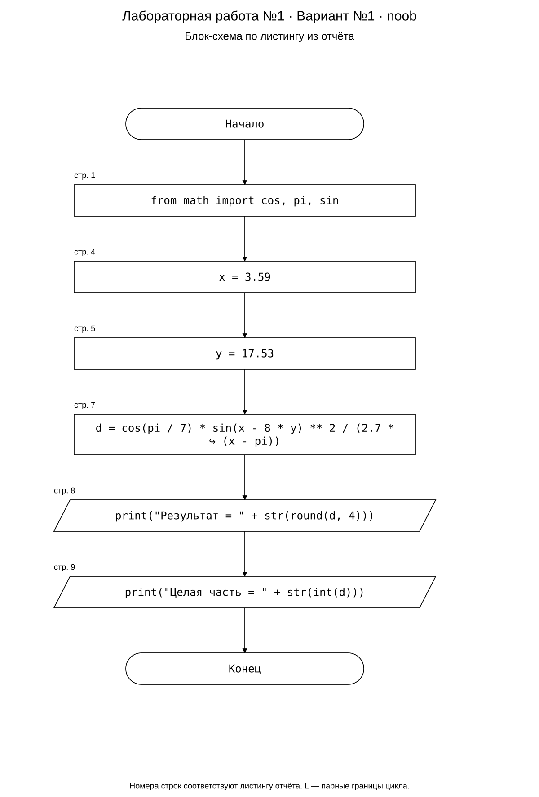

# Лабораторная работа №1. Линейный алгоритм и математические вычисления

Вычислите выражение для заданных x и y и сверьте округлённое значение и целую часть с контрольным примером. Варианты, исходные материалы и команды собраны на этой странице.

[К корню репозитория](../README.md)

## Цель работы

Работа знакомит с последовательным вычислением математического выражения и преобразованием типов. Для каждого варианта преподаватель приводит формулу, контрольные x и y и ожидаемый вывод.

## Материалы преподавателя

- [Полное задание DOCX](<variants/v14/docs/tasks/python_01_lab.docx>). Контрольное задание №1 по теме «Программирование алгоритмов линейной структуры»
- [Вводная методичка PDF](<../docs/introduction_to_python.pdf>).
- Примеры отчётов варианта №14: [noob](<variants/v14/docs/reports/lab_01_v14_noob_report.docx>) · [basic](<variants/v14/docs/reports/lab_01_report.docx>) · [advanced](<variants/v14/docs/reports/lab_01_report_advanced.docx>).

## Порядок решения

1. Разделить выражение на понятные части и сохранить порядок действий, включая скобки и степени.
2. Использовать радианы. Различать натуральный `ln` и десятичный `lg` логарифмы.
3. Для корней и логарифмов учитывать область определения, а для деления — ненулевой знаменатель.
4. Округлённое значение и целая часть вычисляются из одного исходного результата. `int` отбрасывает дробную часть к нулю.

## Подготовка окружения

Для запуска нужен Python 3.10 или новее. Команды PowerShell из корня репозитория:

```powershell
python -m venv .venv
. .\.venv\Scripts\Activate.ps1
python -m pip install -r requirements.txt
```

Если окружение уже создано, достаточно его активировать. Для проверок выполните `python -m pip install -r requirements-dev.txt`.
[Полные инструкции для Windows, Linux и macOS](../README.md#установка).

## Уровни реализации и запуск

В типовом `noob` x и y заданы в скрипте. Новые `basic` и `advanced` читают их из `input.txt` и записывают результат в `result.txt`. У `advanced` есть параметры `--input` и `--output`.

Запуск примера и всех тестов этой работы из корня проекта:

```powershell
python "lab_01_linear_function/variants/v01/src/linear_lab_01_v01_(noob).py"
python -m pytest "lab_01_linear_function/variants"
```

## Пример блок-схемы



## Контроль и особенности

Проверки запускают все три скрипта в изолированных каталогах. Для расчёта проверяются контрольные и альтернативные x и y, округление и целая часть. Для файловых решений проверяются десятичная запятая, запись результата, а для нового `advanced` также пользовательские пути и ошибка ввода. Отдельная проверка анализирует синтаксис `noob` и исключает пользовательские функции, форматирование и файловый ввод.

В ЛР №1 варианта №8 формула даёт −3.6282 при табличном ответе −3.6300. Вариант №14 сохраняет исходный консольный ввод в двух старых решениях. Связанные с ним проверки отмечены как ожидаемые отказы.

Два контрольных случая из отчёта начального решения варианта №6:

| Проверка и данные | Ожидаемый результат | Фактический результат |
| --- | --- | --- |
| x = 1.002, y = −0.5321 | d = 1.6480, целая часть 1 | d = 1.648, целая часть 1 |
| x = 1, y = −4 | d ≈ −1.1366, целая часть −1 | d = −1.1366, целая часть −1 |

## Указатель вариантов

| Вариант | x | y | Табличный результат |
| --- | --- | --- | --- |
| [№1](<variants/v01/README.md>) | 3.59 | 17.53 | 0.7441 |
| [№2](<variants/v02/README.md>) | 1.674 | -0.533 | 1.9456 |
| [№3](<variants/v03/README.md>) | 32.01 | -0.4917 | -2.9359 |
| [№4](<variants/v04/README.md>) | 2.123 | -1.89 | 23.3509 |
| [№5](<variants/v05/README.md>) | 8.402 | -0.2226 | 0.7486 |
| [№6](<variants/v06/README.md>) | 1.002 | -0.5321 | 1.6480 |
| [№7](<variants/v07/README.md>) | 12.003 | -5.408 | -173.9594 |
| [№8](<variants/v08/README.md>) | 1.3802 | -1.9 | -3.6300 |
| [№9](<variants/v09/README.md>) | 12.678 | 6.9 | 14.8449 |
| [№10](<variants/v10/README.md>) | 82.578 | 1.4517 | -13.7820 |
| [№11](<variants/v11/README.md>) | 5.422 | -0.1537 | 1.7678 |
| [№12](<variants/v12/README.md>) | 25.01 | -0.5736 | -227.6709 |
| [№13](<variants/v13/README.md>) | 4.72 | 21.35 | 0.0292 |
| [№14](<variants/v14/README.md>) | 1.472 | -0.4342 | 0.1158 |
| [№15](<variants/v15/README.md>) | 12.345 | 7.5 | 18.5604 |
| [№16](<variants/v16/README.md>) | -1.834 | -0.533 | 0.5175 |
| [№17](<variants/v17/README.md>) | 1.385 | -1.2 | 0.3352 |
| [№18](<variants/v18/README.md>) | 75.412 | 1.1745 | 8.93e18 |
| [№19](<variants/v19/README.md>) | 15.207 | -4.415 | 79.4329 |
| [№20](<variants/v20/README.md>) | 10.315 | -0.2114 | 2.5661 |
| [№21](<variants/v21/README.md>) | 11.485 | -3.231 | -18.5521 |
| [№22](<variants/v22/README.md>) | 4.58 | 16.34 | 0.0047 |
| [№23](<variants/v23/README.md>) | 7.428 | -0.543 | 3.0914 |
| [№24](<variants/v24/README.md>) | 8.804 | -0.4915 | 31.9183 |
| [№25](<variants/v25/README.md>) | 20.356 | 0.523 | 713.8126 |
| [№26](<variants/v26/README.md>) | 75.447 | 1.2328 | 135.6826 |
| [№27](<variants/v27/README.md>) | 12.615 | 7.5 | 441.8435 |
| [№28](<variants/v28/README.md>) | 11.872 | 1.4517 | -3.2972 |
| [№29](<variants/v29/README.md>) | -32.01 | 1.457 | -23.7209 |
| [№30](<variants/v30/README.md>) | -10.22 | 15.368 | -0.00039 |

## Как предложить изменение

Добавьте контрольный пример в `tests/test_solutions.py` нужного варианта, если меняете его поведение.
Проверьте изменение командой `python -m pytest lab_01_linear_function/variants` из корня проекта и приложите итог прогона к запросу на изменение.
Подробный порядок есть в [правилах участия](../README.md#как-внести-вклад).

## Автор и лицензия

Автор проекта — Токарев В.С., группа МЛ12. Отдельная лицензия в репозитории не указана.
[Контакты проекта и сведения о лицензии](../README.md#автор-и-лицензия).
