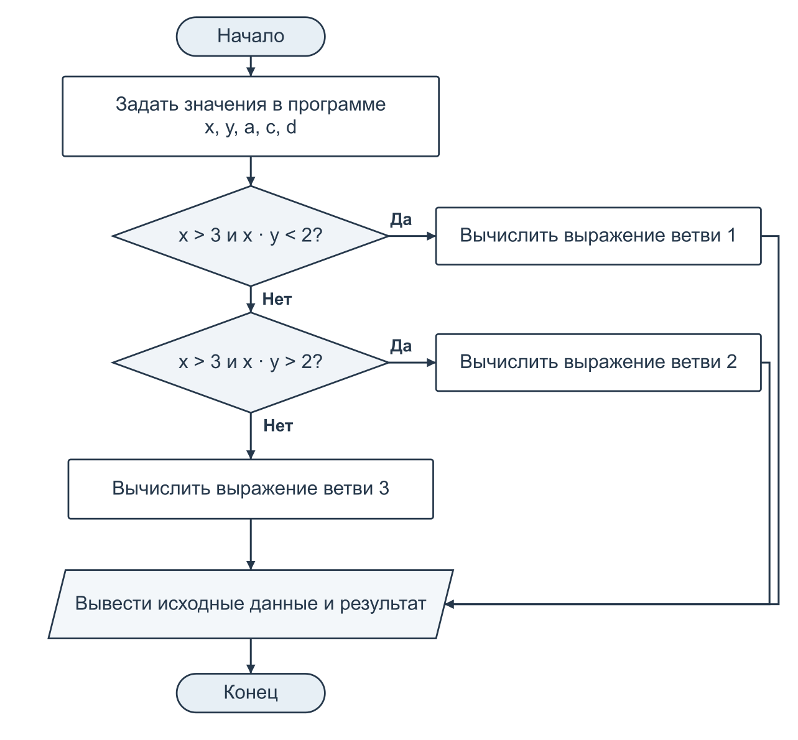

# Лабораторная работа №2. Разветвляющийся алгоритм и кусочные функции

Запустите кусочную функцию на контрольных наборах и сравните результат для каждой ветви и её границ. Варианты, исходные материалы и команды собраны на этой странице.

[К корню репозитория](../README.md)

## Цель работы

Работа знакомит с выбором одной из нескольких формул по знакам, сравнениям и комбинациям входных величин. Таблица преподавателя определяет набор переменных отдельно для каждого варианта.

## Материалы преподавателя

- [Полное задание DOCX](<variants/v14/docs/tasks/python_02_lab.docx>). Контрольное задание №2 по теме «Программирование алгоритмов разветвляющейся структуры»
- [Вводная методичка PDF](<../docs/introduction_to_python.pdf>).
- Примеры отчётов варианта №14: [noob](<variants/v14/docs/reports/lab_02_v14_noob_report.docx>) · [basic](<variants/v14/docs/reports/lab_02_report.docx>) · [advanced](<variants/v14/docs/reports/lab_02_report_advanced.docx>).

## Порядок решения

1. Выписать все ветви сверху вниз и сохранить строгие и нестрогие границы.
2. Подготовить отдельный набор для каждой ветви, а также точки равенства на границах.
3. Вычислять только выбранное выражение. Это важно, если другая ветвь содержит деление, корень или логарифм.
4. Вывести исходные величины и результат. Если для входа в таблице нет формулы, сообщить об этом явно.

## Подготовка окружения

Для запуска нужен Python 3.10 или новее. Команды PowerShell из корня репозитория:

```powershell
python -m venv .venv
. .\.venv\Scripts\Activate.ps1
python -m pip install -r requirements.txt
```

Если окружение уже создано, достаточно его активировать. Для проверок выполните `python -m pip install -r requirements-dev.txt`.
[Полные инструкции для Windows, Linux и macOS](../README.md#установка).

## Уровни реализации и запуск

`noob` использует значения из скрипта и выводит результат в консоль. `basic` и `advanced` запрашивают величины в порядке, указанном в README варианта, и сохраняют данные в `result.txt`. `advanced` повторяет запрос при нечисловом вводе.

Запуск примера и всех тестов этой работы из корня проекта:

```powershell
python "lab_02_branching/variants/v01/src/branching_lab_02_v01_(noob).py"
python -m pytest "lab_02_branching/variants"
```

## Пример блок-схемы



## Контроль и особенности

Проверки прогоняют наборы для всех ветвей и строгих границ, сравнивают исходные величины и численный результат. Для `noob` значения меняются только во временной копии. Для `basic` и `advanced` сверяется файл результата. Дополнительная проверка подаёт `advanced` нечисловой ввод и проверяет повторный запрос.

В вариантах №8 и №23 таблица не определяет значение при x·y = 2 и x·y = 3. В тестах эти точки проверяются отдельно.

Два контрольных случая из отчёта начального решения варианта №6:

| Проверка и данные | Ожидаемый результат | Фактический результат |
| --- | --- | --- |
| x = 6, b = 0.5, c = 2 | Первая ветвь, Z = 3 | 3.0 |
| x = 3, b = 0.5, c = −1 | Вторая ветвь, Z ≈ −2.520574 | −2.520574461395797 |

## Указатель вариантов

| Вариант | Переменные | Ветви | Пример первого набора |
| --- | --- | --- | --- |
| [№1](<variants/v01/README.md>) | x, y, a, c, d | 3 | x=4, y=0.2, a=1, c=2, d=3 |
| [№2](<variants/v02/README.md>) | x, y | 3 | x=2, y=0.5 |
| [№3](<variants/v03/README.md>) | x, y, a | 3 | x=0.5, y=2, a=1 |
| [№4](<variants/v04/README.md>) | x, a, b | 3 | x=2, a=1, b=0.5 |
| [№5](<variants/v05/README.md>) | x, y | 3 | x=2, y=0.5 |
| [№6](<variants/v06/README.md>) | x, b, c | 3 | x=6, b=0.5, c=2 |
| [№7](<variants/v07/README.md>) | x, a, b | 3 | x=2, a=1, b=0.5 |
| [№8](<variants/v08/README.md>) | x, y, c, d | 3 | x=2, y=2, c=1, d=2 |
| [№9](<variants/v09/README.md>) | x, y, a, b | 3 | x=1, y=2, a=1, b=1 |
| [№10](<variants/v10/README.md>) | x, y, a, b | 2 | x=2, y=3, a=1, b=1 |
| [№11](<variants/v11/README.md>) | x, y, a, c, d | 3 | x=4, y=0.2, a=1, c=2, d=3 |
| [№12](<variants/v12/README.md>) | x, y, a, b | 2 | x=2, y=3, a=1, b=1 |
| [№13](<variants/v13/README.md>) | x, a, b | 3 | x=2, a=1, b=0.5 |
| [№14](<variants/v14/README.md>) | x, y, a, c, d | 3 | x=0.5, y=0.7, a=5, c=2, d=1 |
| [№15](<variants/v15/README.md>) | x, y, a | 3 | x=0.5, y=2, a=1 |
| [№16](<variants/v16/README.md>) | x, y, a, c, d | 3 | x=4, y=0.2, a=1, c=2, d=3 |
| [№17](<variants/v17/README.md>) | x, y | 3 | x=2, y=0.5 |
| [№18](<variants/v18/README.md>) | x, y, a | 3 | x=0.5, y=2, a=1 |
| [№19](<variants/v19/README.md>) | x, a, b | 3 | x=2, a=1, b=0.5 |
| [№20](<variants/v20/README.md>) | x, y | 3 | x=2, y=0.5 |
| [№21](<variants/v21/README.md>) | x, b, c | 3 | x=6, b=0.5, c=2 |
| [№22](<variants/v22/README.md>) | x, a, b | 3 | x=2, a=1, b=0.5 |
| [№23](<variants/v23/README.md>) | x, y, c, d | 3 | x=2, y=2, c=1, d=2 |
| [№24](<variants/v24/README.md>) | x, y, a, b | 3 | x=1, y=2, a=1, b=1 |
| [№25](<variants/v25/README.md>) | x, y, a, b | 2 | x=2, y=3, a=1, b=1 |
| [№26](<variants/v26/README.md>) | x, y, a, c, d | 3 | x=4, y=0.2, a=1, c=2, d=3 |
| [№27](<variants/v27/README.md>) | x, y, a, b | 2 | x=2, y=3, a=1, b=1 |
| [№28](<variants/v28/README.md>) | x, a, b | 3 | x=2, a=1, b=0.5 |
| [№29](<variants/v29/README.md>) | x, y, a, c, d | 3 | x=0.5, y=0.7, a=5, c=2, d=1 |
| [№30](<variants/v30/README.md>) | x, y, a | 3 | x=0.5, y=2, a=1 |

## Как предложить изменение

Добавьте контрольный пример в `tests/test_solutions.py` нужного варианта, если меняете его поведение.
Проверьте изменение командой `python -m pytest lab_02_branching/variants` из корня проекта и приложите итог прогона к запросу на изменение.
Подробный порядок есть в [правилах участия](../README.md#как-внести-вклад).

## Автор и лицензия

Автор проекта — Токарев В.С., группа МЛ12. Отдельная лицензия в репозитории не указана.
[Контакты проекта и сведения о лицензии](../README.md#автор-и-лицензия).
