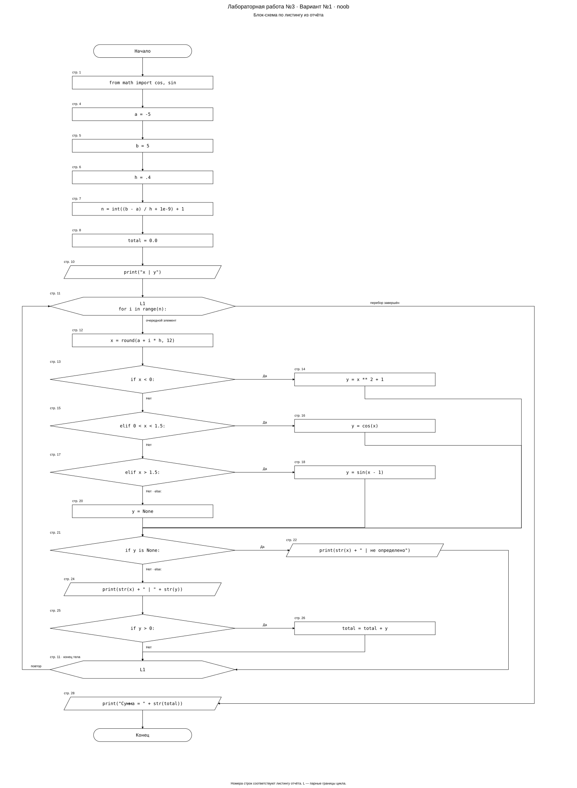

# Лабораторная работа №3. Циклы и табуляция функции

Постройте таблицу значений функции и проверьте итог по всем подходящим точкам заданной сетки. Варианты, исходные материалы и команды собраны на этой странице.

[К корню репозитория](../README.md)

## Цель работы

Работа посвящена циклу с параметром, табуляции и накоплению результата. В зависимости от варианта требуется сумма, произведение, максимум или минимум.

## Материалы преподавателя

- [Полное задание DOCX](<variants/v14/docs/tasks/python_03_lab.docx>). Контрольное задание №3 по теме «Программирование алгоритмов регулярной циклической структуры»
- [Вводная методичка PDF](<../docs/introduction_to_python.pdf>).
- Примеры отчётов варианта №14: [noob](<variants/v14/docs/reports/lab_03_v14_noob_report.docx>) · [basic](<variants/v14/docs/reports/lab_03_report.docx>) · [advanced](<variants/v14/docs/reports/lab_03_report_advanced.docx>).

## Порядок решения

1. Определить отрезок, шаг и количество точек. Использовать целочисленный счётчик и формулу `x = a + i * h`.
2. Вычислить `y` для каждой точки по формуле или по подходящей ветви.
3. Печатать строку таблицы с x и y. В сумму или произведение включать только значения требуемого знака.
4. При строгих границах отметить точки без формулы и исключить их из агрегирования. Если шаг не делит длину отрезка, остановиться на последней точке внутри отрезка.

## Подготовка окружения

Для запуска нужен Python 3.10 или новее. Команды PowerShell из корня репозитория:

```powershell
python -m venv .venv
. .\.venv\Scripts\Activate.ps1
python -m pip install -r requirements.txt
```

Если окружение уже создано, достаточно его активировать. Для проверок выполните `python -m pip install -r requirements-dev.txt`.
[Полные инструкции для Windows, Linux и macOS](../README.md#установка).

## Уровни реализации и запуск

Типовые решения используют параметры варианта из кода. `noob` печатает только в консоль. Новые `basic` и `advanced` также сохраняют таблицу и итог в `result.txt`. У нового `advanced` параметры сетки и путь можно переопределить.

Запуск примера и всех тестов этой работы из корня проекта:

```powershell
python "lab_03_loops/variants/v01/src/tabulation_lab_03_v01_(noob).py"
python -m pytest "lab_03_loops/variants"
```

## Пример блок-схемы



## Контроль и особенности

Проверки сверяют каждое x и y с контрольной сеткой и формулой, заново вычисляют итог и сопоставляют его с консольным и файловым выводом. Для нового `advanced` проверяются некратный шаг, неверные параметры и переопределённый путь результата.

Для пустой суммы используется 0, для пустого произведения — 1. В старых `basic` и `advanced` варианта №14 шаг задаётся с клавиатуры. Их выход за границу при некратном шаге отмечен ожидаемым отказом.

Два контрольных случая из отчёта начального решения варианта №6:

| Проверка и данные | Ожидаемый результат | Фактический результат |
| --- | --- | --- |
| x = −3 и x = 3 | Первая и последняя точки из 21 | 21 строка, обе границы на месте |
| x = −3, x = 0, x = 1.2 | y = −7, −1 и ≈ 3.320117 | −7.0, −1.0 и 3.3201169227365472 |

## Указатель вариантов

| Вариант | Отрезок | Шаг | Итог |
| --- | --- | --- | --- |
| [№1](<variants/v01/README.md>) | [-5; 5] | .4 | сумма, y > 0 |
| [№2](<variants/v02/README.md>) | [-2; 0] | .1 | произведение, y > 0 |
| [№3](<variants/v03/README.md>) | [-3; 3] | .4 | произведение, y > 0 |
| [№4](<variants/v04/README.md>) | [-pi; pi] | pi/8 | сумма, y > 0 |
| [№5](<variants/v05/README.md>) | [-6; 4] | .6 | сумма, y > 0 |
| [№6](<variants/v06/README.md>) | [-3; 3] | .3 | произведение, y > 0 |
| [№7](<variants/v07/README.md>) | [-1; 1] | .1 | произведение, y > 0 |
| [№8](<variants/v08/README.md>) | [-4; 4] | .6 | произведение, y > 0 |
| [№9](<variants/v09/README.md>) | [-pi; pi] | pi/4 | сумма, y > 0 |
| [№10](<variants/v10/README.md>) | [-4; 4] | .5 | сумма, y > 0 |
| [№11](<variants/v11/README.md>) | [-2; 2] | .25 | произведение, y > 0 |
| [№12](<variants/v12/README.md>) | [.1; 1.5] | .1 | максимум |
| [№13](<variants/v13/README.md>) | [-2; 2] | .2 | произведение, y > 0 |
| [№14](<variants/v14/README.md>) | [-5; 5] | .4 | сумма, y > 0 |
| [№15](<variants/v15/README.md>) | [-2; 2] | .25 | сумма, y > 0 |
| [№16](<variants/v16/README.md>) | [-5; 5] | .4 | сумма, y < 0 |
| [№17](<variants/v17/README.md>) | [-2; 0] | .1 | произведение, y < 0 |
| [№18](<variants/v18/README.md>) | [-3; 3] | .4 | произведение, y < 0 |
| [№19](<variants/v19/README.md>) | [-pi; pi] | pi/8 | сумма, y < 0 |
| [№20](<variants/v20/README.md>) | [-6; 4] | .6 | сумма, y < 0 |
| [№21](<variants/v21/README.md>) | [-3; 3] | .3 | произведение, y < 0 |
| [№22](<variants/v22/README.md>) | [-1; 1] | .1 | произведение, y < 0 |
| [№23](<variants/v23/README.md>) | [-4; 4] | .6 | произведение, y < 0 |
| [№24](<variants/v24/README.md>) | [-pi; pi] | pi/4 | сумма, y < 0 |
| [№25](<variants/v25/README.md>) | [-4; 4] | .5 | сумма, y < 0 |
| [№26](<variants/v26/README.md>) | [-2; 2] | .25 | произведение, y < 0 |
| [№27](<variants/v27/README.md>) | [.1; 1.5] | .1 | минимум |
| [№28](<variants/v28/README.md>) | [-2; 2] | .2 | произведение, y < 0 |
| [№29](<variants/v29/README.md>) | [-5; 5] | .4 | сумма, y < 0 |
| [№30](<variants/v30/README.md>) | [-2; 2] | .25 | сумма, y < 0 |

## Как предложить изменение

Добавьте контрольный пример в `tests/test_solutions.py` нужного варианта, если меняете его поведение.
Проверьте изменение командой `python -m pytest lab_03_loops/variants` из корня проекта и приложите итог прогона к запросу на изменение.
Подробный порядок есть в [правилах участия](../README.md#как-внести-вклад).

## Автор и лицензия

Автор проекта — Токарев В.С., группа МЛ12. Отдельная лицензия в репозитории не указана.
[Контакты проекта и сведения о лицензии](../README.md#автор-и-лицензия).
