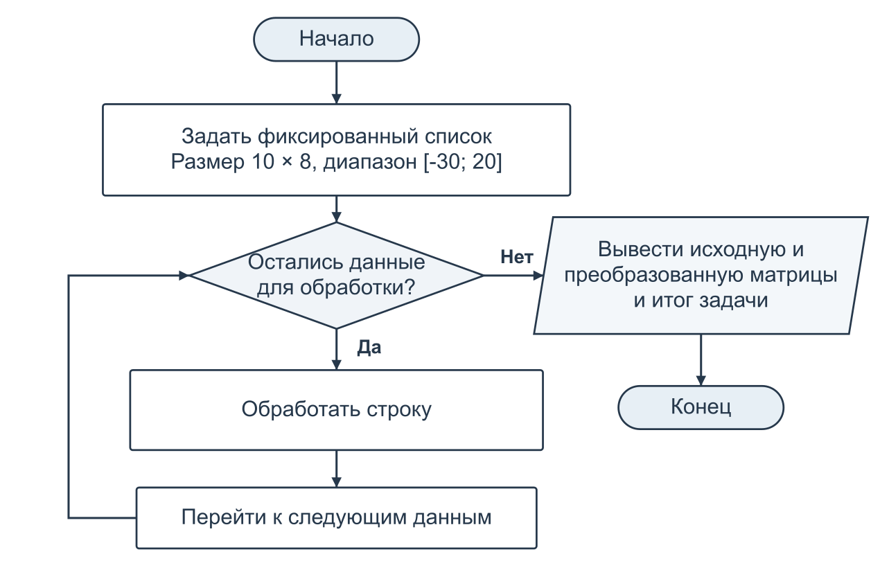

# Лабораторная работа №4. Одномерные массивы и матрицы

Выведите исходную матрицу и проверьте результат отбора или обработки её строк, столбцов и элементов. Варианты, исходные материалы и команды собраны на этой странице.

[К корню репозитория](../README.md)

## Цель работы

Работа знакомит с одномерным списком как представлением матрицы. Таблица преподавателя задаёт число элементов, диапазон и размеры матрицы, а также операцию над строками, столбцами, диагональю или выбранными значениями.

## Материалы преподавателя

- [Полное задание DOCX](<variants/v14/docs/tasks/python_04_lab.docx>). Контрольное задание №4 по теме «Списки / Одномерный массив»
- [Вводная методичка PDF](<../docs/introduction_to_python.pdf>).
- Примеры отчётов варианта №14: [noob](<variants/v14/docs/reports/lab_04_v14_noob_report.docx>) · [basic](<variants/v14/docs/reports/lab_04_report.docx>) · [advanced](<variants/v14/docs/reports/lab_04_report_advanced.docx>).

## Порядок решения

1. Проверить, что число элементов равно произведению числа строк и столбцов.
2. Использовать линейный индекс `i * m + j` для строки i и столбца j.
3. Выполнить операцию по условию варианта. Для нумерации элементов и координат в задачах с номерами использовать отсчёт с единицы.
4. Показать исходную матрицу. Для отбора напечатать матрицу с нулями вне отбора, а для групповых задач — вычисленные характеристики строк или столбцов.

## Подготовка окружения

Для запуска нужен Python 3.10 или новее. Команды PowerShell из корня репозитория:

```powershell
python -m venv .venv
. .\.venv\Scripts\Activate.ps1
python -m pip install -r requirements.txt
```

Если окружение уже создано, достаточно его активировать. Для проверок выполните `python -m pip install -r requirements-dev.txt`.
[Полные инструкции для Windows, Linux и macOS](../README.md#установка).

## Уровни реализации и запуск

`noob` использует фиксированный список. Новые `basic` и `advanced` генерируют целые числа с seed варианта и сохраняют вывод в `result.txt`. У нового `advanced` можно задать `--seed` и `--output`.

Запуск примера и всех тестов этой работы из корня проекта:

```powershell
python "lab_04_arrays/variants/v01/src/array_lab_04_v01_(noob).py"
python -m pytest "lab_04_arrays/variants"
```

## Пример блок-схемы



## Контроль и особенности

Тесты проверяют размеры и диапазон, пересчитывают преобразованную матрицу и результат по напечатанным значениям. В новых решениях дополнительно подаются фиксированные массивы с границами и нулями. У нового `advanced` проверяется воспроизводимость по seed и отдельный выходной файл.

Варианты с пустой выборкой, повторяющимися экстремумами и геометрическим средним разобраны в соответствующих README. В старом `advanced` варианта №14 тесты отдельно фиксируют два ограничения проверки размеров.

Два контрольных случая из отчёта начального решения варианта №6:

| Проверка и данные | Ожидаемый результат | Фактический результат |
| --- | --- | --- |
| Фиксированный массив | 10 × 7. Все 70 чисел от −40 до 60 | Размер и диапазон подтверждены |
| Подсчёт по исходной матрице | Количество 37, сумма 131 | Количество 37, сумма 131 |

## Указатель вариантов

| Вариант | Размер | Диапазон | Операция |
| --- | --- | --- | --- |
| [№1](<variants/v01/README.md>) | 10 × 8 | [-30; 20] | Разность по строкам |
| [№2](<variants/v02/README.md>) | 10 × 6 | [-30; 70] | Количество и сумма |
| [№3](<variants/v03/README.md>) | 8 × 8 | [-40; 50] | Сумма и количество по строкам |
| [№4](<variants/v04/README.md>) | 10 × 9 | [-30; 50] | Максимум, строка и столбец |
| [№5](<variants/v05/README.md>) | 8 × 9 | [-20; 80] | Минимум, строка и столбец |
| [№6](<variants/v06/README.md>) | 10 × 7 | [-40; 60] | Количество и сумма |
| [№7](<variants/v07/README.md>) | 15 × 8 | [-70; 70] | Среднее арифметическое |
| [№8](<variants/v08/README.md>) | 8 × 7 | [-50; 50] | Количество и произведение |
| [№9](<variants/v09/README.md>) | 9 × 9 | [-10; 80] | Сумма положительных и произведение отрицательных |
| [№10](<variants/v10/README.md>) | 12 × 7 | [-20; 50] | Сумма отрицательных и количество положительных |
| [№11](<variants/v11/README.md>) | 10 × 6 | [-10; 70] | Номера отрицательных элементов |
| [№12](<variants/v12/README.md>) | 8 × 8 | [-60; 40] | Сумма модулей |
| [№13](<variants/v13/README.md>) | 9 × 8 | [-40; 60] | Количество и сумма |
| [№14](<variants/v14/README.md>) | 10 × 9 | [-50; 20] | Номера положительных элементов |
| [№15](<variants/v15/README.md>) | 8 × 8 | [-10; 90] | Норма |
| [№16](<variants/v16/README.md>) | 10 × 8 | [-10; 60] | Сумма квадратов |
| [№17](<variants/v17/README.md>) | 12 × 7 | [-70; 10] | Среднее геометрическое |
| [№18](<variants/v18/README.md>) | 10 × 7 | [-30; 20] | Норма |
| [№19](<variants/v19/README.md>) | 7 × 8 | [-50; 10] | Сумма квадратов |
| [№20](<variants/v20/README.md>) | 9 × 9 | [-60; 30] | Количество нулей и сумма положительных |
| [№21](<variants/v21/README.md>) | 10 × 7 | [-40; 40] | Минимум, максимум и среднее геометрическое |
| [№22](<variants/v22/README.md>) | 11 × 6 | [-30; 70] | Количество и разность |
| [№23](<variants/v23/README.md>) | 9 × 9 | [-42; 42] | Произведение и количество |
| [№24](<variants/v24/README.md>) | 7 × 8 | [-35; 35] | Максимум минимумов строк |
| [№25](<variants/v25/README.md>) | 8 × 8 | [-60; 10] | Количество и произведение |
| [№26](<variants/v26/README.md>) | 8 × 10 | [-40; 60] | Среднее арифметическое |
| [№27](<variants/v27/README.md>) | 11 × 9 | [-20; 70] | Минимум максимумов строк |
| [№28](<variants/v28/README.md>) | 6 × 8 | [-65; 56] | Количество и произведение |
| [№29](<variants/v29/README.md>) | 7 × 8 | [-30; 60] | Сумма и произведение по строкам |
| [№30](<variants/v30/README.md>) | 8 × 11 | [-50; 40] | Сумма и количество по столбцам |

## Как предложить изменение

Добавьте контрольный пример в `tests/test_solutions.py` нужного варианта, если меняете его поведение.
Проверьте изменение командой `python -m pytest lab_04_arrays/variants` из корня проекта и приложите итог прогона к запросу на изменение.
Подробный порядок есть в [правилах участия](../README.md#как-внести-вклад).

## Автор и лицензия

Автор проекта — Токарев В.С., группа МЛ12. Отдельная лицензия в репозитории не указана.
[Контакты проекта и сведения о лицензии](../README.md#автор-и-лицензия).
